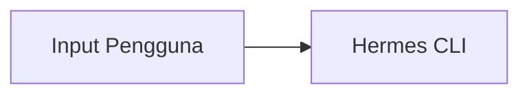

# Panduan Terjemahan — Kursus "AI dari A–Z"

Semua materi Hermes diterjemahkan ke **Bahasa Indonesia**. Aturan di bawah berlaku
untuk SEMUA file keluaran. Baca dulu sebelum menerjemahkan.

## Nada bahasa

- Bahasa Indonesia baku, tapi hangat. Sapa orang sebagai "kamu".
- Kalimat pendek. Satu kalimat = satu ide. Hindari kalimat bertele-tele.
- Ramping: buang kata Assurance yang tidak menambah makna.
- Jelaskan seperti senior engineer menjelaskan ke rekan kerja baru.
- Jangan p.translate itu "Anda" → "kamu" (bukan "Anda"). Konsisten.
- Hindari idiom Inggris yang tidak diterjemahkan. Kalau memang istilah teknis
  yang sudah umum (prompt, token, tool, agent, skill, memory), pakai apa adanya.

## Yang TIDAK diterjemahkan

- Perintah terminal, kode, nama file, path, env var, nama tool, nama skill.
  Examples: `hermes setup`, `~/.hermes/HERMES.md`, `/init`, `delegate_task`.
- Nama produk: Hermes Agent, Telegram, Discord, Slack, MCP, OpenRouter, Z.AI.
- Kode Mermaid: **jangan** sentuh isi diagram, tapi **boleh** terjemahkan
  label di dalam kurung siku `"..."` ke Bahasa Indonesia.
- Nama option CLI seperti `--profile`, `--yolo`, `--resume`.

## Yang diterjemahkan

- Semua prosa, judul, subjudul.
- Isi tabel (header DAN isi), kecuali nama file/perintah/teknis.
- Teks di dalam blok kode yang bukan perintah (mis. komentar, output contoh,
  pesan error) — terjemahkan, tapi **jangan** mengubah perilaku kode.
- Teks UI (nama tombol, label, pesan).

## Format file

Setiap modul adalah satu file `.md` dengan frontmatter YAML di paling atas:

```yaml
---
title: Memori
slug: memori
bagian: 3
modul: 14
durasi: 45 menit
titlePendek: Memori
ringkasan: Satu kalimat yang menjelaskan modul ini.
prasyarat: [mulai-cepat]
diagram: d8-memori
---
```

- `title` — judul modul dalam Bahasa Indonesia.
- `slug` — kebab-case ASCII, tanpa angka.
- `bagian` — 1 (Fondasi AI), 2 (AI Engineer), 3 (Hermes Praktis), 4 (Penutup).
- `modul` — nomor global modul, unik dan berurutan 1..30.
- `durasi` — perkiraan waktu baca+practice, contoh `45 menit`.
- `titlePendek` — judul singkat untuk sidebar.
- `ringkasan` — 1 kalimat, untuk daftar konten.
- `prasyarat` — daftar **slug** modul yang perlu dikuasai lebih dulu. Boleh kosong `[]`.
- `diagram` — id symbol di `diagrams/sprite.svg`, contoh `d8-memori`.

Setelah frontmatter, struktur file HARUS seperti ini:

```markdown
# Judul Modul

## Gambaran Umum

[2–4 paragraf. Paragraph pertama: apa itu Hermes dan mengapa ini penting.]

## Yang Akan Kamu Pelajari

- [5–8 poin, satu baris each, pakai kalimat yang menjelaskan]

## Konsep Kunci

### [Subkonsep 1]

[Penjelasan + contoh]

## [Subkonsep 2]

[Penjelasan + contoh]

## Perintah Praktis

[blok kode bash]

## Contoh Nyata

[blok kode atau contoh kasus]

## Catatan Penting

[3–6 poin, termasuk jebakan umum]

## Apa Selanjutnya

[1 kalimat + tautan ke modul berikutnya]
```

Aturan struktur:
- WAJIB ada bagian `## Gambaran Umum`, `## Yang Akan Kamu Pelajari`, `## Konsep Kunci`.
- WAJIB ada `## Apa Selanjutnya` di akhir.
- `## Konsep Kunci` punya 2–5 subbagian `###`.
- Minimal 1 blok kode atau tabel. Kalau sumbernya punya, pertahankan.
- Panjang target: 800–1600 kata per modul. Jangan memendekkan sampai substansi hilang.
- Kalau sumber punya tabel perbandingan, buat tabel Markdown yang sama.

## Diagram Mermaid

Pertahankan blok mermaid dari sumber, dengan label diterjemahkan:

````

````

## Yang boleh dipangkas

- Kalimat marketing seperti "Hermes adalah solusi terbaik...".
- Badge, emoji dekoratif di awal file.
- Bagian "Contributing", "License", "Next Steps" versi repo (ganti dengan
  `## Apa Selanjutnya`).
- Logo HTML `<picture>` di awal file.
- Link ke file lain dalam repo yang tidak ikut diterjemahkan (hapus, ganti
  dengan teks biasa).

## Yang TIDAK boleh dipangkas

- Perintah terminal, contoh output, tabel konfigurasi, nama opsi.
- Penjelasan tentang *kenapa* sesuatu bekerja begitu (ini substansi).
- Peringatan, jebakan, catatan tentang batasan.
- Alur kerja end-to-end.
