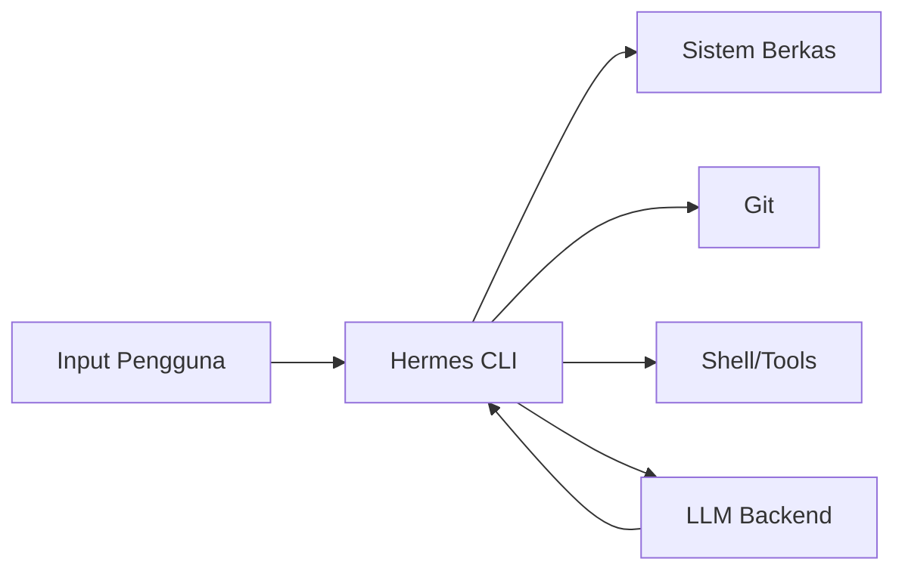
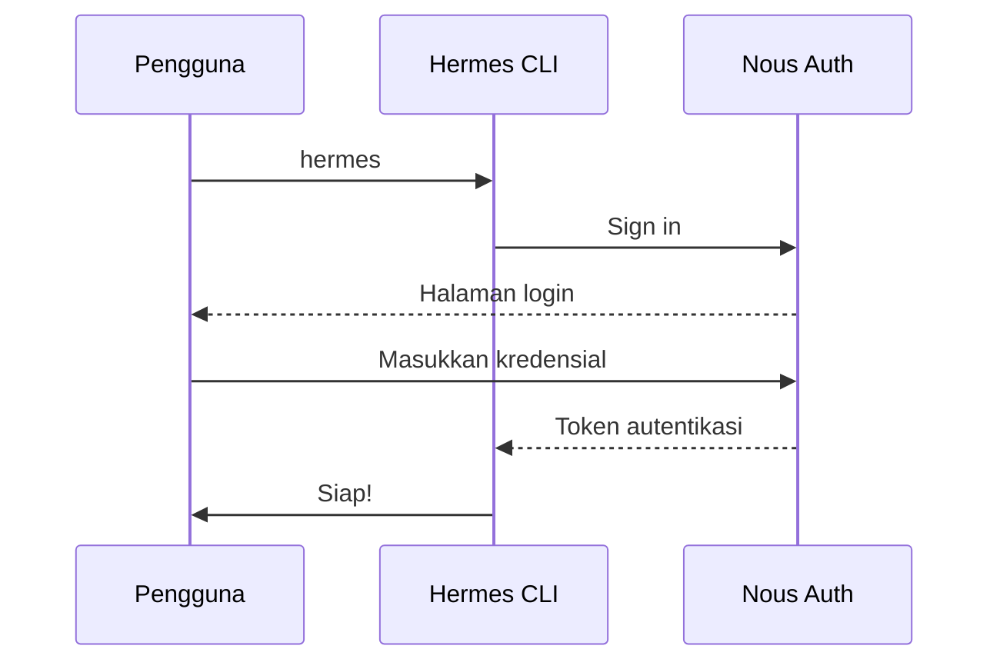
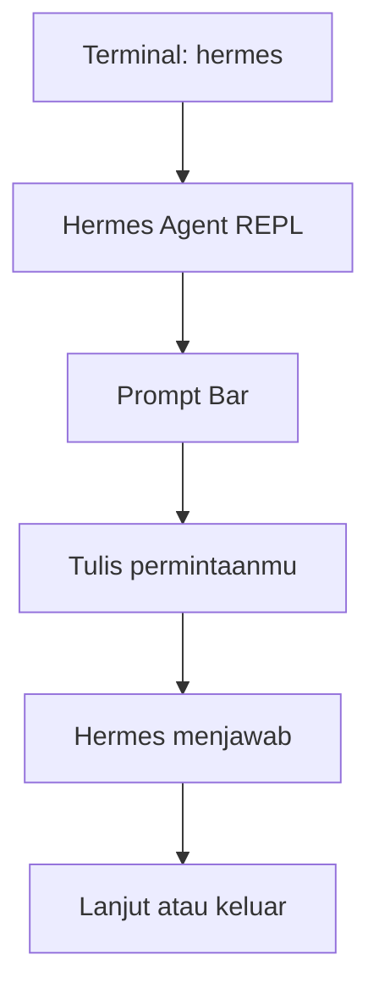

# Mulai Cepat

## Gambaran Umum

Hermes Agent adalah AI agent dari Nous Research yang berjalan di terminal kamu. Dia memadukan model bahasa yang kuat dengan akses file system yang luas, integrasi git, dan eksekusi tool. Semua itu supaya kamu bisa menulis, meninjau, dan merapikan kode dengan bantuan AI.

Bedanya dengan chat biasa: Hermes bukan cuma menjawab. Hermes bisa membuka file, menjalankan perintah, mengubah isi repo, lalu menjelaskan apa yang dia lakukan.

Modul ini menuntun kamu dari nol sampai Hermes Agent benar-benar jalan di mesin kamu. Ada tiga bagian: pemasangan, percakapan pertama, dan konfigurasi dasar.



## Yang Akan Kamu Pelajari

- Persyaratan sistem dan platform mana saja yang didukung Hermes Agent
- Cara memasang Hermes Agent di macOS, Linux, dan Windows lewat WSL
- Cara memverifikasi pemasangan dan melakukan login ke akun Nous Research
- Menjalankan Hermes Agent dalam mode REPL interaktif, sekali jalan, atau lewat pipe
- Menulis prompt yang jelas supaya jawabannya langsung pakai
- Mengatur model, tema, level izin, dan variabel lingkungan
- Membuat `HERMES.md` supaya Hermes Agent tahu konteks proyek kamu

## Konsep Kunci

### Platform yang didukung dan cara memasangnya

Hermes Agent butuh sistem operasi, shell, dan koneksi internet (untuk menjangkau LLM).

Bandingkan menulis kode manual dengan memakai Hermes Agent:

| Aspek | Menulis kode manual | Hermes Agent |
|-------|---------------------|--------------|
| **Kecepatan** | Menulis tiap baris sendiri | Menghasilkan fungsi utuh |
| **Konsistensi** | Bervariasi antar developer | Mengikuti pola proyek |
| **Pencarian** | `grep` plus review manual | Tanya saja dan dapat konteks |
| **Debugging** | Tambah log, telusuri manual | Jelaskan masalahnya |
| **Dokumentasi** | Sering dilewati | Dihasilkan di dalam kode |

| Kebutuhan | Keterangan |
|------------|------------|
| **OS** | macOS 12+, Linux (Ubuntu 20.04+), Windows dengan WSL |
| **Shell** | Bash, Zsh, Fish, atau PowerShell |
| **Jaringan** | Koneksi internet untuk akses LLM |

Status dukungan tiap platform:

| Platform | Status | Catatan |
|----------|--------|---------|
| macOS 12+ | Sepenuhnya didukung | Aplikasi native atau CLI |
| Linux (Ubuntu 20.04+) | Sepenuhnya didukung | CLI saja |
| Windows (WSL) | Sepenuhnya didukung | Pakai terminal WSL2 |
| Windows (native) | Segera hadir | Belum tersedia |

macOS punya dua cara. Unduh aplikasi dari [hermes-agent.dev](https://hermes-agent.dev), lalu tarik Hermes Agent ke folder Applications. Atau pakai Homebrew:

```bash
brew install --cask hermes
```

Linux bisa pakai skrip pemasangan:

```bash
curl -sSL https://storage.googleapis.com/hermes-agent/hermes.sh | sh
```

Kalau mau memasang manual, langkah-langkahnya begini:

```bash
# Unduh binary
curl -O https://storage.googleapis.com/hermes-agent/hermes-linux-x86_64

# Beri izin eksekusi
chmod +x hermes-linux-x86_64

# Pindahkan ke PATH
sudo mv hermes-linux-x86_64 /usr/local/bin/hermes
```

Di Windows, jalankan perintah pemasangan di dalam WSL, bukan di PowerShell atau CMD. Kalau perintahnya salah tempat, Hermes tidak akan ketemu.

### Verifikasi, login, dan proses pertama kali

Setelah pemasangan, cek Hermes Agent sudah jalan:

```bash
hermes --version
```

Hasilnya kira-kira begini:

```
Hermes Agent v1.0.0
```

Saat pertama kali dijalankan, Hermes akan meminta tiga hal:

1. **Sign in** — autentikasi dengan akun Nous Research atau API key.
2. **Choose settings** — pilih default sesuai alur kerja kamu.
3. **Grant permissions** — izinkan akses file system dan git.



Hermes Agent mendukung beberapa penyedia AI. Akun gratis punya kuota terbatas, paket Pro memberi batas lebih tinggi.

| Paket | Pemakaian Bulanan | Fitur |
|-------|-------------------|-------|
| Free | Terbatas | Fitur dasar |
| Pro | Batas lebih tinggi | Akses penuh |
| Max | Batas tertinggi | Akses prioritas |

Untuk masuk dari terminal:

```bash
hermes login
```

Perintah ini membuka jendela browser untuk autentikasi OAuth.

### Menjalankan percakapan pertama

Buka terminal, lalu jalankan:

```bash
hermes
```

Hermes Agent masuk mode REPL interaktif. Di bawah akan muncul bilah prompt.



Ada beberapa cara memakai Hermes:

| Mode | Perintah | Kapan dipakai |
|------|----------|---------------|
| Satu prompt | `hermes "Tulis hello world di Python"` | Pertanyaan sekali jalan |
| REPL interaktif | `hermes` lalu ketik beberapa prompt | Sesi kerja panjang |
| Pipe input | `echo "Jelaskan kode ini" \| hermes --input src/utils.js` | Otomasi dari skrip |

Contoh perintah yang sering dipakai di dalam REPL:

| Perintah | Fungsi |
|----------|--------|
| `/help` | Tampilkan semua perintah |
| `/clear` | Mulai percakapan baru |
| `/model` | Ganti AI model |
| `/exit` | Keluar dari Hermes Agent |
| `/plan` | Masuk ke plan mode |
| `/compact` | Perkecil konteks |

### Konfigurasi dasar

Hermes Agent menyimpan pengaturan di `.hermes/settings.json`. Lihat konfigurasi yang sedang aktif dengan:

```bash
# Lihat konfigurasi saat ini
hermes /config
```

Lokasi berkas konfigurasi:

| Lingkungan | Path |
|------------|------|
| Proyek | `.hermes/settings.json` |
| Home | `~/.hermes/settings.json` |

Tiga pengaturan yang paling sering diubah:

```json
{
  "model": "opus-4.7"
}
```

```json
{
  "theme": "dark"
}
```

```json
{
  "permissions": {
    "allowBash": "all",
    "allowWrite": "/Ask",
    "allowNetwork": "all"
  }
}
```

Pilihan model:

| Model | Paling cocok untuk | Kecepatan |
|-------|-------------------|------------|
| `opus-4.7` | Tugas rumit, generate kode | Paling lambat |
| `sonnet-4.6` | Seimbang antara kecepatan dan kualitas | Sedang |
| `haiku-4` | Tugas cepat, edit sederhana | Paling cepat |

Opsi tema: `dark`, `light`, `system`.

Variabel lingkungan yang berguna:

| Variabel | Kegunaan | Default |
|----------|----------|---------|
| `HERMES_MODEL` | Model default | `opus-4.7` |
| `HERMES_PERMISSIONS` | Mode izin | `Ask` |
| `HERMES_THEME` | Tema warna | `dark` |
| `EDITOR` | Editor eksternal | `vim` |

```bash
# Linux/macOS
export HERMES_MODEL=opus-4.7

# Windows (WSL)
export HERMES_MODEL=opus-4.7
```

**Membatasi tool yang boleh dipakai**

Kamu bisa menentukan tool apa saja yang boleh dipakai tanpa tanya. Ini penting karena Hermes Agent menjalankan perintah atas namamu. Kalau `allowWrite: "all"`, Hermes bisa menulis file apa pun di repo. Mulai dari `tracked` atau `Ask` kalau masih bereksperimen.

Contoh:

```json
{
  "permissions": {
    "allowBash": "all",
    "allowBashNames": ["git *", "npm *", "uv *"],
    "allowWrite": "tracked",
    "allowNetwork": "Ask"
  }
}
```

Level izin yang tersedia:

| Level | Arti |
|-------|------|
| `all` | Selalu diizinkan |
| `Ask` | Selalu ditanyakan |
| `tracked` | Hanya file yang dilacak git |
| `none` | Tidak pernah diizinkan |

### HERMES.md sebagai konteks proyek

File `HERMES.md` di root proyek memberi tahu Hermes aturan main proyek kamu. Buat dengan:

```bash
# Inisialisasi
hermes /init
```

Contoh isi:

```markdown
# Gambaran Proyek

Ini adalah web API Python yang memakai FastAPI.

## Berkas Penting

- `src/main.py` - titik masuk API
- `src/routes/` - handler route
- `tests/` - berkas pengujian

## Konvensi

- Gunakan type hint di semua fungsi
- Format dengan `ruff`
- Jalankan test dengan `pytest`

## Perintah

- Start: `uvicorn src.main:app`
- Test: `pytest`
- Lint: `ruff check`
```

Integrasi git punya setelan sendiri. Auto-commit:

```json
{
  "git": {
    "autoCommit": true,
    "autoPush": false,
    "commitMessage": "Auto-commit by Claude Code"
  }
}
```

Perilaku branch:

```json
{
  "git": {
    "defaultBranch": "main",
    "createBranch": true
  }
}
```

Kalau mau memakai Claude API key:

```bash
export ANTHROPIC_API_KEY=sk-ant-...
```

Atau endpoint berbeda:

```json
{
  "apiKey": "sk-ant-...",
  "baseURL": "https://api.anthropic.com"
}
```

Cek semua konfigurasi sekaligus:

```bash
hermes doctor
```

## Perintah Praktis

```bash
# Pasang di macOS
brew install --cask hermes

# Pasang di Linux
curl -sSL https://storage.googleapis.com/hermes-agent/hermes.sh | sh

# Pastikan Hermes jalan
hermes --version

# Masuk ke akun
hermes login

# Mulai sesi interaktif
hermes

# Periksa konfigurasi dan diagnose masalah
hermes doctor

# Dokumentasi lengkap: https://hermes-agent.nousresearch.com/docs
```

## Contoh Nyata

Satu percakapan pertama yang lengkap, dari awal sampai keluar.

**1. Jalankan Hermes Agent:**

```bash
hermes
```

**2. Minta skrip Python:**

```
Buat skrip Python yang membaca berkas CSV dan mencetak isinya
```

**3. Hermes menghasilkan skrip lengkap:**

```python
import csv

def read_csv(filepath):
    with open(filepath, 'r') as f:
        reader = csv.DictReader(f)
        for row in reader:
            print(row)

if __name__ == "__main__":
    read_csv("data.csv")
```

**4. Minta disimpan:**

```
Simpan ini ke read_csv.py
```

**5. Minta perbaikan:**

```
Tambahkan type hint dan penanganan error
```

**6. Keluar:**

```
/exit
```

Perbandingan singkat Hermes Agent dengan Hermes CLI:

| Aspek | Hermes Agent | Hermes CLI |
|-------|--------------|------------|
| Antarmuka | REPL di terminal | Satu prompt |
| Konteks | Mengingat percakapan | Sekali jalan |
| Tool | Akses penuh | Terbatas |
| Cocok untuk | Pengembangan | Pertanyaan singkat |

## Catatan Penting

- Kalau `hermes` tidak ditemukan setelah pemasangan, tambahkan `/usr/local/bin` ke `PATH` lalu jalankan `hash -r` agar shell membaca ulang jalannya.
- "Permission denied" biasanya karena binary belum executable. Jalankan `chmod +x /usr/local/bin/hermes`.
- Kalau koneksi bermasalah: cek koneksi internet, pastikan firewall mengizinkan `*.nousresearch.com`, lalu coba `hermes login` sekali lagi.
- Prompt yang terlalu kabur menghasilkan jawaban yang tidak bisa dipakai. Sebutkan file, bahasa, dan hasil akhir yang kamu inginkan. Bandingkan "Buat komponen React untuk form login" dengan "Buat form login" saja.
- Prompt yang baik itu perlu iterasi. Mulai dari yang dasar, lalu tambah detail di prompt berikutnya.
- `allowWrite: "all"` memberi Hermes hak menulis file apa pun. Mulai dari `tracked` atau `Ask` kalau masih sedang bereksperimen.
- `HERMES.md` yang berisi kredensial atau API key akan ikut ter-commit ke git. Jangan pernah menaruh rahasia di sana.

## Apa Selanjutnya

Lanjut ke [Modul 14](/modul/memori), supaya Hermes Agent mengingat konteks proyek kamu dari sesi ke sesi.
