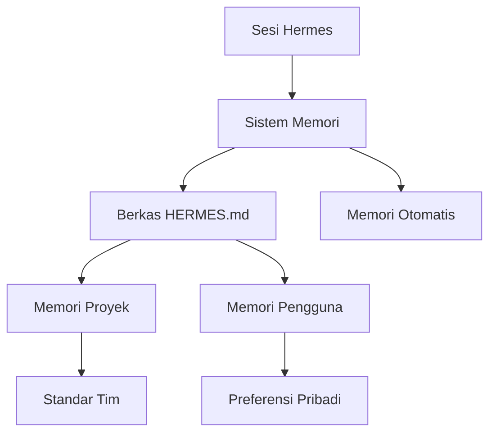
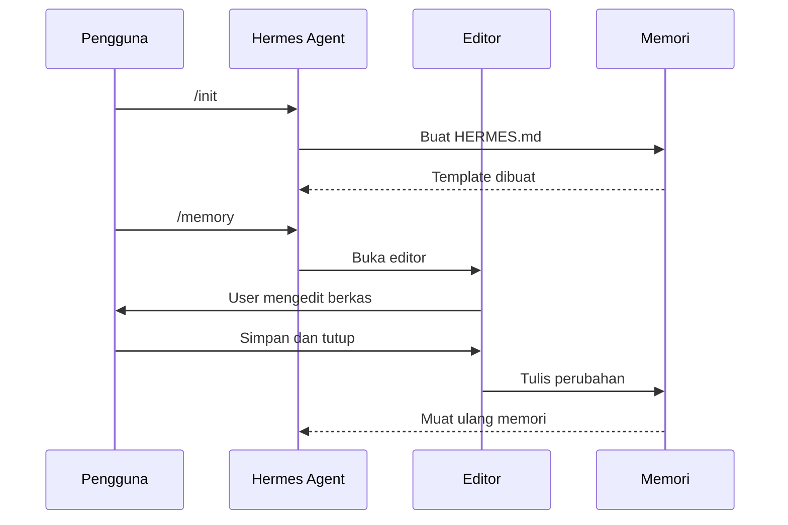
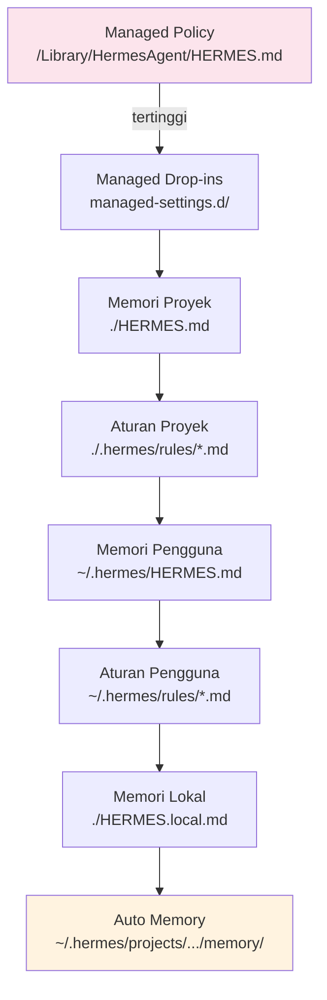

# Memori

## Gambaran Umum

Konteks percakapan itu sementara. Begitu sesi ditutup, semua yang sudah dibicarakan hilang. Untuk proyek yang lama, itu jadi masalah: aturan tim, konvensi kode, dan preferensi pribadi harus kamu ulang-ulang di tiap sesi.

Hermes Agent menjawab dengan sistem memori. Semua konteks yang penting ditulis ke berkas di disk, lalu dibaca lagi otomatis di sesi berikutnya. Berkas yang sama bisa dipakai ulang oleh anggota tim lain, asalkan di-commit ke git.



## Yang Akan Kamu Pelajari

- Perbedaan antara `HERMES.md` (kamu yang menulis) dan `MEMORY.md` (Hermes yang menulis)
- Enam jenis memori: managed policy, project memory, project rules, user memory, local memory, dan auto memory
- Cara membuat `HERMES.md` pertama dengan perintah `/init`
- Cara mengedit memori yang sudah ada dengan perintah `/memory`
- Cara mengimpor berkas lain memakai `@path/to/file`
- Cara menulis aturan khusus untuk jalur tertentu dengan frontmatter `paths`
- Urutan prioritas saat beberapa berkas memori dimuat bersamaan

## Konsep Kunci

### Dua jenis berkas memori

`HERMES.md` adalah memori yang kamu rawat sendiri. Kamu buat, kamu ubah, dan kamu tentukan isinya.

| Lokasi | Cakupan | Di-track git |
|--------|---------|--------------|
| `./HERMES.md` atau `./.hermes/HERMES.md` | Proyek | Ya |
| `~/.hermes/HERMES.md` | Pengguna (semua proyek) | Tidak |
| `./HERMES.local.md` | Lokal proyek | Tidak (diabaikan git) |

`MEMORY.md` adalah memori yang ditulis Hermes Agent sendiri selama sesi.

| Lokasi | Kegunaan |
|--------|----------|
| `~/.hermes/projects/<project>/memory/MEMORY.md` | Titik masuk utama auto memory |
| `~/.hermes/projects/<project>/memory/*.md` | Auto memory per topik |

Perbandingan keduanya:

| Aspek | HERMES.md | MEMORY.md |
|-------|-----------|-----------|
| Siapa yang menulis | Kamu | Hermes Agent otomatis |
| Kegunaan | Instruksi, standar | Pola yang dipelajari |
| Pembaruan | Manual | Otomatis selama sesi |
| Version control | Ya (level proyek) | Tidak |
| Pemuatan | Semua saat start | 200 baris pertama / 25KB |

Struktur dasar `HERMES.md`:

```markdown
# Konfigurasi Proyek

## Gambaran Proyek
- Nama: Proyek Kamu
- Tech Stack: Node.js, PostgreSQL, React
- Jumlah Developer: 5

## Standar Pengembangan
- Gunakan TypeScript strict mode
- Jalankan test sebelum commit
- Ikuti conventional commits

## Arsitektur
@docs/architecture.md
@docs/api-standards.md
```

### Impor, aturan per jalur, dan aturan modular

**Impor dengan `@`**. Kamu bisa menunjuk berkas lain tanpa menyalin isinya:

```markdown
# Dokumentasi Proyek
Lihat @README.md untuk gambaran umum
Lihat @docs/api.md untuk standar API
@~/.hermes/my-instructions.md
```

- Path relatif dan absolut keduanya didukung.
- Impor bisa berantai sampai 5 level dalam.
- Impor berkas eksternal untuk pertama kali butuh persetujuan kamu.

**Aturan per jalur**. Pakai frontmatter YAML supaya aturan hanya berlaku untuk file tertentu:

```markdown
---
paths: src/api/**/*.ts
---

# Aturan API

- Semua endpoint wajib validasi input
- Gunakan Zod untuk validasi schema
```

**Aturan modular**. Simpan aturan terpisah di direktori `.hermes/rules/`:

```
.hermes/
├── HERMES.md
└── rules/
    ├── code-style.md
    ├── testing.md
    └── security.md
```

Semua aturan modular ikut di-track git, jadi tim kamu mendapat standar yang sama.

### Perintah /init dan /memory

Dua perintah ini mengatur memori.

**`/init`** membuat `HERMES.md` baru dengan template awal.

```bash
/init
```

Untuk setup interaktif:

```bash
CLAUDE_CODE_NEW_INIT=1 hermes
/init
```

Yang terjadi di balik layar:

1. Membuat `./HERMES.md` atau `./.hermes/HERMES.md`.
2. Mengisi template dengan bagian-bagian proyek standar.
3. Membangun fondasi untuk konteks yang bertahan lama.

Pakai `/init` saat memulai proyek baru, pertama kali menyiapkan `HERMES.md`, membangun standar tim, atau menyusun hierarki memori.

Contoh keluaran `/init`:

```markdown
# Konfigurasi Proyek

## Gambaran Proyek
- Nama: Proyek Kamu
- Tech Stack: [teknologi kamu]
- Jumlah Developer: [jumlah developer]

## Standar Pengembangan
- Preferensi gaya kode
- Persyaratan pengujian
- Konvensi alur kerja git
```

**`/memory`** membuka berkas memori yang sudah ada di editor sistem.

```bash
/memory
```

Yang terjadi:

1. Membuka menu pilihan berkas memori.
2. Kamu memilih berkas yang mau diedit.
3. Berkas dibuka di editor sistem.
4. Memori dimuat ulang setelah kamu selesai mengedit.

Pilihan yang muncul:

```
1. Managed Policy Memory
2. Project Memory (./HERMES.md)
3. User Memory (~/.hermes/HERMES.md)
4. Local Project Memory
```

Perbandingan keduanya:

| Aspek | /init | /memory |
|-------|-------|---------|
| Kegunaan | Membuat HERMES.md baru | Mengedit memori yang ada |
| Aksi | Menghasilkan template | Membuka editor |
| Kapan | Proyek baru | Perawatan berkelanjutan |
| Alur | Setup sekali | Iterasi berkala |

Kamu juga bisa menambah memori di tengah percakapan. Cara pertama, bicara langsung:

```markdown
Ingat bahwa proyek ini memakai TypeScript strict mode.
Tambahkan ke memori: lebih suka async/await daripada promise.
```

Cara kedua, menyebut berkas secara langsung:

```markdown
# Tambahkan ke ./HERMES.md:
- Selalu validasi input dengan schema Zod
```

Hermes akan meminta konfirmasi berkas mana yang mau diperbarui.



### Urutan prioritas provider memori

Hermes memuat berkas memori berurutan. Yang paling atas menang.



Lokasi tiap provider:

| Provider | Lokasi | Prioritas | Version control | Kegunaan |
|----------|--------|-----------|-----------------|----------|
| Managed Policy | macOS: `/Library/Application Support/HermesAgent/HERMES.md`, Linux/WSL: `/etc/hermes-agent/HERMES.md`, Windows: `C:\Program Files\HermesAgent\HERMES.md` | 1 | Tidak | Kebijakan organisasi dan standar keamanan |
| Managed Drop-ins (v2.1.83+) | `managed-settings.d/` di samping managed policy | 2 | Tidak | Kebijakan modular, berkas digabung berurutan abjad |
| Memori Proyek | `./HERMES.md` atau `./.hermes/HERMES.md` | 3 | Ya | Konteks bersama tim, di-commit ke git |
| Aturan Proyek | `./.hermes/rules/*.md` | 4 | Ya | Instruksi proyek per topik, mendukung subdirektori |
| Memori Pengguna | `~/.hermes/HERMES.md` | 5 | Tidak | Preferensi pribadi di semua proyek |
| Aturan Pengguna | `~/.hermes/rules/*.md` | 6 | Tidak | Aturan pribadi untuk semua proyek |
| Memori Lokal | `./HERMES.local.md` | 7 | Tidak | Preferensi pribadi khusus proyek (diabaikan git) |
| Auto Memory | `~/.hermes/projects/<project>/memory/` | 8 | Tidak | Catatan dan pelajaran otomatis dari Hermes |

Managed policy berlaku untuk seluruh organisasi, memori proyek dipakai bersama tim, sedangkan memori pengguna, aturan pengguna, memori lokal, dan auto memory bersifat pribadi.

### Setelan memori dan perilaku pemuatan

Setelan terkait memori (`autoMemoryDirectory`, `hermesMdExcludes`) mengikuti hierarki ini:

| Level | Lokasi | Cakupan |
|-------|--------|---------|
| 1 (tertinggi) | Managed policy | Organisasi |
| 2 | `managed-settings.d/` | Kebijakan modular |
| 3 | `~/.hermes/settings.json` | Pengguna |
| 4 | `.hermes/settings.json` | Proyek (di-track git) |
| 5 (terendah) | `.hermes/settings.local.json` | Override lokal |

Kecualikan berkas HERMES.md yang tidak relevan di monorepo besar:

```json
{
  "hermesMdExcludes": [
    "packages/legacy-app/HERMES.md",
    "vendors/**/HERMES.md"
  ]
}
```

Ubah lokasi auto memory:

```json
{
  "autoMemoryDirectory": "/path/to/custom/memory"
}
```

Perilaku pemuatan:

- Semua berkas HERMES.md dimuat otomatis saat sesi dimulai.
- Semakin atas di hierarki, semakin tinggi prioritasnya.
- Auto memory memuat 200 baris pertama / 25KB dari MEMORY.md.
- Berkas HERMES.md di subdirektori dimuat ketika kamu mengakses direktori itu.
- Berkas auto memory per topik dimuat sesuai permintaan.

Subagent juga bisa dibatasi cakupannya:

```yaml
memory: user      # Hanya level pengguna
memory: project   # Hanya level proyek
memory: local     # Hanya memori lokal
```

Variabel lingkungan yang relevan:

| Variabel | Kegunaan |
|----------|----------|
| `CLAUDE_CODE_NEW_INIT=1` | Aktifkan mode init interaktif |
| `CLAUDE_CODE_DISABLE_AUTO_MEMORY=0` | Paksa auto memory aktif |
| `CLAUDE_CODE_DISABLE_AUTO_MEMORY=1` | Paksa auto memory mati |

## Perintah Praktis

```bash
# Inisialisasi memori proyek
hermes /init

# Edit memori yang sudah ada
hermes /memory

# Lihat isi memori proyek saat ini
cat ./HERMES.md
```

```bash
# Mode init interaktif
CLAUDE_CODE_NEW_INIT=1 hermes
/init
```

## Contoh Nyata

Templat `HERMES.md` untuk proyek:

```markdown
# Nama Proyek

## Gambaran
- Tech Stack: [daftar]
- Jumlah Developer: [jumlah]

## Standar
- Gaya kode: [konvensi]
- Pengujian: [persyaratan]
- Alur git: [proses]

## Perintah
| Perintah | Kegunaan |
|---------|----------|
| npm test | Jalankan test |
| npm run build | Build |
```

Templat `HERMES.md` pribadi memakai bentuk yang sama: "Tentang Saya" (pengalaman, bahasa, gaya komunikasi), "Preferensi Kode" (penanganan error, komentar, pengujian), dan "Standar Proyek".

Contoh percakapan menambah memori:

```markdown
User: Ingat bahwa saya lebih suka indentasi 2 spasi
Hermes: Saya akan tambahkan ini ke memori kamu. Berkas mana?
User: Memori proyek
Hermes: ✅ Tersimpan ke ./HERMES.md
```

## Catatan Penting

- Jangan pernah menaruh rahasia atau kredensial di berkas memori. `HERMES.md` proyek biasanya ikut ter-commit ke git.
- Jangan menulis aturan yang terlalu kabur. "Tulis kode yang baik" tidak bisa dijalankan; "Gunakan `ruff format`" bisa.
- Jangan menggandakan isi yang sama di banyak berkas. Pakai impor `@` sebagai gantinya.
- `HERMES.md` proyek sebaiknya di-commit ke git supaya seluruh tim dapat standar yang sama. Aturan pribadi tetap di `~/.hermes/`.
- Auto memory hanya memuat 200 baris pertama. Kalau pelajaran penting ada di berkas topik, Hermes baru membacanya saat topik itu relevan.
- Semua worktree dalam satu repo git berbagi direktori auto memory yang sama.
- managed policy punya prioritas tertinggi. Kalau aturanmu bertabrakan dengan kebijakan organisasi, aturan organisasi menang.
- `hermesMdExcludes` berguna di monorepo besar, tapi hati-hati: berkas yang dikecualikan tidak akan pernah terbaca.

## Apa Selanjutnya

Lanjut ke [Modul 15](/modul/skills), supaya pengetahuan dan alur kerja yang bisa dipakai ulang disimpan sebagai skill.
