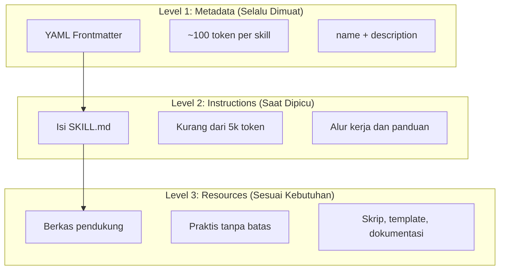
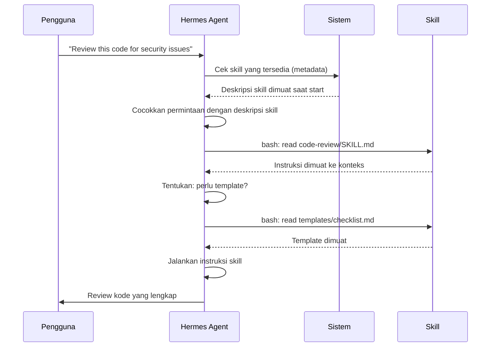

# Skills

## Gambaran Umum

Skill adalah kemampuan siap pakai yang tersimpan di file system. Skill membungkus keahlian domain, alur kerja, dan praktik terbaik menjadi komponen yang bisa ditemukan Hermes Agent dan dipakai otomatis saat relevan.

Bedanya dengan prompt biasa. Prompt adalah instruksi sekali pakai untuk satu tugas. Skill tersimpan permanen, dimuat saat dibutuhkan, lalu langsung memberi dampak ke semua percakapan berikutnya. Kamu tidak perlu mengulang panduan yang sama di tiap sesi.

## Yang Akan Kamu Pelajari

- Perbedaan skill dengan slash command, subagent, memori, MCP, dan hooks
- Struktur direktori skill dan isi file `SKILL.md`
- Field frontmatter wajib dan opsional yang mengatur perilaku skill
- Cara menulis `description` yang memicu pemanggilan otomatis
- Konsep progressive disclosure: metadata, instruksi, dan sumber daya
- Cara mengendalikan pemanggilan skill dan membatasi akses tool
- Cara menjalankan skill di subagent terisolasi
- Risiko keamanan dari skill yang berasal dari sumber tidak tepercaya

## Konsep Kunci

### Jenis skill dan tempatnya

| Jenis | Lokasi | Cakupan | Paling cocok untuk |
|-------|--------|---------|-------------------|
| **Personal** | `~/.hermes/skills/<skill-name>/SKILL.md` | Individu | Alur kerja pribadi |
| **Project** | `.hermes/skills/<skill-name>/SKILL.md` | Tim | Standar tim |
| **Plugin** | `<plugin>/skills/<skill-name>/SKILL.md` | Sesuai plugin | Fitur bawaan |

Skill berbeda dari fitur Hermes lain:

| Fitur | Cara dipanggil | Paling cocok untuk |
|-------|----------------|-------------------|
| **Skills** | Otomatis atau `/name` | Ke expertise dan alur kerja yang dipakai ulang |
| **Slash Commands** | Dipanggil user dengan `/name` | Pintasan cepat |
| **Subagents** | Didelegasikan otomatis | Eksekusi tugas terisolasi |
| **Memory (HERMES.md)** | Selalu dimuat | Konteks proyek persisten |
| **MCP** | Real-time | Akses data atau layanan eksternal |
| **Hooks** | Dipicu event | Efek samping otomatis |

Hermes Agent juga membawa skill bawaan:

| Skill | Kegunaan |
|-------|----------|
| `/simplify` | Meninjau berkas yang berubah untuk reuse, kualitas, dan efisiensi |
| `/batch <instruction>` | Mengelola perubahan paralel berskala besar |
| `/debug [description]` | Mendiagnosis masalah sesi berjalan |
| `/loop [interval] <prompt>` | Menjalankan prompt berulang dengan interval tertentu |

### Struktur direktori, format SKILL.md, dan isinya

Setiap skill hidup di satu direktori. File `SKILL.md` wajib ada di dalamnya.

```
my-skill/
├── SKILL.md           # Instruksi utama (wajib)
├── template.md        # Template untuk diisi Hermes
├── examples/
│   └── sample.md      # Contoh keluaran dengan format yang diharapkan
└── scripts/
    └── validate.sh    # Skrip yang bisa dijalankan Hermes
```

Isi `SKILL.md`:

```yaml
---
name: your-skill-name
description: Brief description of what this Skill does and when to use it
---

# Your Skill Name

## Instructions
Provide clear, step-by-step guidance for Claude.

## Examples
Show concrete examples of using this Skill.
```

Field wajib:

| Field | Aturan |
|-------|--------|
| **name** | Huruf kecil, angka, dan tanda hubung saja (maks 64 karakter). Tidak boleh memuat "anthropic" atau "claude". |
| **description** | Apa yang dikerjakan skill ini DAN kapan memakainya (maks 1024 karakter). Ini penentu utama pemicu otomatis. |

Field opsional beserta artinya:

| Field | Deskripsi |
|-------|-----------|
| `argument-hint` | Petunjuk yang tampil di menu autocompletion `/` (mis. `"[filename] [format]"`). |
| `disable-model-invocation` | `true` = hanya user yang bisa memanggil lewat `/name`. Hermes tidak pernah memanggil otomatis. |
| `user-invocable` | `false` = tersembunyi dari menu `/`. Hanya Hermes yang bisa memanggil otomatis. |
| `allowed-tools` | Daftar tool yang boleh dipakai tanpa prompt izin. |
| `model` | Override model selama skill aktif (mis. `opus`, `sonnet`). |
| `effort` | Level usaha: `low`, `medium`, `high`, atau `max`. |
| `context` | `fork` menjalankan skill di konteks subagent yang terpisah. |
| `agent` | Tipe subagent saat `context: fork` (mis. `Explore`, `Plan`). |
| `shell` | Shell untuk perintah: `bash` (default) atau `powershell`. |
| `hooks` | Hook yang terikat pada siklus hidup skill ini. |
| `paths` | Pola glob yang membatasi kapan skill aktif otomatis. |

Contoh frontmatter ringkas:

```yaml
---
name: my-skill
description: What this skill does and when to use it
argument-hint: "[filename] [format]"        # Petunjuk untuk autocompletion
disable-model-invocation: true              # Hanya user yang boleh memanggil
allowed-tools: Read, Grep, Glob             # Batasi akses tool
context: fork                               # Jalankan di subagent terisolasi
agent: Explore                              # Tipe agent yang dipakai
paths: "src/api/**/*.ts"               # Pola glob yang membatasi aktivasi
---
```

Ada dua jenis isi skill. **Reference content** menambah pengetahuan yang diterapkan pada pekerjaan berjalan, misalnya konvensi, pola, dan panduan gaya:

```yaml
---
name: api-conventions
description: API design patterns for this codebase
---

When writing API endpoints:
- Use RESTful naming conventions
- Return consistent error formats
- Include request validation
```

**Task content** berisi langkah-langkah untuk tindakan tertentu, biasanya dipanggil langsung dengan `/skill-name`:

```yaml
---
name: deploy
description: Deploy the application to production
context: fork
disable-model-invocation: true
---

Deploy the application:
1. Run the test suite
2. Build the application
3. Push to the deployment target
```

### Substitusi dan injeksi konteks dinamis

Skill mendukung nilai dinamis yang diselesaikan sebelum isi skill dikirim ke Hermes.

| Variabel | Deskripsi |
|----------|-----------|
| `$ARGUMENTS` | Semua argumen yang diberikan saat pemanggilan |
| `$ARGUMENTS[N]` atau `$N` | Ambil argumen tertentu berdasarkan indeks (mulai dari 0) |
| `${CLAUDE_SESSION_ID}` | ID sesi berjalan |
| `${CLAUDE_SKILL_DIR}` | Direktori yang berisi berkas SKILL.md |
| `` !`command` `` | Injeksi konteks dinamis — jalankan perintah shell dan sisipkan keluarannya |

`$ARGUMENTS` dipakai di dalam skill seperti ini: `Fix GitHub issue $ARGUMENTS following our coding standards.`

Sintaks `` !`command` `` menjalankan perintah shell sebelum isi skill dikirim ke Hermes. Ini berguna untuk memasukkan data yang selalu berubah, seperti diff pull request.

```yaml
---
name: pr-summary
description: Summarize changes in a pull request
context: fork
agent: Explore
---

## Pull request context
- PR diff: !`gh pr diff`
- PR comments: !`gh pr view --comments`
- Changed files: !`gh pr diff --name-only`

## Your task
Summarize this pull request...
```

### Progressive disclosure: pemuatan bertahap

Skill memuat informasi secara bertahap. Ini menjaga konteks tetap efisien tanpa batas jumlah skill.



| Level | Kapan dimuat | Biaya token | Isi |
|-------|--------------|-------------|-----|
| **Level 1: Metadata** | Selalu (saat start) | ~100 token per skill | `name` dan `description` dari frontmatter YAML |
| **Level 2: Instructions** | Saat skill dipicu | Kurang dari 5k token | Isi SKILL.md berisi instruksi dan panduan |
| **Level 3+: Resources** | Sesuai kebutuhan | Praktis tanpa batas | Berkas pendukung dijalankan lewat bash tanpa dimuat ke konteks |

Artinya kamu bisa memasang banyak skill tanpa penalti konteks. Hermes Agent hanya tahu bahwa skill itu ada, dan kapan harus memakainya.



### Mengendalikan pemanggilan dan mengelola skill

Secara bawaan, kamu dan Hermes Agent sama-sama bisa memanggil skill mana pun. Dua field controlling:

| Frontmatter | Kamu bisa memanggil | Hermes bisa memanggil |
|-------------|---------------------|----------------------|
| (bawaan) | Ya | Ya |
| `disable-model-invocation: true` | Ya | Tidak |
| `user-invocable: false` | Tidak | Ya |

Pakai `disable-model-invocation: true` untuk alur kerja yang punya efek samping: `/commit`, `/deploy`, `/send-slack-message`. Kamu tidak ingin Hermes memutuskan melakukan deploy hanya karena kodemu terlihat siap.

Pakai `user-invocable: false` untuk pengetahuan latar yang tidak layak jadi perintah. Skill `legacy-system-context` menjelaskan cara kerja sistem lama. Berguna untuk Hermes, tapi tidak masuk akal sebagai aksi untuk user.

**Penemuan otomatis.** Saat kamu bekerja dengan berkas di subdirektori, Hermes Agent otomatis menemukan skill dari subdirektori `.hermes/skills/` yang bersarang. Kalau kamu mengedit `packages/frontend/`, Hermes juga mencari skill di `packages/frontend/.hermes/skills/`. Skill dari direktori yang ditambahkan lewat `--add-dir` ikut dimuat otomatis dengan deteksi perubahan langsung.

**Anggaran deskripsi.** Deskripsi skill (metadata Level 1) dibatasi **1% dari context window** (cadangan: **8.000 karakter**). Kalau skill yang kamu pasang banyak, deskripsi bisa dipotong. Atur ulang dengan variabel lingkungan `SLASH_COMMAND_TOOL_CHAR_BUDGET`.

**Menjalankan skill di subagent.** Tambahkan `context: fork` agar skill berjalan di konteks subagent terisolasi dengan context window sendiri. Field `agent` menentukan tipe agentnya.

| Tipe Agent | Paling cocok untuk |
|------------|-------------------|
| `Explore` | riset read-only, analisis codebase |
| `Plan` | menyusun rencana implementasi |
| `general-purpose` | tugas luas yang butuh semua tool |

```yaml
---
context: fork
agent: Explore
---
```

**Melihat dan menguji skill.** Tanya Hermes Agent langsung:

```
What Skills are available?
```

Atau periksa file system dengan perintah `ls` (lihat bagian Perintah Praktis), lalu uji skill secara langsung:

```
/code-review src/auth/login.ts
```

**Memperbarui skill.** Edit berkas `SKILL.md` secara langsung. Perubahan berlaku saat Hermes Agent dijalankan lagi.

```bash
# Skill personal
code ~/.hermes/skills/my-skill/SKILL.md

# Skill proyek
code .hermes/skills/my-skill/SKILL.md
```

**Membatasi akses skill.** Matikan semua skill di `/permissions`:

```
# Tambahkan ke aturan deny:
Skill
```

Izinkan atau tolak skill tertentu:

```
# Izinkan hanya skill tertentu
Skill(commit)
Skill(review-pr *)

# Tolak skill tertentu
Skill(deploy *)
```

Skill boleh punya banyak berkas pendukung: folder `templates/`, `examples/`, `references/`, dan `scripts/`. Jaga `SKILL.md` di bawah **500 baris** dan rujuk berkas pendukung dengan path relatif.

## Perintah Praktis

```bash
# Daftar skill personal dan proyek
ls ~/.hermes/skills/
ls .hermes/skills/

# Edit skill, perubahan berlaku saat Hermes dijalankan lagi
code .hermes/skills/my-skill/SKILL.md
```

## Contoh Nyata

Contoh skill `code-review` dengan frontmatter lengkap:

```yaml
---
name: code-review
description: Review kode untuk masalah keamanan, kualitas, dan performa. Gunakan saat pengguna meminta review kode atau review pull request.
allowed-tools: Read, Grep, Glob
---

Ikuti checklist di @templates/review-checklist.md.
Rangkum temuan di @templates/finding-template.md.
```

Struktur direktori lengkap ada di bagian Konsep Kunci. Menulis deskripsi yang trigger-nya tepat:

```yaml
# Buram
description: "Helps with documents"

# Spesifik dengan kata pemicu
description: "Extract text and tables from PDF files, fill forms, merge documents. Use when working with PDF files or when the user mentions PDFs, forms, or document extraction."
```

## Catatan Penting

- Satu skill = satu kemampuan. Skill "mengisi form PDF" bagus. Skill "pemrosesan dokumen" terlalu luas.
- `description` adalah satu-satunya hal yang dilihat Hermes saat memilih skill. Deskripsi yang vag berarti skill tidak pernah terpakai.
- Nama skill hanya boleh huruf kecil, angka, dan tanda hubung. Maksimal 64 karakter. Jangan pakai kata "anthropic" atau "claude". Pakai nama deskriptif yang berorientasi aksi, misalnya `code-review`, `deploy`, `refactor`.
- Jaga `SKILL.md` di bawah **500 baris** dan pindahkan detail ke berkas pendukung yang dirujuk dengan path relatif.
- Skill yang punya efek samping (`/deploy`, `/commit`) sebaiknya memakai `disable-model-invocation: true`.
- Hanya pakai skill dari sumber tepercaya. Skill memberi Hermes kemampuan lewat instruksi dan kode, jadi skill berbahaya bisa menyuruh Hermes memanggil tool atau menjalankan kode yang merusak. Audit semua berkas di direktori skill sebelum dipasang, terutama skill yang mengambil data dari URL eksternal. Perlakukan skill seperti memasang perangkat lunak: baca dulu, baru pakai.
- Kalau skill tidak terpicu: cek kata kuncinya, cek daftar skill yang tersedia, coba ulang dengan kalimat yang lebih mirip deskripsi, lalu panggil langsung dengan `/skill-name` untuk mengetes.
- Kalau skill terlalu sering terpicu, pertegas deskripsinya atau tambahkan `disable-model-invocation: true`.

## Apa Selanjutnya

Lanjut ke [Modul 16](/modul/delegasi), untuk memecah pekerjaan besar ke subagent yang berjalan paralel dengan konteks terpisah.
