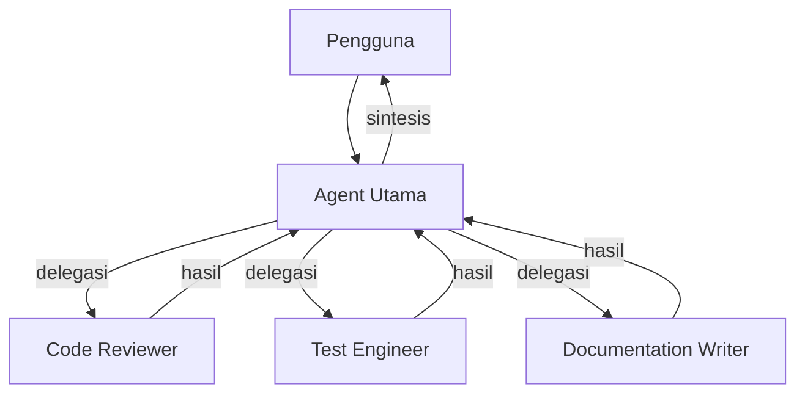
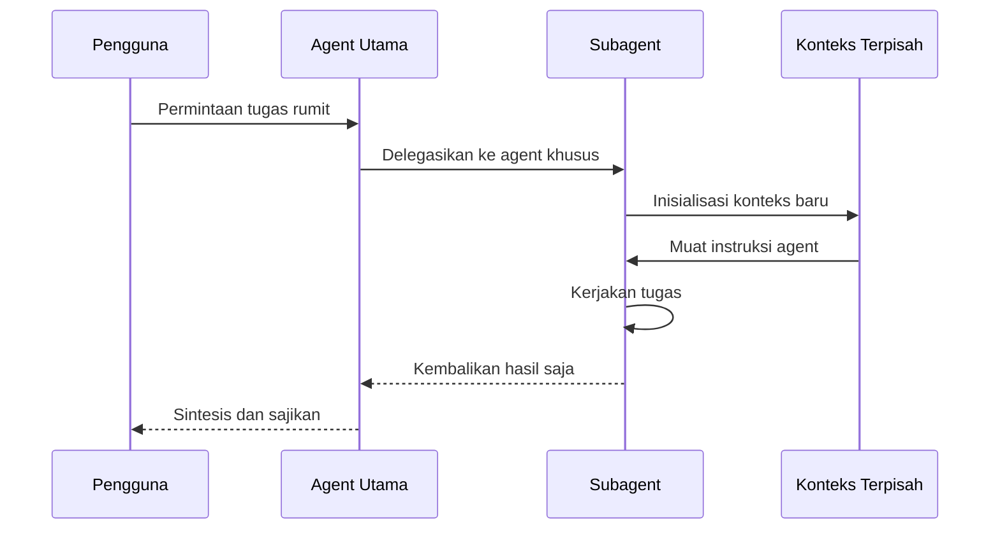
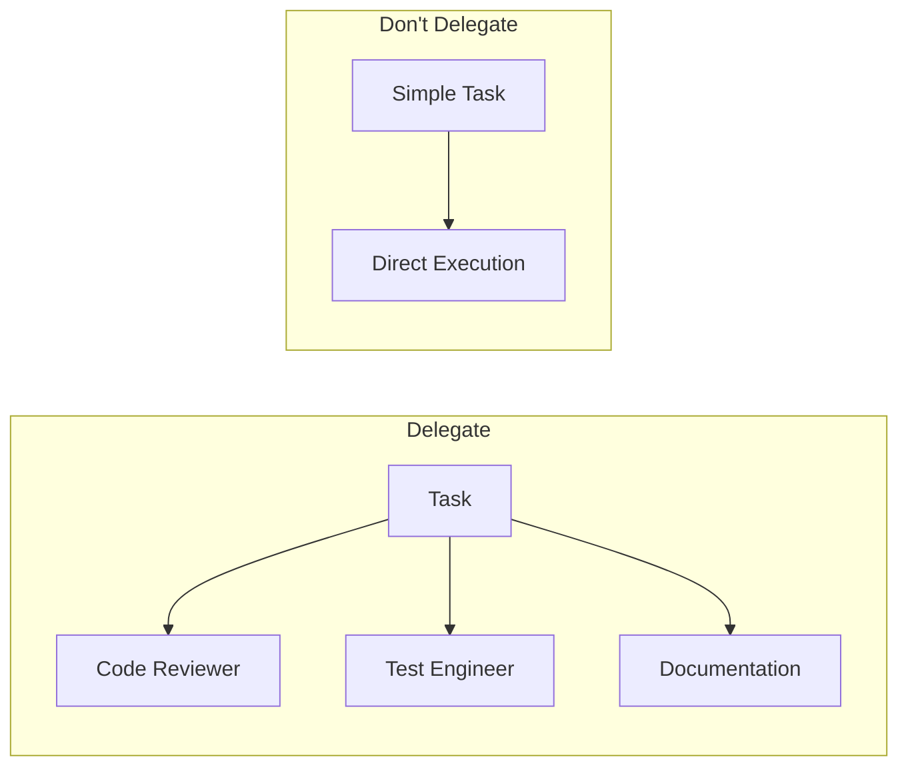

# Delegasi

## Gambaran Umum

Delegasi adalah fitur khas Hermes Agent: membuat subagent khusus yang bekerja paralel pada tugas terfokus, masing-masing dengan context window sendiri.

Kenapa ini penting? Satu context window tidak cukup untuk semua pekerjaan. Kalau agent utama harus sekaligus membaca dokumentasi, menulis tes, dan meninjau kode, konteksnya cepat penuh dan instruksi yang penting tenggelam. Dengan delegasi, tiap subagent dapat satu konteks bersih untuk satu tugas.



## Yang Akan Kamu Pelajari

- Perbedaan agent utama dengan subagent
- Cara memanggil tool `delegate_task` dan parameternya
- Pola delegasi tunggal, delegasi paralel, dan kelanjutan subagent yang berjalan
- Cara menjalankan beberapa subagent secara paralel
- Cara mengisi goal dan context supaya subagent punya semua yang dibutuhkannya
- Panduan memutuskan kapan harus mendelegasikan dan kapan tidak
- Jebakan delegasi yang sering terjadi

## Konsep Kunci

### Agent utama dan subagent

| Aspek | Agent Utama | Subagent |
|-------|-------------|----------|
| **Konteks** | Seluruh riwayat percakapan | Mulai dari nol per tugas |
| **Tool** | Semua tool yang tersedia | Dibatasi oleh konfigurasi |
| **Membuat anak** | Bisa membuat subagent | Tidak bisa membuat yang lain |
| **Peran** | Koordinasi dan sintesis | Eksekusi tugas terfokus |

Alur delegasi:



Perhatikan langkah terakhir. Subagent mengembalikan **hasil saja**, bukan riwayat kerja lengkapnya. Itu yang menjaga konteks agent utama tetap bersih.

### Tool delegate_task

Tool `delegate_task` membuat subagent dengan context window sendiri, sehingga beberapa tugas spesialis bisa berjalan paralel tanpa saling mengotori konteks.

Spesifikasi tool:

```
delegate_task(tasks: array, action?: string, subagent_id?: string, message?: string)
```

| Parameter | Tipe | Wajib | Deskripsi |
|-----------|------|-------|-----------|
| `tasks` | array | Ya | Daftar tugas yang dijalankan paralel |
| `action` | string | Tidak | Aksi pada subagent yang sudah jalan (mis. "message") |
| `subagent_id` | string | Tidak | ID subagent yang dituju saat memakai `action` |
| `message` | string | Tidak | Pesan yang dikirim ke subagent itu |

Setiap entri di `tasks` punya tiga kolom:

| Kolom | Tipe | Wajib | Isi |
|-------|------|-------|-----|
| `goal` | string | Ya | Hasil yang harus dicapai. Self-contained, karena subagent tidak tahu riwayat obrolanmu |
| `context` | string | Tidak | Latar belakang yang perlu diketahui child ini: path file, pesan error, batasan |
| `output_schema` | object | Tidak | JSON Schema yang harus dipenuhi jawaban akhir child |

Satu task tunggal tetap ditulis sebagai array satu elemen:

```
delegate_task(tasks=[
    {"goal": "Tinjau modul autentikasi untuk celah keamanan"},
])
```

Beberapa task sekaligus berjalan paralel:

```
delegate_task(tasks=[
    {"goal": "Tinjau perubahan terbaru di src/auth/", "context": "Fokus pada otorisasi"},
    {"goal": "Tulis test untuk modul auth", "context": "Pakai pytest"},
    {"goal": "Perbarui dokumentasi modul auth"},
])
```

Nilai balik:

```
{
  delegation_id: "deleg_a1b2c3d4",
  subagent_ids: ["sa-0-1a2b3c4d", "sa-1-5e6f7a8b"],
  results: [
    {
      "task_index": 0,
      "status": "ok",
      "summary": "Task completed. Found 3 security issues...",
      "exit_reason": "completed"
    }
  ]
}
```

`subagent_ids` adalah id yang kamu pakai nanti untuk `action="steer"` atau
`action="stop"`. `delegation_id` adalah id batch-nya. Dua-duanya muncul di
respons dispatch untuk delegation yang berjalan di latar belakang.

Tiap entri `results` punya `task_index`, `status` (`ok` atau `error`),
`summary` (ringkasan kerja child), dan `exit_reason` (kenapa child berhenti).

Hermes tidak punya daftar "agent bawaan" terpisah seperti di Claude Code.
Setiap subagent adalah instance agent baru dengan konteks kosong, dan perannya
kamu tentukan lewat isi `goal`.

Yang menentukan tool apa yang boleh dipakai adalah **toolset milik parent**.
Subagent mewarisi toolset yang sedang aktif. Jadi kalau parent tidak punya
akses tulis, subagent juga tidak. `delegate_task` sengaja tidak punya
parameter `toolsets` — supaya model tidak bisa memberi anak kemampuan lebih
dari yang parent-nya punya.

Untuk membatasi cakupan, cukup tulis batasannya di `context`:

```
delegate_task(tasks=[
    {
        "goal": "Tinjau kode pembayaran untuk celah keamanan",
        "context": "Hanya baca. Jangan ubah file. Proyek di /home/user/toko."
    },
])
```

### Delegasi paralel

Kirim beberapa entri dalam satu array `tasks`. Semua berjalan bersamaan dan
mengembalikan hasil saat selesai.

```
delegate_task(tasks=[
    {"goal": "Tinjau perubahan terbaru di src/auth/", "context": "Fokus pada otorisasi"},
    {"goal": "Tulis test untuk modul auth", "context": "Pakai pytest"},
    {"goal": "Perbarui dokumentasi modul auth"},
])
```

Hermes mengembalikan satu ringkasan gabungan setelah semua child selesai.

Untuk menghantar pesan ke subagent yang sedang berjalan, pakai `action`:

```
delegate_task(action="steer", subagent_id="sa-0-1a2b3c4d", message="Fokuskan pada src/payment/ saja")
```

Contoh lain:

```
delegate_task(tasks=[{"goal": "Temukan semua komentar TODO di codebase"}])
```

```
delegate_task(tasks=[
    {"goal": "Tinjau kode proses pembayaran", "context": "Perhatikan validasi input dan penanganan error"},
])
```

Dengan konteks eksplisit:

```
delegate_task(tasks=[{
    "goal": "Baca src/database/schema.sql, analisis relasi antar tabel, lalu usulkan optimasi pola query",
    "context": "Proyek di /home/user/toko. Skema di src/database/schema.sql."
}])
```

Melanjutkan pekerjaan sebelumnya:

```
delegate_task(action="steer", subagent_id="sa-0-1a2b3c4d", message="Lanjutkan dari tadi: implementasikan endpoint yang tersisa")
```

Tombol pintas saat subagent berjalan di latar belakang:

| Pintasan | Aksi |
|----------|------|
| `action="list"` | Lihat id, goal, status, dan transkrip subagent yang berjalan |
| `action="steer"` | Koreksi arah jalan subagent tanpa menghentikannya |
| `action="stop"` | Hentikan satu subagent lebih awal; hasilnya tetap dikembalikan |

### Kapan harus mendelegasikan

Panduan keputusan singkat:

```
Is the task complex with multiple distinct concerns?
├── YES → Delegate to specialized agents
└── NO → Is it a single, well-defined task?
    ├── YES → Consider direct execution
    └── NO → Delegate for better context isolation
```

**Delegasikan saat eksekusi paralel menguntungkan:**

| Situasi | Alasan mendelegasikan |
|----------|-----------------------|
| Beberapa tugas independen | Berjalan bersamaan |
| Butuh keahlian berbeda | Pakai agent spesialis |
| Bagian besar codebase | Bagi dan taklukkan |
| Pekerjaan yang mendesak | Proses paralel |

**Delegasikan saat isolasi konteks dibutuhkan:**

| Situasi | Alasan mendelegasikan |
|----------|-----------------------|
| Analisis panjang | Mencegah konteks habis |
| Perubahan eksperimental | Sandbox di worktree |
| Audit keamanan | Akses tool minimal |
| Area fokus berbeda | Konteks bersih per tugas |

**Delegasikan saat dibutuhkan keahlian khusus.** Contoh peran: code reviewer (keamanan dan kualitas), test engineer (cakupan dan kasus tepi), documentation writer (penjelasan yang jelas), dan debugger (analisis akar masalah).

**Jangan delegasikan untuk:**

| Aspek | Delegasi | Jangan delegasi |
|-------|----------|-----------------|
| Kompleksitas | Multi-langkah | Satu langkah |
| Kemandirian | Bisa paralel | Bergantung berurutan |
| Keahlian | Butuh spesialis | Pengetahuan umum |
| Durasi | Berjalan lama | Tugas singkat |
| Konteks | Konteks baru membantu | Konteks itu penting |
| Tool | Butuh akses dibatasi | Butuh akses penuh |

Contoh yang salah:

```
# Jangan delegasikan tugas sederhana
delegate_task(tasks=[{"goal": "Jam berapa sekarang?"}])

# Jangan delegasikan percakapan yang butuh konteks
"Based on our previous discussion about architecture..."

# Jangan delegasikan pertanyaan cepat
delegate_task(tasks=[{"goal": "Apa fungsi ini?"}])
```

Pola arsitektur:



### Jebakan dan praktik terbaik

| Jebakan | Masalah | Pendekatan yang lebih baik |
|---------|---------|---------------------------|
| Terlalu banyak delegasi | Terlalu banyak agent, beban koordinasi | Gabungkan ke beberapa agent saja |
| Terlalu sedikit delegasi | Agent utama mengerjakan semuanya | Kenali kebutuhan spesialis |
| Delegasi yang banyak bicara | Bolak-balik berlebihan | Pakai agent yang bisa dilanjutkan |
| Beban kerja tidak merata | Satu agent kewalahan | Bagi tugas secara seimbang |

Praktik terbaik:

1. **Mulai sederhana** — mulai dari agent utama, delegasi saat kompleksitas demanding.
2. **Tanggung jawab tunggal** — tiap agent punya satu tujuan yang jelas.
3. **Batasi tool** — hanya berikan tool yang memang dibutuhkan agent.
4. **Prompt yang jelas** — berikan deskripsi tugas yang spesifik dan bisa dijalankan.
5. **Paralel saat independen** — pakai delegasi paralel untuk tugas yang tidak bergantung satu sama lain.

Contoh delegasi yang baik:

```
# Review, tes, dan dokumentasi berjalan paralel
delegate_task(tasks=[
    {"goal": "Tinjau endpoint API baru"},
    {"goal": "Tulis integration test untuk API itu"},
    {"goal": "Dokumentasikan endpoint baru"},
])
```

Contoh delegasi yang buruk:

```
# Jangan delegasikan tugas sederhana
delegate_task(tasks=[{"goal": "Buat file hello.txt berisi 'Halo Dunia'"}])

# Jangan delegasikan pekerjaan yang bergantung konteks
delegate_task(tasks=[{"goal": "Lanjutkan refactoring berdasarkan diskusi tadi"}])
```

## Perintah Praktis

```bash
# Lihat agent yang tersedia di proyek
ls ~/.hermes/logs/

# Lihat agent yang tersedia untuk semua proyek
ls ~/.hermes/cache/delegation/live/
```

Di dalam Hermes, perintah `/review`untur memanggil reviewer independen:

```
/review src/auth/login.ts
```

Reviewer itu jalan di latar belakang dengan akses penuh. Dia benar-benar membuka
PR, membaca diff, dan menjalankan kode — bukan menilai dari cuplikan.

## Contoh Nyata

Satu permintaan delegasi paralel yang lengkap:

```
Gunakan tiga subagent sekaligus: satu mereview kode, satu menulis test,
satu memperbarui dokumentasi.
```

Agen utama lalu menjalankan satu tool `delegate_task` dengan tiga entri
sekaligus, mengumpulkan hasilnya, dan menyajikan satu ringkasan ke kamu. Kamu
tidak pernah melihat context window ketiga subagent, dan konteks agent utama
tetap berisi ringkasan yang bisa dicetak ulang.

Untuk melanjutkan agent yang sama di sesi berikutnya:

```
Steer the running subagent sa-0-1a2b3c4d to focus on the pricing module
```

## Catatan Penting

- Subagent mengembalikan hasil saja. Kalau kamu butuh detail proses, minta di dalam `goal` supaya hasilnya memuat detail itu.
- Beri `goal` dan `context` yang lengkap. Subagent tidak melihat riwayat percakapan agent utama.
- **Pakai toolset sempit di parent.** Subagent mewarisi toolset parent, jadi kalau parent-nya tidak punya akses tulis, subagent juga tidak. Ini cara paling murah menjaga subagent tidak merusak apa pun — bukan karena ada parameter `toolsets` di `delegate_task`, tapi karena toolset parent-nya yang dibatasi.
- Terlalu banyak delegasi menambah biaya dan memperlambat. Gabungkan dulu, baru pisah.
- Jangan mendelegasikan percakapan yang bergantung konteks. Konteks itu ada di agent utama, memindahkannya berarti membuang informasi.
- **Subagent tidak bisa membuat subagent lagi secara bawaan.** Yang mengizinkan bukan parameter `role` (argumen itu diabaikan), tapi dua pengaturan di `config.yaml`: `delegation.orchestrator_enabled` (harus `true`) dan `delegation.max_spawn_depth` (harus lebih dari 1). Bawaannya `max_spawn_depth` = 1, jadi pohonnya rata.
- Gunakan `action="steer"` plus `subagent_id` untuk mengoreksi arah subagent yang sedang jalan tanpa menghentikannya.
- `action="stop"` menghentikan satu subagent, bukan seluruh batch. Hasil parsialnya tetap dikembalikan, jadi pekerjaan tidak hilang.
- Cek `/lesson-quiz delegation` untuk menguji pemahamanmu tentang delegasi.

## Apa Selanjutnya

Kamu sudah paham dasar Hermes Agent, memori, skills, dan delegasi. Langkah berikutnya: [Modul 17](/modul/mcp), supaya Hermes bisa menjangkau tool dari luar, lalu rancang alur kerja yang memakai semuanya bersama-sama.
