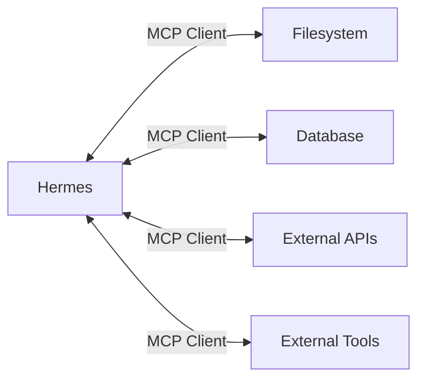
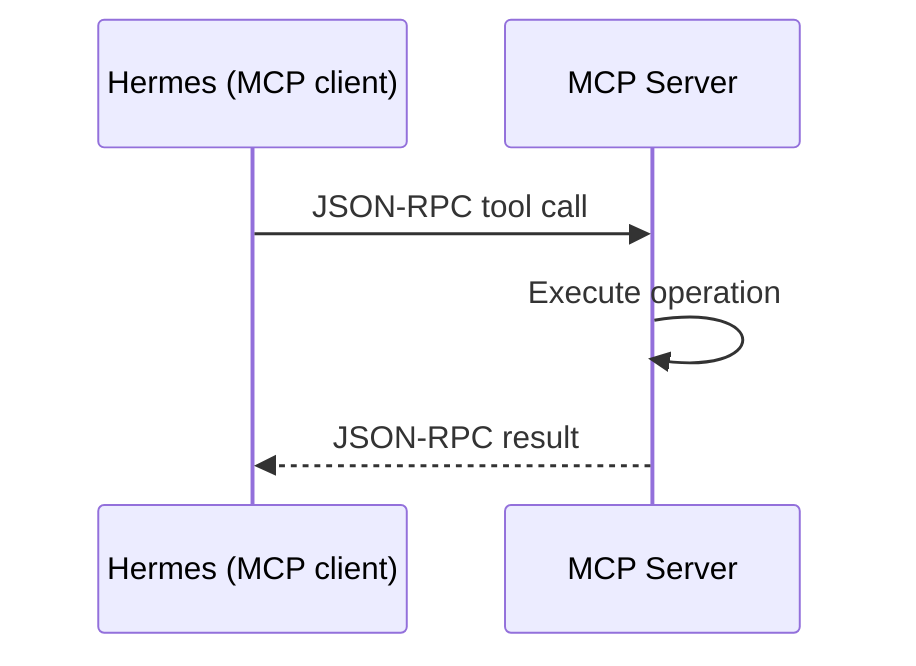

# Integrasi MCP

## Gambaran Umum

Hermes Agent punya sekumpulan tool bawaan. Tapi dunia nyata butuh lebih dari itu: GitHub, Slack, database, mesin lokal. Model Context Protocol (MCP) adalah cara standar untuk menyambungkan Hermes ke semuanya.

MCP membuat Hermes bisa membaca dari database, menulis di file system, memanggil API luar, sampai menjalankan tool khusus seperti Docker atau `kubectl`. Semua lewat satu antarmuka yang sama.

Yang membuat MCP terasa aman adalah penyaringan tool: kamu menentukan tool mana yang boleh dipakai, dikunci, atau hanya untuk operasi baca.



Hermes adalah MCP **client**. Dia yang menghubungi server. Tidak ada
"bridge" terpisah di tengah — Hermes yang menjalankan percakapan JSON-RPC-nya
langsung ke tiap server.

## Yang Akan Kamu Pelajari

- Peran MCP client, MCP server, Tool, dan Resource dalam arsitektur Hermes
- Cara menambahkan server MCP pertama dan memverifikasi tool-nya muncul
- Struktur konfigurasi `mcp_servers` di `config.yaml` dan field yang tersedia
- Cara menyimpan token API lewat environment variable, bukan langsung di berkas
- Cara menyaring tool per server, global, dan berdasarkan pola nama
- Protokol, versi, dan pilihan transport yang dipakai MCP
- Cara mendiagnosis server yang tidak mau start atau tool yang tidak muncul

## Konsep Kunci

### Arsitektur MCP

| Komponen | Peran |
|----------|-------|
| **MCP client** | Hermes. Mengirim permintaan dan menerima hasil |
| **MCP Server** | Mengimplementasikan protokol MCP untuk satu layanan |
| **Tool** | Satu fungsi yang diekspos oleh MCP server |
| **Resource** | Sumber data yang bisa diakses lewat MCP |

Hermes bicara langsung ke server. Tidak ada komponen perantara — Hermes
yang jadi client-nya, dan di situlah penyaringan tool dilakukan. Jenis server
yang paling sering dipakai:

| Jenis | Kegunaan | Contoh |
|-------|----------|--------|
| **Filesystem** | Operasi file lokal | Baca, tulis, cari berkas |
| **Database** | Kueri database luar | PostgreSQL, SQLite |
| **API** | Integrasi layanan luar | GitHub, Slack, API sendiri |
| **Tool** | Tool eksternal khusus | Docker, kubectl, CLI cloud |

### Menambahkan server pertama

Prasyaratnya: Hermes sudah terpasang, Node.js 18+ untuk server berbasis JavaScript, dan kamu paham cara tool dipakai.

Mulai dari melihat status MCP:

```
Show me the current MCP configuration and available servers
```

Perintah itu menampilkan server yang terpasang, statusnya, jumlah tool dari tiap server, dan error konfigurasi kalau ada. Server pertama paling aman adalah filesystem dengan akses baca saja:

```
Add the filesystem MCP server with read-only access to the project directory
```

Hermes akan menuliskan konfigurasi seperti ini di `~/.hermes/config.yaml`:

```yaml
mcp_servers:
  filesystem:
    command: "npx"
    args: ["-y", "@modelcontextprotocol/server-filesystem", "/path/to/project"]
```

Untuk server yang butuh kredensial, misalnya GitHub:

```
Add the GitHub MCP server with my API token
```

```yaml
mcp_servers:
  github:
    command: "npx"
    args: ["-y", "@modelcontextprotocol/server-github"]
    env:
      GITHUB_TOKEN: "${GITHUB_TOKEN}"
```

Nilainya dibaca dari environment saat server terhubung, jadi tokennya tidak
pernah ditulis ke berkas konfigurasi.

Setelah itu, verifikasi tool-nya terdaftar dengan `List all MCP tools currently available`. Untuk server filesystem, tool yang biasanya muncul:

| Tool | Keterangan |
|------|------------|
| `read_file` | Membaca isi berkas |
| `read_multiple_files` | Membaca beberapa berkas sekaligus |
| `list_directory` | Menampilkan isi direktori |
| `directory_tree` | Menampilkan struktur direktori |
| `search_files` | Mencari teks di dalam berkas |

MCP tool berjalan berdampingan dengan tool bawaan Hermes. Kamu bisa menggabungkan keduanya dalam satu prompt:

```
Read the config file using the filesystem server, then create a test plan based on its contents
```

### Konfigurasi server

Semua server dikonfigurasi di `~/.hermes/config.yaml`, di dalam blok `mcp_servers`.

Field yang bisa dipakai untuk tiap server:

| Field | Wajib | Keterangan |
|-------|-------|------------|
| `command` | Ya | Path executable (absolut atau relatif terhadap PATH) |
| `args` | Tidak | Array argumen command line |
| `env` | Tidak | Objek environment variable |
| `url` | Tidak | Alamat server HTTP (untuk server berbasis HTTP) |
| `headers` | Tidak | Header HTTP (untuk server berbasis HTTP) |
| `connect_timeout` | Tidak | Batas waktu koneksi, dalam detik |
| `oauth` | Tidak | Pengaturan OAuth, termasuk `timeout` |

Rahasia disimpan lewat environment variable, bukan ditulis langsung:

```yaml
mcp_servers:
  github:
    command: "npx"
    args: ["-y", "@modelcontextprotocol/server-github"]
    env:
      GITHUB_TOKEN: "${GITHUB_TOKEN}"
```

Sama dengan perintah CLI-nya:

```bash
hermes mcp add github --command npx --args -y @modelcontextprotocol/server-github
```

Untuk server HTTP:

```bash
hermes mcp add linear --url https://mcp.linear.app/mcp --auth oauth
```

Server berbasis HTTP ditulis dengan `url` dan `headers`:

```yaml
mcp_servers:
  asana:
    url: "https://mcp.asana.com/v2/mcp"
    headers:
      Authorization: "Bearer ${ASANA_TOKEN}"
```

Placeholder `${VAR}` di `env` dan `headers` diselesaikan saat server
terhubung. Selain variabel environment biasa, ada juga `${userHome}`,
`${workspaceFolder}`, `${workspaceFolderBasename}`, dan `${pathSeparator}`.

Untuk membatasi akses direktori, itu duty server MCP-nya sendiri. Contohnya
`server-filesystem` menerima daftar path sebagai argumen:

```yaml
mcp_servers:
  filesystem:
    command: "npx"
    args:
      - "-y"
      - "@modelcontextprotocol/server-filesystem"
      - "/project/src"
      - "/project/tests"
      - "/project/docs"
```

Perintah untuk mengelola server:

| Tugas | Perintah |
|-------|----------|
| Tambah server | `hermes mcp add <name> --command <cmd> --args <args...>` |
| Tambah server HTTP | `hermes mcp add <name> --url <endpoint>` |
| Hapus server | `hermes mcp remove <name>` |
| Lihat daftar server | `hermes mcp list` |
| Uji koneksi | `hermes mcp test <name>` |
| Atur pilihan tool | `hermes mcp configure <name>` |
| Login ulang (OAuth) | `hermes mcp login <name>` |
| Lihat katalog | `hermes mcp catalog` |
| Pasang dari katalog | `hermes mcp install <name>` |
| Buka pemilih interaktif | `hermes mcp` |

Server tidak dijalankan manual. Hermes menemukan sendiri tool-nya, lalu
memakainya seperti tool bawaan.

Semua server disimpan di `~/.hermes/config.yaml`, jadi aktif untuk semua proyek. Kalau kamu butuh server khusus satu proyek, jalankan Hermes dari direktori itu dan pakai profil terpisah.

Contoh server yang sering dipakai:

| Server | Paket | Kegunaan | Environment variable |
|--------|-------|----------|----------------------|
| Filesystem | `@modelcontextprotocol/server-filesystem` | Baca, tulis, cari berkas | Tidak wajib |
| GitHub | `@modelcontextprotocol/server-github` | Issue, PR, repo | `GITHUB_TOKEN` |
| Slack | `@modelcontextprotocol/server-slack` | Pesan, channel | `SLACK_BOT_TOKEN`, `SLACK_TEAM_ID` |
| Brave Search | `@modelcontextprotocol/server-brave-search` | Pencarian web | `BRAVE_API_KEY` |
| PostgreSQL | `@modelcontextprotocol/server-postgres` | Kueri database | `DATABASE_URL` |
| SQLite | `@modelcontextprotocol/server-sqlite` | Kueri database | `DB_PATH` |
| Everything | `@modelcontextprotocol/server-everything` | Pencarian file desktop | Tidak wajib |

Tool GitHub: `mcp__github__create_issue`, `mcp__github__search_issues`, `mcp__github__get_issue`, `mcp__github__create_pull_request`, `mcp__github__list_pulls`.

### Detail protokol

MCP memakai JSON-RPC. Hermes speaks dua transport:

| Transport | Kegunaan |
|-----------|----------|
| `stdio` | Server lokal, dijalankan sebagai subprocess lokal |
| `http` | Server remote lewat Streamable HTTP |

Server berbasis HTTP menulis `url` dan opsional `headers`. Server stdio
menulis `command` dan `args`.

Jadi `mcp_servers.<nama>` bisa berupa:

```yaml
mcp_servers:
  filesystem:
    command: "npx"
    args: ["-y", "@modelcontextprotocol/server-filesystem", "/project"]
  linear:
    url: "https://mcp.linear.app/mcp"
    headers:
      Authorization: "Bearer ${LINEAR_TOKEN}"
```



### Menyaring tool

Server MCP bisa mengekspos banyak tool. Penyaringan membuat kamu bisa:

- **Membatasi operasi berbahaya** — mencegah tulis atau hapus berkas
- **Memperkecil cakupan** — hanya izinkan operasi baca
- **Mengurangi noise** — sembunyikan tool yang tidak pernah dipakai
- **Menjaga keamanan** — atur akses berdasarkan tingkat kepercayaan

Konfigurasinya ada di `~/.hermes/config.yaml`, di bawah `mcp_servers.<nama>.tools`. `include` saja membatasi tool yang boleh dipakai, `exclude` saja mengizinkan semua kecuali yang disebut, dan keduanya bisa dipakai bersama dengan pola wildcard:

```yaml
mcp_servers:
  filesystem:
    command: "npx"
    args: ["-y", "@modelcontextprotocol/server-filesystem", "/project"]
    tools:
      include: ["read_file", "list_directory", "search_files"]
      exclude: ["write_file", "delete_file", "move_file"]
```

Pola wildcard juga boleh, misalnya `include: ["read_*", "list_*", "search_*"]`.

Filter dipasang per server, di bawah `mcp_servers.<nama>.tools`. Kalau
semua tool dari server itu kamu mau, blok `tools` tidak perlu ditulis sama
sekali.

Hermes mencatat tool server MCP dengan nama seperti `mcp__<server>__<tool>`:

| Server | Tool | Nama lengkap |
|--------|------|--------------|
| filesystem | read_file | `mcp__filesystem__read_file` |
| github | create_issue | `mcp__github__create_issue` |
| postgresql | query | `mcp__postgresql__query` |

Pola filter yang sering dipakai:

| Kasus | Include | Exclude |
|-------|---------|---------|
| Hanya baca | `read_*`, `list_*`, `search_*`, `get_*` | `write_*`, `create_*`, `delete_*`, `move_*` |
| Tanpa penghapusan | `*` | `delete_*`, `remove_*`, `destroy_*` |
| Tanpa perubahan state | `read_*`, `list_*`, `search_*` | `create_*`, `update_*`, `delete_*` |
| Mode audit | `*` | - |

Pasang server dari katalog, lalu atur tool-nya lewat `hermes mcp configure
<nama>`. Filter yang kamu pilih di sana ditulis ke `tools.include`.

Kalau server punya permukaan tool yang sangat besar, katalognya bisa
mendeklarasikan `tools.default_excluded` — daftar blokir bawaan. Kalau
begitu, Hermes langsung menulis `tools.exclude` dan semua yang tidak
termatch tetap aktif.

## Perintah Praktis

```bash
# Server berbasis npm
npx -y @modelcontextprotocol/server-filesystem /path/to/dir
npx -y @modelcontextprotocol/server-github
# Server berbasis Python
pip install mcp-server-filesystem
```

## Contoh Nyata

Lingkungan pengembangan yang aman: filesystem hanya boleh dibaca. Katakan ke Hermes `Configure the filesystem server to only allow read operations`, lalu hasilkan konfigurasi seperti ini:

```yaml
mcp_servers:
  filesystem:
    command: "npx"
    args: ["-y", "@modelcontextprotocol/server-filesystem", "/project"]
    tools:
      include:
        - read_file
        - read_multiple_files
        - list_directory
        - directory_tree
        - search_files
```

Lingkungan CI/build: boleh baca berkas dan jalankan operasi docker/podman, tapi tidak boleh mengubah berkas. Cukup `include` dengan pola wildcard:

```yaml
mcp_servers:
  filesystem:
    command: "npx"
    args: ["-y", "@modelcontextprotocol/server-filesystem"]
    tools:
      include: ["read_*", "list_*"]
```

Kalau server tidak mau start: cek perintahnya benar, pastikan Node.js atau Python terpasang, dan periksa environment variable sudah diisi. Log-nya bisa dilihat dengan `Show me the MCP server logs for the filesystem server`.

Kalau tool tidak muncul: cek servernya lewat `hermes mcp list`, uji koneksinya dengan `hermes mcp test <name>`, lalu cek apakah `tools.include` memblokir tool tersebut. Kalau muncul "Permission denied": periksa izin berkas dan direktori tujuan, atau apakah path-nya di luar workspace.

## Catatan Penting

- **Simpan token di environment variable.** Menulis `GITHUB_TOKEN` langsung di `config.yaml` berarti secret itu ikut ter-commit ke git. Pakai placeholder `${GITHUB_TOKEN}` — nilainya dibaca dari environment saat server terhubung, dan tidak pernah ditulis ke berkas.
- **Batasi akses sejak awal.** Untuk server filesystem, berikan path spesifik sebagai argumen. Jangan pakai root tanpa batas yang jelas.
- **Gunakan `include` lebih dulu.** Server yang hanya mengizinkan operasi baca hampir selalu cukup untuk membantu coding.
- **Pakai wildcard dengan hati-hati.** `include: ["*"]` berarti tidak ada penyaringan sama sekali, terlepas dari nilai `exclude` yang kelihatan aman.
- **Perhatikan batas waktu koneksi.** Pakai `connect_timeout` untuk server yang lambat merespons, dan `oauth.timeout` kalau proses login-nya memang butuh waktu lama.
- **Perhatikan ukuran hasil.** Tool yang mengembalikan data besar bisa memenuhi konteks Hermes dengan cepat. Filter `include` yang sempit membantu.

## Apa Selanjutnya

Lanjut ke [Modul 18](/modul/suara) untuk mengaktifkan Hermes Agent lewat suara, dari terminal sampai bot Telegram dan Discord.
