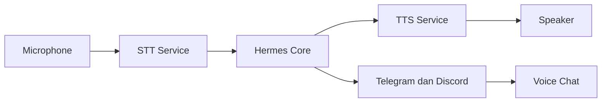
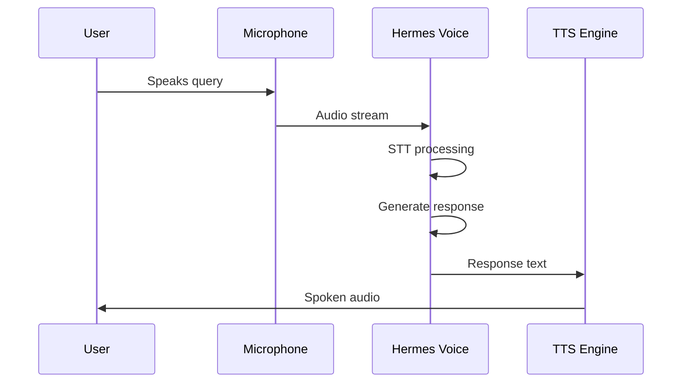

# Mode Suara

## Gambaran Umum

Hermes Agent biasanya berbicara lewat teks. Mode Suara mengubahnya jadi mitra percakapan lisan. Kamu bicara, Hermes mengubah suaramu jadi teks, memprosesnya, lalu membacakan jawabannya.

Di balik layar ada dua proses: STT (speech-to-text) untuk menangkap masukan, dan TTS (text-to-speech) untuk mengisi keluaran. Hasilnya, kamu bisa memakai Hermes tanpa menyentuh keyboard. Mode ini berguna saat tangan kamu sibuk, saat kamu hanya ingin bertanya cepat, atau saat kamu lebih nyaman berbicara daripada menulis.



## Yang Akan Kamu Pelajari

- Perbedaan mode teks dan mode suara, termasuk latensi dan penggunaan terbaiknya
- Cara mengidentifikasi mikrofon dan speaker, lalu mengujinya
- Perbedaan backend STT/TTS dan cara memilihnya
- Menyalakan mode suara dari dalam CLI lewat `/voice` dan mengaturnya di `config.yaml`
- Mengaktifkan suara lewat bot Telegram, termasuk grup dan pengaturan bahasa
- Mengaktifkan suara lewat Discord, termasuk voice channel dan deteksi suara otomatis
- Cara mendiagnosis saat Hermes tidak mendengar atau tidak membalas

## Konsep Kunci

### Mode teks vs mode suara

| Aspek | Mode Teks | Mode Suara |
|-------|-----------|-------------|
| **Masukan** | Ketik keyboard | Bicara ke mikrofon |
| **Keluaran** | Teks di terminal | Suara dari TTS |
| **Latensi** | Tampil seketika | Ada proses + jeda TTS |
| **Cocok untuk** | Edit dan tulis kode | Tanya cepat, brainstorming |
| **Aksesibilitas** | Antarmuka visual | Antarmuka audio |

Kebutuhan sistemnya: mikrofon yang berfungsi, speaker atau headphone, dan koneksi internet untuk pemrosesan STT/TTS. Tiga cara memakai mode suara: CLI (suara langsung di terminal, latensi rendah, kualitas tergantung backend), Telegram (lewat bot, latensi sedang, kualitas tinggi), dan Discord (lewat bot, latensi sedang, kualitas tinggi).

### Menyiapkan audio dan memilih backend

Pertama, cari tahu perangkat mana yang dipakai:

```bash
# Linux (ALSA)
arecord -l
# macOS
system_profiler SPAudioDataType
# Daftar perangkat yang tersedia di PulseAudio
pactl list sources short
```

Uji mikrofon dengan rekaman pendek:

```bash
# Rekam clip pendek
arecord -d 5 -f cd test.wav
# Putar ulang untuk verifikasi
aplay test.wav
```

Untuk sisi output, caranya sama: `pactl list sinks short` (PulseAudio) atau
`aplay -l` (ALSA), lalu uji dengan `speaker-test -t sine -f 440`.

Hermes memisahkan dua hal: **STT** (suara jadi teks) dan **TTS** (teks jadi
suara). Keduanya punya provider sendiri, dan dipilih lewat
`~/.hermes/config.yaml`:

```yaml
# Speech-to-Text
stt:
  enabled: true
  provider: "local"          # local | groq | openai | mistral | xai | elevenlabs | deepinfra
  local:
    model: "base"            # tiny, base, small, medium, large-v3, turbo
    language: ""             # hint ISO-639-1; kosong = deteksi otomatis

# Text-to-Speech
tts:
  provider: "edge"           # edge | elevenlabs | openai | neutts | minimax | mistral | gemini | xai | kittentts | piper
  edge:
    voice: "en-US-AriaNeural"  # 322 suara, 74 bahasa
```

Provider STT yang tersedia:

| Provider | Kebutuhan | Catatan |
|----------|-----------|---------|
| `local` | Tanpa API key | Faster-Whisper di mesin sendiri, gratis |
| `groq` | `GROQ_API_KEY` | Cepat, bahasa dari `stt.groq.language` |
| `openai` | `OPENAI_API_KEY` | Whisper |
| `xai` | `XAI_API_KEY` | Endpoint `wss://api.x.ai/v1/stt` |
| `elevenlabs` | `ELEVENLABS_API_KEY` | Scribe v2 realtime |

Provider TTS `edge` gratis dan tidak butuh API key, jadi cocok untuk coba-coba
dulu.

Kalau kamu ingin transkripsi berjalan sambil kamu bicara, bukan setelah kamu
berhenti, set `stt.streaming: true`. Teks parsial langsung muncul saat kamu
bicara, dan transkripnya sudah siap ketika rekaman berhenti.

Per-platform ada langkah tambahan. Di Linux, pasang `alsa-utils` dan
`pulseaudio`, lalu jalankan `pulseaudio --start`. Di macOS, audio ditangani
otomatis, tapi izin mikrofon harus diberikan di System Preferences. Di Windows
WSL, audio butuh PulseAudio di sisi Windows.

### Mode suara dari terminal

Tidak ada perintah `hermes voice`. Mode suara dinyalakan dari dalam sesi CLI
lewat slash command:

```bash
hermes
```

```
/voice on       # nyalakan mode suara
/voice off      # matikan
/voice tts      # toggle keluaran suara saja
/voice status   # lihat condition sekarang
```

Mode suara tersedia di CLI klasik (`hermes chat`) dan TUI (`hermes --tui`).
Perilaku keduanya sama: perintah yang sama, deteksi diam yang sama, TTS
beralir yang sama, dan filter halusinasi yang sama.

Alurnya:

1. Jalankan `hermes`, lalu nyalakan `/voice on`
2. **Tekan Ctrl+B** — bunyi beep (880Hz) menandakan rekaman mulai
3. **Bicara** — bar level audio langsung terlihat: `● [▁▂▃▅▇▇▅▂] ❯`
4. **Berhenti bicara** — setelah 3 detik diam, rekaman berhenti sendiri
5. Dua beep (660Hz) menandakan rekaman selesai
6. Audio ditranskripsi lalu dikirim ke agent
7. Kalau TTS aktif, jawaban agent dibacakan
8. Rekaman **otomatis jalan lagi** — bicara lagi tanpa menekan tombol apa pun

Loop ini jalan sampai kamu menekan **Ctrl+B** saat merekam (keluar dari mode
kontinu) atau tiga rekaman berturut-turut tidak menangkap suara.

Tombol rekam bisa diganti lewat `voice.record_key` di
`~/.hermes/config.yaml` (bawaan: `ctrl+b`).

### Mengakhiri obrolan suara dengan suara

Ucapkan **"stop"** — hanya itu — untuk mengakhiri percakapan suara tanpa
menyentuh keyboard. Pencocokannya sengaja ketat: seluruh ucapan (tidak
membedakan huruf besar-kecil, tanda baca di luar diabaikan) harus sama
dengan frasa yang dikonfigurasi. Jadi "stop doing that and try X instead"
tetap sampai ke agent seperti biasa.

Frasa ini bisa diganti lewat `voice.stop_phrases` di `config.yaml`, misalnya
`["stop", "sampai jumpa"]`, atau `[]` untuk mematikannya. Kalau
`voice.stop_phrases` masih bawaan, Hermes juga menerima beberapa kata
bahasa Inggris seperti "goodbye" dan "never mind".

Mengetik frasa stop saat obrolan suara aktif juga berfungsi di semua
permukaan (CLI, TUI, desktop): pesannya mengakhiri obrolan suara, bukan
dikirim ke agent.



Mode kontinu sudah jadi bawaan: begitu rekaman selesai, Hermes langsung siap
mendengarkan lagi. Kalau suara langsung tanpa henti bikin agent salah
dengar, kamu bisa naikkan ambang diamnya lewat `silence_threshold` dan
`silence_duration` di `config.yaml`.

Kalau tidak ada suara sama sekali selama 15 detik, rekaman berhenti sendiri.
Beep penanda mulai dan berhenti rekaman bisa dimatikan dengan
`voice.beep_enabled: false`.

### Suara lewat Telegram

Prasyaratnya: akun Telegram, token bot dari [@BotFather](https://t.me/BotFather), dan Hermes yang sudah dikonfigurasi untuk integrasi Telegram.

Buat botnya: buka Telegram, cari **@BotFather**, kirim `/newbot`, ikuti pertanyaan untuk memberi nama, lalu salin tokennya (`123456789:ABCdefGhIJKlmNoPQRsTUVwxyZ`). Konfigurasi Hermes:

```bash
export TELEGRAM_BOT_TOKEN="your-bot-token"
```

```yaml
# ~/.hermes/config.yaml
gateway:
  platforms:
    telegram:
      enabled: true
      extra:
        allow_from:
          - "123456789"      # user ID Telegram kamu
```

Jalankan gateway-nya:

```bash
hermes gateway setup     # wizard: pilih Telegram, tempel token
hermes gateway run
```

Cara pakainya: buka percakapan dengan bot, tekan dan tahan tombol mikrofon,
ucapkan pertanyaan, lalu lepas untuk mengirim. Hermes mengubah suara jadi
teks (STT), memprosesnya, lalu membalas dengan **voice bubble** — pesan suara
Telegram yang bisa langsung diputar inline.

Kalau mode suara gagal atau kamu lebih suka teks, kirim pesan biasa saja;
Hermes tetap membalas dengan teks.

Balasan suara dan transkripsi dikonfigurasi di blok `stt` dan `tts` yang
sudah dibahas di atas, bukan di bawah `telegram`.

Perintah di dalam Telegram: `/start` (mulai percakapan), `/help` (tampilkan
perintah yang tersedia), `/voice` (nyalakan atau matikan mode suara),
`/status`, `/memory`, `/model`, dan `/clear` (bersihkan percakapan).

Untuk grup, bot harus diizinkan lebih dulu:

```yaml
gateway:
  platforms:
    telegram:
      extra:
        group_allow_from:
          - "987654321"              # user ID yang boleh panggil bot di grup
        group_allowed_chats:
          - "-1001234567890"         # seluruh grup ini boleh pakai bot
```

Di dalam grup, panggil bot secara eksplisit: kirim pesan suara yang menyebut
@yourbot, lalu bot membalas dengan suara.

Batas yang perlu diketahui: Bot API publik Telegram membatasi unduhan
`getFile` di **20 MB**. Voice note atau audio yang lebih besar dari itu
ditolak dengan balasan "too large". Kalau kamu butuh file jauh lebih besar,
jalankan daemon [telegram-bot-api](https://github.com/tdlib/telegram-bot-api)
di server sendiri — batasnya jadi 2 GB, dan Hermes otomatis lifting batas
internalnya kalau `base_url` kustom dikonfigurasi.

### Suara lewat Discord

Buat aplikasinya di [Discord Developer Portal](https://discord.com/developers/applications): klik **New Application**, beri nama, buka bagian **Bot**, klik **Reset Token**, lalu salin tokennya. Aktifkan **Message Content Intent** di bawah Privileged Gateway Intents.

```bash
export DISCORD_BOT_TOKEN="your-bot-token"
```

```yaml
# ~/.hermes/config.yaml
gateway:
  platforms:
    discord:
      enabled: true
```

Tambahkan bot ke server: buka **OAuth2 > URL Generator**, pilih scope `bot` dan
`applications.commands`, pilih izin Send Messages, Read Message History,
Connect, dan Speak, salin URL-nya, lalu buka URL tersebut. Setelah itu
jalankan `hermes gateway setup` lalu `hermes gateway run`.

Masuk ke voice channel mana pun. Bot akan muncul terhubung di sana dan bisa
mendengarkan orang bicara, lalu menjawab dengan suara.

Perintah voice channel di Discord:

| Perintah | Arti |
|----------|------|
| `/voice join` | Masuk ke voice channel |
| `/voice channel` | Masuk ke voice channel tertentu |
| `/voice leave` | Keluar dari voice channel sekarang |
| `/voice on` | Nyalakan mode suara |
| `/voice tts` | Toggle balasan suara |
| `/voice status` | Lihat condition sekarang |

Ada dua timeout yang mengatur perilaku bot di voice channel:

```yaml
discord:
  voice_channel_inactivity_timeout_seconds: 300  # 0 = stay sampai /voice leave
  voice_playback_timeout_seconds: 120           # watchdog pemutar
```

Pengaturan voice channel Discord:

| Pengaturan | Keterangan | Default |
|------------|------------|---------|
| `voice_channel_inactivity_timeout_seconds` | Berapa lama bot menunggu di channel | 300 |
| `voice_playback_timeout_seconds` | Watchdog pemutar | 120 |

Set `voice_channel_inactivity_timeout_seconds: 0` kalau kamu mau bot tetap di
channel sampai diperintahkan pergi dengan `/voice leave`.

Transkripsi dan sintesis suara tetap dikonfigurasi di blok `stt` dan `tts`
yang sama seperti di CLI. Tidak ada pengaturan `voice_mode` per-platform.

Kalau suara tidak nyaman, kirim pesan teks di channel mana pun. Hermes
membalas dengan teks. Cara ini berguna untuk pertanyaan panjang atau potongan
kode.

## Perintah Praktis

```bash
# Jalankan CLI, lalu nyalakan mode suara dari dalam sesi
hermes
# lalu ketik: /voice on

# Setup dan jalankan bot suara di Telegram atau Discord
hermes gateway setup
hermes gateway run
```

## Contoh Nyata

Pertanyaan cepat dari terminal:

```
$ hermes
/voice on
[Beep 880Hz — rekaman mulai]
You: "What's the weather today?"
[Rekaman berhenti setelah 3 detik diam]
[Beep 660Hz × 2]
Hermes: "I don't have access to real-time weather data,
         but I can help you check if you have weather
         configuration set up."
[Audio: jawaban dibacakan]
```

Ucapkan "stop" untuk mengakhiri tanpa menyentuh keyboard.

## Catatan Penting

- **Uji audio sebelum Hermes.** Kalau `arecord` dan `aplay` sudah benar, masalahnya pasti di sisi Hermes.
- **Jarak mikrofon ideal 6–12 inci.** Terlalu jauh membuat STT sering salah baca. Kurangi derau di ruangan.
- **Latensi ikut provider.** STT lokal (Faster-Whisper) jalan di mesin sendiri tanpa API key, tapi perlu CPU. Provider cloud jauh lebih cepat, tapi menambah biaya dan mengimboh audio ke pihak ketiga.
- **Pilih bahasa STT dengan benar.** Set `stt.local.language` (atau `stt.groq.language`) ke kode ISO-639-1, misalnya `id`. Kosong berarti deteksi otomatis.
- **Bot Telegram hanya melihat pesan yang ditujukan padanya** saat privacy mode aktif. Matikan lewat `/setprivacy` untuk grup.
- **Gateway bisa mengirim balasan suara sendiri.** Kalau `tts.provider` diset, jawaban agent dikirim sebagai voice bubble, bukan teks biasa.
- **Simpan token dengan aman.** Token bot memberi kendali penuh atas bot kamu. Jangan menaruhnya di berkas yang ikut ter-commit.

## Apa Selanjutnya

Lanjut ke [Modul 19](/modul/gateway-pesan) untuk menghubungkan Hermes Agent ke Telegram, Discord, dan Slack sebagai bot percakapan penuh.
