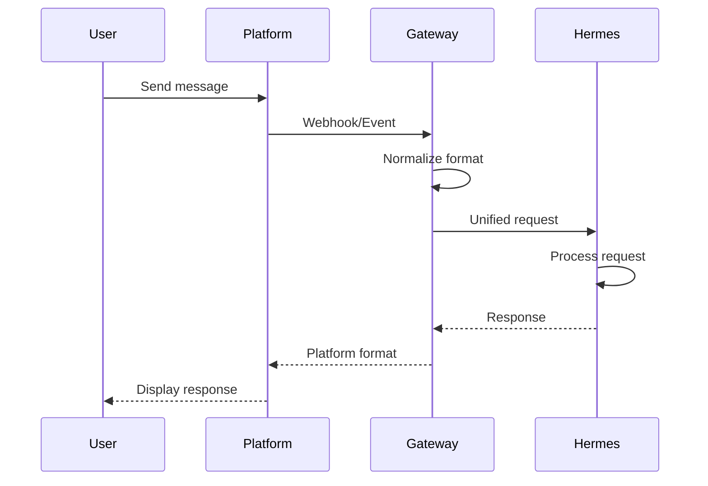
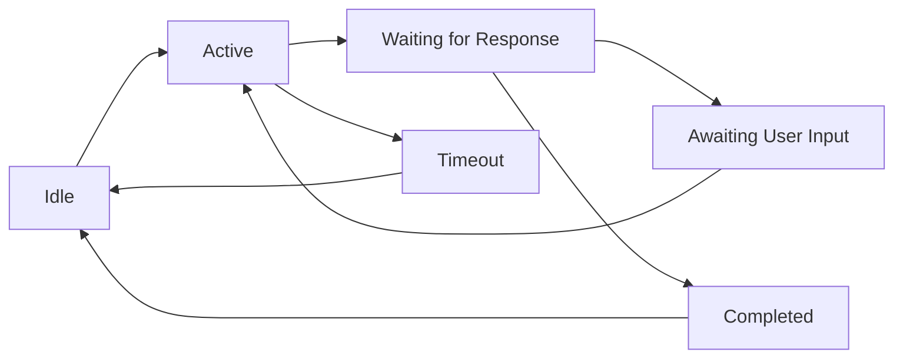
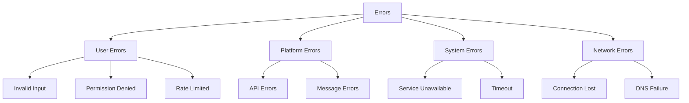

# Gateway Pesan

## Gambaran Umum

Messaging Gateway adalah jembatan antara Hermes Agent dan platform chat. Kamu chat dengan Hermes lewat aplikasi yang biasa kamu pakai, dan Hermes menjawab di tempat yang sama.

Gateway bukan sekadar pengirim pesan. Semua pesan dinormalisasi dulu menjadi satu format yang sama, lalu diteruskan ke inti Hermes, dan jawabannya dikembalikan dalam format asli platform.



## Yang Akan Kamu Pelajari

- Perbedaan karakter tiap platform: batas panjang pesan, thread, tombol, dan perintah slash
- Cara membuat bot di Telegram, Discord, dan Slack lalu menyambungkannya ke gateway
- Variabel lingkungan dan konfigurasi YAML yang dipakai tiap platform
- Pola bot yang bisa dipakai ulang: command handler, formatter, conversation flow, dan error handling
- Cara menjaga keamanan dan menangani error agar pesan pengguna tetap ramah

## Konsep Kunci

### Perbandingan platform

| Aspek | Telegram | Discord | Slack |
|-------|----------|---------|-------|
| **Kompleksitas setup** | Rendah | Sedang | Sedang |
| **Jenis bot** | Bot @username | Application | App + Bot User |
| **Pesan maksimum** | 4096 karakter | 2000 karakter | 30000 karakter |
| **Thread** | Tidak native | Ya | Ya |
| **Perintah slash** | Lewat / | Ya | Ya |
| **Tombol** | Inline/Keyboard | Buttons + Selects | Buttons + Selects |
| **Dukungan grup** | Sampai 200K | Sampai 2.5M (guilds) | Lewat channel |

Variabel lingkungan yang dipakai: `TELEGRAM_BOT_TOKEN`, `DISCORD_BOT_TOKEN`, `SLACK_BOT_TOKEN`, `SLACK_SIGNING_SECRET` (rahasia penandatangan request), dan `GATEWAY_PORT` (port server webhook lokal, opsional).

Lima hal yang wajib dijaga: token tidak boleh masuk ke version control, tanda tangan webhook selalu divalidasi, batas API platform dihormati, pesan masuk disanitasi, izin diberikan secukupnya saja.

### Menyiapkan Telegram

Buat botnya lewat **@BotFather**: kirim `/newbot`, beri nama, lalu salin tokennya. Token ini memberi kendali penuh atas bot, jadi simpan aman.

```bash
export TELEGRAM_BOT_TOKEN="your-bot-token-here"
```

```yaml
messaging:
  telegram:
    enabled: true
    bot_token: "${TELEGRAM_BOT_TOKEN}"
```

Hermes menerima update lewat webhook, jadi jalankan gateway lalu daftarkan URL-nya:

```bash
hermes gateway setup
hermes gateway run
```

Secara bawaan Hermes memakai **polling** — dia menarik update dari Telegram.
Untuk deployment cloud (Fly.io, Railway, Render), mode webhook lebih hemat
karena platform bisa bangun dari tidur saat ada trafik masuk:

```bash
export TELEGRAM_WEBHOOK_URL="https://my-app.fly.dev/telegram"
export TELEGRAM_WEBHOOK_SECRET="$(openssl rand -hex 32)"
hermes gateway run
```

`TELEGRAM_WEBHOOK_SECRET` wajib diisi kalau `TELEGRAM_WEBHOOK_URL` diset —
gateway menolak start tanpa itu. Jalur webhook diambil otomatis dari URL-nya.

Untuk pengembangan lokal, pakai terowongan seperti `ngrok http 8080`. Perintah bot yang berguna: `/start` (mulai percakapan), `/help`, `/status`, `/memory`, `/model`, dan `/clear` (bersihkan percakapan). Telegram juga mendukung inline button: reply keyboard seperti `[Help] [Status] [Memory]` ditulis di `reply_markup.keyboard`, sedangkan inline keyboard seperti `[View History] [Share] [Delete]` memakai `callback_data`.

Untuk grup, matikan privacy mode lewat `/setprivacy` di BotFather, lalu batasi grup yang boleh dipakai:

```yaml
messaging:
  telegram:
    group_mode:
      enabled: true
      prefix_required: true
      allowed_groups:
        - "-1001234567890"   # Group chat ID
```

Handle file yang masuk dari Telegram: gambar diproses sebagai input vision (maks 10 MB), dokumen menjadi lampiran (20 MB), dan audio ditranskripsi bila voice aktif (20 MB).

Keamanan webhook dijaga lewat `secret_token` dan `ip_whitelist`. Kalau bot tidak merespons, cek token dulu, lalu pastikan webhook terdaftar di `https://api.telegram.org/bot<TOKEN>/getWebhookInfo` dan gateway berjalan.

### Menyiapkan Discord

Di [Discord Developer Portal](https://discord.com/developers/applications), buat **New Application**, beri nama, buka bagian **Bot**, klik **Reset Token**, lalu salin tokennya. Aktifkan **Message Content Intent** di bawah Privileged Gateway Intents.

```bash
export DISCORD_BOT_TOKEN="your-bot-token-here"
```

```yaml
messaging:
  discord:
    enabled: true
    bot_token: "${DISCORD_BOT_TOKEN}"
```

Untuk memberi akses ke server, buka **OAuth2 > URL Generator**, pilih scope `bot` dan `applications.commands`, lalu pilih izin View Channels, Send Messages, Embed Links, Read Message History, Add Reactions, dan Use Slash Commands.

```bash
hermes gateway setup
hermes gateway run
```

Gateway Discord terhubung lewat WebSocket, jadi URL webhook tidak dibutuhkan
untuk fungsi dasar. Perintah slash-nya disinkronkan otomatis saat gateway
start. Cara sinkronisasinya diatur lewat `DISCORD_COMMAND_SYNC_POLICY`:

| Nilai | Perilaku |
|-------|----------|
| `safe` (bawaan) | Bandingkan perintah global yang ada, hanya yang berubah yang di-update |
| `bulk` | Perilaku lama — seluruh pohon perintah di-sync ulang |
| `off` | Matikan sinkronisasi saat start sepenuhnya |

Sinkronisasi global bisa memakan waktu sampai satu jam untuk muncul di
Discord.

Fitur khas Discord yang didukung Hermes: thread (`threads.auto_create` dengan awalan `hermes-`), kontrol akses berbasis role, embed pesan, tombol, modal formulir, dan presence bot. Channel yang didukung: text channel dan thread (penuh), DM, dan group DM (fitur terbatas).
Discord punya batas rate yang ketat:

| Aksi | Batas |
|------|-------|
| Kirim pesan | 5/5 detik (bucket) |
| Edit pesan | 5/5 detik |
| Hapus pesan | 5/5 detik |
| Reaksi | 1/0.25 detik |
| Konfirmasi perintah slash | 3/3 detik |

Hermes mengantre pesan secara otomatis agar batas itu dihormati.

### Menyiapkan Slack

Buat app di [Slack API](https://api.slack.com/apps) dengan **Create New App > From scratch**. Di **Basic Information > App Credentials**, salin `App ID`, `Client ID`, `Client Secret`, dan `Signing Secret`, lalu aktifkan bot user lewat **Bot Users > Add Bot User**.

```bash
export SLACK_CLIENT_ID="your-client-id"
export SLACK_CLIENT_SECRET="your-client-secret"
export SLACK_SIGNING_SECRET="your-signing-secret"
export SLACK_BOT_TOKEN="your-bot-token"
```

```yaml
messaging:
  slack:
    enabled: true
    client_id: "${SLACK_CLIENT_ID}"
    client_secret: "${SLACK_CLIENT_SECRET}"
    signing_secret: "${SLACK_SIGNING_SECRET}"
    bot_token: "${SLACK_BOT_TOKEN}"
```

Scope yang dibutuhkan: `chat:write` (kirim pesan), `channels:history` dan `channels:read` (channel publik), `groups:history` (channel privat), `im:history` dan `im:read` (pesan langsung), `mpim:history` (group DM), `app_mentions:read` (@mention), `reactions:read`/`reactions:write` (reaksi), `files:read`/`files:write` (berkas), serta `users:read` (data pengguna).

Aktifkan **Event Subscriptions**, isi Request URL dengan `https://your-domain.com/slack/events`, lalu subscribe ke `app_mention`, `message.channels`, `message.groups`, `message.im`, dan `message.mpim`. Perintah slash didaftarkan di menu **Slash Commands** dengan Request URL yang sama, lalu jalankan `hermes gateway run`.

Hermes mendukung thread (`thread_ts`), channel terbatas dengan `require_mention: true`, DM dengan sapaan otomatis, Block Kit, tombol, select menu, shortcut, dan Slack Workflows. Format pesan Slack memakai mrkdwn: `*tebal*`, `_miring_`, `` `kode` ``, dan `<https://url|text>` untuk tautan. Batas rate Slack: 1 pesan/detik (burst 10), 100 panggilan API/menit, 10 unggah berkas/menit.

### Pola bot yang bisa dipakai ulang

Pola bot membuat integrasi di beberapa platform tetap konsisten. Empat intinya: command handler (parsing dan routing perintah), response formatter (format jawaban per platform), conversation flows (status percakapan banyak giliran), dan error handling (kegagalan tanpa merusak pengalaman pengguna).

Command handler memotong awalan, membuang suffix `@namabot`, lalu meneruskan sisanya ke router. Rate limit-nya 10 perintah per menit per pengguna per platform. Tingkat izin: **Public** untuk semua pengguna, **Admin** untuk admin channel atau server, dan **Owner** untuk pemilik bot. Awalan tiap platform: `/` untuk Telegram, `!` untuk Discord, `/` untuk Slack.

Adapter per platform menormalisasi pesan jadi format yang sama: identitas pengguna, id chat atau channel, teks, perintah, lampiran, dan balasan yang dirujuk. Router mencari handler yang cocok, sementara middleware seperti `RateLimitMiddleware` atau `PermissionMiddleware` berjalan sebelumnya.

Conversation flow memakai state machine agar Hermes tahu posisi percakapan:



Niat pesan dideteksi dari polanya: sapaan, pertanyaan, perintah, konfirmasi, atau pembatalan. Dari situ Hermes bisa menjalankan alur banyak langkah, misalnya membuat tugas: kumpulkan nama, minta konfirmasi, jalankan, laporkan selesai. Kalau pengguna diam terlalu lama, percakapan masuk status timeout dan diberi tahu cara mengulanginya.

Tiap platform punya cara berbeda untuk threaded: Telegram memakai rantai balasan, Discord memakai thread asli yang cocok untuk embed, sedangkan Slack memakai `thread_ts` yang cocok untuk Block Kit.

### Menangani error dengan baik

Error di tiap platform punya bentuk berbeda, jadi kategori-kategori ini dipisahkan dan masing-masing ada penanganannya.



Kode error platform yang paling sering muncul: di Telegram, 429 (terlalu banyak permintaan, ada `retry_after`), 403 (bot diblokir pengguna), dan 400 (chat tidak ditemukan). Di Discord, 50013 dan 30001 (izin kurang), 20001 dan 50001 (akses ditolak), 30010 (batas thread tercapai). Di Slack, `channel_not_found`, `not_authed`, `token_revoked`, `ratelimited`, `msg_too_long`.

Pola responsnya seragam: catat error, tentukan jenisnya, lalu kirim pesan yang ramah. Jangan pernah menampilkan exception mentah ke pengguna.

| Jenis error | Pesan untuk pengguna |
|-------------|---------------------|
| Timeout jaringan | "Having trouble connecting. Please try again." |
| Kena rate limit | "You're doing that too fast. Please wait." |
| Layanan tidak tersedia | "Service is temporarily unavailable. Please try later." |
| Input tidak valid | "I didn't understand that. Could you rephrase?" |
| Izin ditolak | "You don't have permission for that action." |
| Pesan terlalu panjang | "That message is too long. Can you shorten it?" |
| Error tidak dikenal | "Something went wrong. Please try again." |

Pengambilan ulang dilakukan dengan backoff, dan error yang masih gagal disimpan di dead letter queue supaya bisa dicoba lagi nanti. Kalau pesan tidak muat, Hermes mundur bertahap: lepas format, lalu potong teks sesuai batas platform.

## Perintah Praktis

```bash
# Setup wizard: pilih platform, masukkan token, selesai
hermes gateway setup

# Jalankan gateway di foreground
hermes gateway run

# Jalankan sebagai service background (systemd/launchd)
hermes gateway install
hermes gateway start
hermes gateway status

# Lihat semua profil dan status gateway-nya
hermes gateway list
```

Gateway-nya satu proses untuk semua platform. Platform aktif ditentukan lewat
`hermes gateway setup` dan variabel environment, bukan lewat subcommand
per-platform.

Buat manifest Slack yang mendaftarkan semua perintah gateway sebagai slash
command Slack:

```bash
hermes slack manifest
```

Salin keluarannya ke Slack app config → Features → App Manifest → Edit, lalu
Save.

## Contoh Nyata

Bot Telegram dengan perintah dasar dan webhook aman:

```yaml
messaging:
  telegram:
    enabled: true
    bot_token: "${TELEGRAM_BOT_TOKEN}"
    webhook:
      url: "https://your-domain.com/telegram"
      secret_token: "${TELEGRAM_SECRET}"
```

## Catatan Penting

- **Token tidak pernah masuk git.** Simpan di environment variable dan pakai `${NAMA_VARIABEL}` di YAML.
- **Verifikasi tanda tangan webhook selalu.** Tanpa itu, siapa pun bisa memicu task kamu.
- **Hormati rate limit platform.** Gateway mengantre pesan otomatis, jadi jangan menambah request paralel sendiri.
- **Batasi izin sekeras mungkin.** Bot yang hanya membaca tidak perlu izin tulis.
- **Perintah slash Discord butuh waktu untuk muncul.** Sinkronisasi global bisa memakan waktu sampai satu jam.
- **Pakai satu bahasa untuk pesan error.** Pengguna butuh tahu apa yang harus dilakukan berikutnya, bukan kode HTTP.

## Apa Selanjutnya

Lanjut ke [Modul 20](/modul/jadwal) untuk menjadwalkan tugas otomatis, memicu task dari webhook, dan membangun alur kerja tanpa harus memicu manual.
