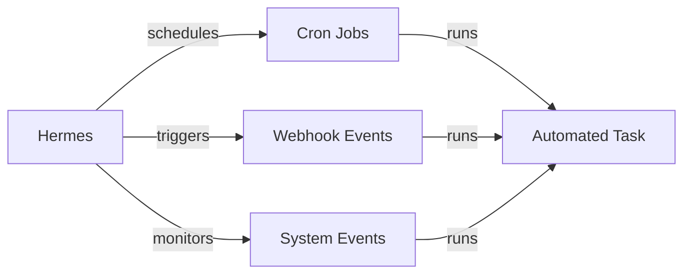
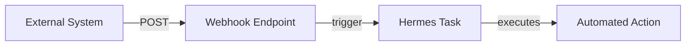

# Jadwal

## Gambaran Umum

Hermes Agent tidak selalu kamu panggil manual. Lewat cron dan automation, Hermes bisa menjalankan tugas sendiri: cek status tiap jam, rangkum proyek tiap pagi, dan bereaksi saat ada push di GitHub.

Empat cara penjadwalan yang perlu kamu kenal. **Cron** berbasis waktu, misalnya "setiap hari jam 9 pagi". **Interval** berbasis frekuensi tetap, misalnya "setiap 15 menit". **Webhook** berbasis event, misalnya "saat GitHub push terjadi". **Manual** bersifat on-demand, dijalankan saat kamu minta. Yang membedakan modul ini adalah tugasnya berjalan di belakang layar: kalau tidak ada yang memicu, tidak ada yang jalan.



## Yang Akan Kamu Pelajari

- Empat jenis penjadwalan dan kapan masing-masing dipakai
- Format ekspresi cron beserta arti setiap field-nya
- Cara membuat job terjadwal pertama, memeriksa daftar, dan menjalankannya manual
- Field konfigurasi job: timeout, timezone, dan penanganan kegagalan
- Cara memicu task dari webhook GitHub, HTTP, file, dan jadwal
- Cara memverifikasi tanda tangan webhook dan menyaring event

## Konsep Kunci

### Ekspresi cron

```
┌───────────── minute (0-59)
│ ┌───────────── hour (0-23)
│ │ ┌───────────── day of month (1-31)
│ │ │ ┌───────────── month (1-12)
│ │ │ │ ┌───────────── day of week (0-6)
│ │ │ │ │
* * * * *
```

| Field | Nilai | Karakter khusus |
|-------|-------|-----------------|
| minute | 0-59 | * , - / |
| hour | 0-23 | * , - / |
| day | 1-31 | * , - / |
| month | 1-12 | * , - / |
| weekday | 0-6 | * , - / |

Contoh yang paling sering dipakai:

| Ekspresi | Arti |
|----------|------|
| `0 * * * *` | Setiap jam tepat menit 0 |
| `0 9 * * *` | Setiap hari jam 9:00 pagi |
| `0 9 * * 1-5` | Hari kerja jam 9:00 pagi |
| `*/15 * * * *` | Setiap 15 menit |
| `0 0 * * 0` | Setiap Minggu tengah malam |
| `0 0 1 * *` | Tanggal 1 setiap bulan |

String singkat juga tersedia: `@hourly`, `@daily`, `@weekly`, `@monthly`, dan `@yearly`.

### Membuat job pertama

Prasyaratnya: Hermes sudah terpasang, dan kamu paham cara task berjalan di Hermes. Mulai dengan melihat status cron:

```
Show me the current cron configuration and scheduled jobs
```

Perintah itu menampilkan job aktif beserta waktu jalan berikutnya, status aktif/nonaktif, dan riwayat eksekusi terakhir. Lalu buat job sederhana:

```
Schedule a task to run every hour that checks system status
```

```yaml
name: hourly-status
schedule: "0 * * * *"
task:
  prompt: "Run system status check and report any issues"
  tool: default
```

Laporan harian hari kerja:

```
Schedule a task to run every weekday at 9 AM that summarizes project activity
```

```yaml
name: daily-report
schedule: "0 9 * * 1-5"
task:
  prompt: "Generate a summary of project commits, issues, and pull requests from the last 24 hours"
  tool: default
```

Ringkasan mingguan memakai jadwal `0 0 * * 0` dan prompt yang memuat tugas selesai, item tertunda, serta prioritas minggu depan.

Setelah job dibuat, daftarkan semuanya dengan `hermes cron list`, lalu jalankan satu job manual dengan `hermes cron run <job_id>`. Perintah lain untuk mengelola job:

| Tugas | Perintah |
|-------|----------|
| Lihat daftar job | `hermes cron list` |
| Tambah job | `hermes cron create "<jadwal>" "<tugas>"` |
| Ubah job | `hermes cron edit <job_id>` |
| Jeda job | `hermes cron pause <job_id>` |
| Lanjutkan job | `hermes cron resume <job_id>` |
| Jalankan sekarang | `hermes cron run <job_id>` |
| Hapus job | `hermes cron remove <job_id>` |
| Lihat riwayat | `hermes cron history <job_id>` |
| Cek kesehatan | `hermes cron doctor` |

Semua job disimpan di `~/.hermes/cron/jobs.json`. Kamu juga bisa mengelola job
lekat bahasa alami di dalam chat, lewat perintah `/cron`, atau dari tool
`cronjob_manage` yang dipakai agent itu sendiri.

Contoh membuat job:

```bash
hermes cron create "every 2h" "Cek status server"
hermes cron create "every 1d at 09:00" "Ringkas commit hari ini"
```

### Konfigurasi job

Field wajib:

| Field | Tipe | Keterangan |
|-------|------|------------|
| `name` | string | Identifier job yang unik |
| `schedule` | string | Ekspresi cron |
| `task.prompt` | string | Task yang dijalankan |

Field opsional:

| Field | Tipe | Default | Keterangan |
|-------|------|---------|------------|
| `description` | string | - | Deskripsi yang mudah dibaca manusia |
| `enabled` | boolean | true | Apakah job jalan sesuai jadwal |
| `timeout` | number | 300 | Batas waktu eksekusi dalam detik |
| `timezone` | string | local | Zona waktu jadwal |
| `on_failure` | string | log | Tindakan saat gagal: log, retry, stop |
| `notify` | boolean | false | Kirim notifikasi saat selesai |

Untuk interval sederhana, tanpa ekspresi cron:

```yaml
name: health-check
interval: "15m"  # Every 15 minutes
task:
  prompt: "Check service health endpoints"
```

Satuan yang tersedia: `5m` (setiap 5 menit), `1h` (setiap jam), `6h` (setiap 6 jam), `1d` (setiap hari), dan `1w` (setiap minggu).

### Webhook trigger

Webhook membuat Hermes bereaksi terhadap event dari sistem luar. Contohnya push GitHub, PR baru, request HTTP ke endpoint kamu, perubahan berkas, atau jadwal yang sudah cocok.



Konfigurasi dasar:

```yaml
webhook:
  name: github-push-handler
  endpoint: /webhook/github
  events:
    - push
    - pull_request
  task:
    prompt: "Process the incoming GitHub event and take appropriate action"
```

Field webhook:

| Field | Tipe | Wajib | Keterangan |
|-------|------|-------|------------|
| `name` | string | Ya | Identifier webhook yang unik |
| `endpoint` | string | Ya | Path URL untuk webhook |
| `secret` | string | Tidak | Rahasia bersama untuk verifikasi tanda tangan |
| `events` | string[] | Ya | Daftar jenis event yang ditangani |
| `task` | object | Ya | Task yang dijalankan saat memicu |

Jenis event yang tersedia: `push` (kode di-push ke repository), `pull_request` (PR dibuka, diubah, atau ditutup), `issue.opened`, `issue.commented`, `release.published`, `tag.created`, `http.post`, `http.get`, `file.created`, `file.modified`, `file.deleted`, `schedule.cron` (ekspresi cron cocok), dan `schedule.interval` (interval tetap tercapai).

Contoh webhook GitHub dengan filter branch dan verifikasi tanda tangan:

```yaml
webhook:
  name: github-push
  endpoint: /webhook/github
  secret:
    type: env
    name: WEBHOOK_SECRET
  signature:
    header: X-Hub-Signature-256
    algorithm: sha256
  events:
    - push
  filters:
    branches:
      - main
      - develop
  task:
    prompt: |
      Analyze the recent push and provide:
      1. Summary of changes
      2. Files that were modified
      3. Any potential issues or concerns
```

Contoh watcher berkas konfigurasi:

```yaml
webhook:
  name: config-watcher
  endpoint: /webhook/file
  events:
    - file.modified
  filters:
    paths:
      - "*.yaml"
      - "*.yml"
      - "config/*"
  task:
    prompt: "Validate the modified configuration file and check for syntax errors"
```

Header tanda tangan yang dipakai tiap platform:

| Header | Algoritma | Keterangan |
|--------|-----------|------------|
| `X-Hub-Signature-256` | SHA256 | Bawaan GitHub |
| `X-Hub-Signature` | SHA1 | GitHub versi lama |
| `X-Slack-Signature` | HMAC | Webhook Slack |

Filter menentukan event mana yang boleh memicu task. Bisa per branch (`main`, `develop`, `release/*`), per path (`src/**/*.ts`, `*.md`, `docs/**`), atau per kondisi:

```yaml
filters:
  events:
    - push
  conditions:
    - type: compare
      field: payload.commits.length
      operator: greater_than
      value: 0
```

Saat webhook memicu task, task menerima konteks: `event.type` (jenis event), `event.timestamp` (kapan terjadi), `payload` (payload webhook asli), `headers` (HTTP header request), dan `signature` (tanda tangan verifikasi).

Perintah untuk mengelola webhook:

| Tugas | Perintah |
|-------|----------|
| Lihat webhook | `hermes webhook list` |
| Tambah webhook | `hermes webhook add <name> <config>` |
| Hapus webhook | `hermes webhook remove <name>` |
| Uji webhook | `hermes webhook test <name>` |
| Aktifkan adapter | `hermes gateway setup` |

Adapter webhook dinyalakan lewat `hermes gateway setup` atau variabel
environment. Port defaultnya 8644, dan route-nya dilayani di
`http://server-kamu:8644/webhooks/<nama-route>`.

## Perintah Praktis

```bash
# Kelola job cron
hermes cron list
hermes cron run <job_id>
hermes cron history <job_id>
# Kelola webhook
hermes webhook list
hermes webhook test <name>
```

## Contoh Nyata

Pantau perubahan konfigurasi dan laporkan setiap kali ada push ke branch utama:

```
Send a test push event to the github-push webhook
```

```
Show me recent webhook triggers for the github-push webhook
```

Untuk task yang butuh waktu lama, naikkan timeout-nya menjadi `timeout: 3600` (1 jam).

## Catatan Penting

- **Job tidak jalan kalau Hermes tidak jalan.** Task terjadwal butuh proses Hermes yang aktif, bukan sekadar berkas konfigurasi.
- **Pastikan job aktif.** `hermes cron list` menunjukkan status; job yang dijeda terlihat tapi tidak dieksekusi.
- **Cek rentang field cron.** Menit 0-59, jam 0-23, dan hari 0-6 dengan 0=Minggu dan 6=Sabtu. Salah satu angka membuat seluruh job ditolak.
- **Naikkan `timeout` untuk task berat.** Default 300 detik, dan analisis panjang bisa melewati itu.
- **Pakai `timezone` eksplisit untuk job harian.** Kalau kamu bepergian, jadwalnya ikut bergeser.
- **Tentukan `on_failure`.** Tanpa itu, kegagalan cuma masuk log. Pilih `retry` untuk task yang sering gagal sementara.
- **Verifikasi tanda tangan webhook selalu.** Tanpa `secret`, siapa pun bisa memicu task kamu.
- **Filter event dan branch.** Webhook tanpa filter bisa memicu task terlalu sering dan boros token.
- **Uji webhook dengan `hermes webhook test <name>`.** Masalah jadi kelihatan cepat.
- **Deklarasikan `notify` kalau hasil job penting.** Tanpa itu, tidak ada yang tahu task sudah selesai.

## Apa Selanjutnya

Lanjut ke [Modul 21 — Karakter](/modul/karakter) untuk memberi Hermes Agent kepribadian, supaya gaya jawabannya konsisten dan sesuai karaktermu.
