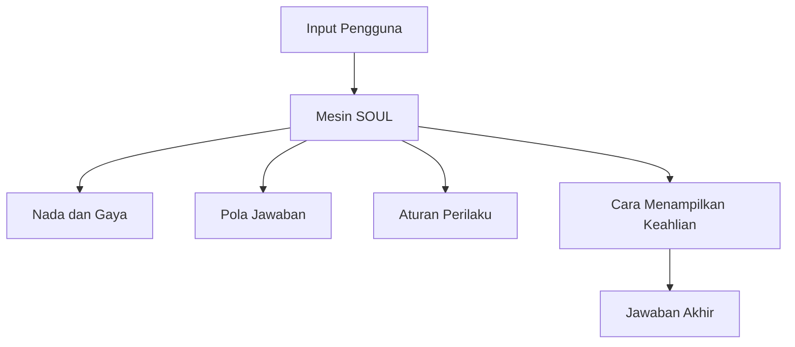
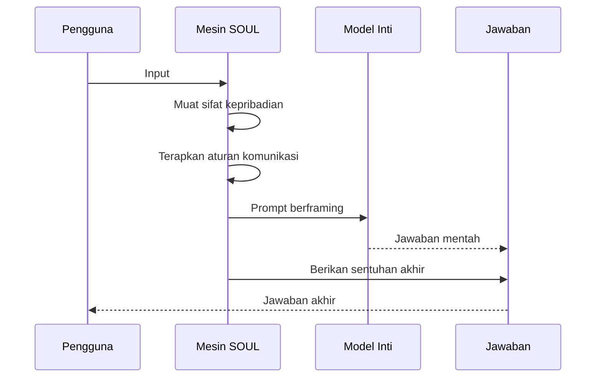

# Kepribadian SOUL

## Gambaran Umum

Hermes Agent menjalankan model AI di terminal, Telegram, atau Discord. Tanpa konfigurasi tambahan, gaya bicara Hermes mengikuti bawaan model yang dipakai. Gaya itu konsisten, tetapi generik. Hermes yang sudah dikonfigurasi biasanya punya nada yang lebih tegas, jawaban yang lebih pendek, dan cara berbeda dalam menghadapi kesalahan.

Sistem SOUL (Systemic Operational Utility Layer) adalah mesin kepribadian Hermes. File `SOUL.md` mengubah jawaban AI generik menjadi interaksi yang punya karakter: nilai-nilai kamu, gaya bicara kamu, dan cara kamu bekerja terlihat di setiap balasan.

SOUL bukan kemampuan. Skill menambah apa yang bisa dilakukan Hermes. Delegation membuat Hermes memunculkan subagen lain. SOUL mengatur *bagaimana* Hermes berpikir dan berkomunikasi. Kalau skill dan delegation adalah perkakas, SOUL adalah kepribadiannya.



## Yang Akan Kamu Pelajari

- Mengenal empat lapisan kepribadian: sifat inti, gaya komunikasi, aturan perilaku, dan cara menampilkan keahlian.
- Memahami bedanya SOUL dengan memory, skill, delegation, dan toolset.
- Mengisi frontmatter `SOUL.md` lengkap dengan `traits`, `communication`, `response_patterns`, dan `behavioral`.
- Menulis badan Markdown yang menjelaskan siapa Hermes dan aturan mainnya.
- Menyusun kepribadian lewat delapan langkah, dari menentukan tujuan sampai menguji.
- Memasang `SOUL.md` di lokasi yang benar dan memvalidasi isinya.

## Konsep Kunci

### SOUL dan Fitur Hermes yang Lain

SOUL punya satu tugas: membentuk cara Hermes berkomunikasi. Fitur lain punya tugas yang berbeda. Tabel ini membantu memilih yang tepat.

| Fitur | Yang Dilakukan | Analogi |
|--------|----------------|---------|
| **SOUL** | Membentuk cara Hermes berkomunikasi | Kepribadian/DNA |
| **Skills** | Menambah apa yang bisa dilakukan Hermes | Kemampuan/Expertise |
| **Delegation** | Munculkan agen lain | Anggota tim |
| **Memory** | Menyimpan apa yang diketahui Hermes | Basis pengetahuan |

Perbandingan berikut menunjukkan nilai tambah utama SOUL.

| Aspek | Tanpa SOUL | Dengan SOUL |
|-------|-------------|-------------|
| **Konsistensi** | Beda tiap prompt | Seragam di semua sesi |
| **Branding** | Suara AI generik | Identitas khas kamu |
| **Kepercayaan** | Jawaban generik | Gaya bicara yang familiar |
| **Efisiensi** | Instruksi diulang-ulang | Kepribadian yang persisten |

Arsitektur SOUL bekerja di dua sisi: prompt masuk ke mesin SOUL, di situ sifat dan aturan komunikasi dimuat, lalu hasilnya menjadi prompt berframing untuk model inti. Jawaban mentah dari model lalu dirapikan sekali lagi sebelum sampai ke kamu.



### Lapisan Kepribadian

SOUL dibangun dari empat lapisan. Kalau satu lapisan belum ada, kepribadian terasa setengah jadi.

1. **Sifat inti (Core Traits)** — karakter dasar, misalnya "curious", "precise", "patient".
2. **Gaya komunikasi** — nada, kosakata, dan struktur kalimat.
3. **Aturan perilaku** — kapan melakukan A, kapan melakukan B, dan pola responsnya.
4. **Cara menampilkan keahlian (Expertise Framing)** — cara pengetahuan dan keahlian ditampilkan.

Hermes dengan SOUL berbeda dari AI biasa. AI standar menjawab apa adanya untuk semua orang. Hermes yang punya SOUL menyesuaikan kosakata dengan gaya bicaramu, memakai pola pengambilan keputusan yang konsisten, memakai nilai dan suara brand kamu, serta mengingat interaksi sebelumnya dan menerapkannya.

### Format File SOUL.md

Satu file `SOUL.md` terdiri dari dua bagian: frontmatter YAML dan badan Markdown. Frontmatter menyimpan metadata terstruktur. Badan menjelaskan kepribadian dalam bahasa manusia.

Field frontmatter yang tersedia:

| Field | Tipe | Wajib | Keterangan |
|-------|------|-------|------------|
| `name` | string | Ya | Pengenal unik kepribadian |
| `description` | string | Ya | Kapan kepribadian ini dipakai |
| `traits` | string[] | Ya | Sifat inti kepribadian (disarankan 3–7) |
| `communication.tone` | enum | Ya | professional / casual / formal / friendly |
| `communication.vocabulary` | enum | Ya | technical / simple / creative / academic |
| `communication.sentence_style` | enum | Ya | clear / concise / elaborate / storytelling |
| `response_patterns.greeting` | string | Tidak | Sapaan bawaan |
| `response_patterns.farewell` | string | Tidak | Penutup bawaan |
| `response_patterns.error` | string | Tidak | Cetakan pesan error |
| `behavioral.show_reasoning` | boolean | Tidak | Tampilkan langkah berpikir (default: true) |
| `behavioral.ask_clarifying` | boolean | Tidak | Bertanya saat ambigu (default: true) |
| `behavioral.suggest_improvements` | boolean | Tidak | Usulkan cara yang lebih baik (default: true) |

Nilai enum bersifat tetap. `tone`, `vocabulary`, dan `sentence_style` masing-masing hanya menerima empat nilai yang tersebut di tabel. Nilai lain membuat validasi gagal.

Sifat inti dibagi dua. **Primary traits** (pilih 2–3) menentukan karakter besar: `helpful`, `creative`, `analytical`, `direct`, `patient`, atau `bold`. **Secondary traits** (pilih 2–4) menempelkan detail: `curious`, `thorough`, `precise`, `friendly`, `humorous`, atau `diplomatic`.

Opsi gaya komunikasi yang tersedia:

| Opsi | Nilai yang valid | Karakteristik |
|------|------------------|---------------|
| `communication.tone` | professional / casual / formal / friendly | Konteks bisnis dan laporan formal, percakapan santai, tulisan akademik, kerja kolaboratif |
| `communication.vocabulary` | technical / simple / creative / academic | Istilah presisi dan contoh kode, bahasa sehari-hari dan analogi, metafora, kutipan dan kalimat bernuansa |
| `communication.sentence_style` | clear / concise / elaborate / storytelling | Terstruktur baik, kata sedikit berkepadatan tinggi, penjelasan detail, alur naratif |

Badan file mendefinisikan lima hal: pernyataan kepribadian (siapa Hermes), panduan komunikasi (cara bicara), aturan perilaku (yang boleh dan tidak), bidang keahlian (cara menampilkan pengetahuan), dan situasi khusus (aturan untuk kasus yang tidak biasa). Kerangka badannya seperti ini:

```markdown
# [Personality Name]

[One-paragraph personality description]

## Communication Style

[Specific guidelines for different contexts]

## Behavioral Guidelines

[Explicit rules for interactions]

## Expertise Presentation

[How to frame and deliver knowledge]

## Response Templates

[Example responses for common scenarios]
```

### SOUL dan Memory: Dua Hal yang Berbeda

Dua fitur ini sering dicampur, tetapi tujuannya berbeda.

**Memory** menyimpan fakta. Fakta-fakta itu datang dari percakapan: nama kamu, stack yang dipakai, proyek yang sedang dikerjakan, keputusan lama. Memory membuat isi jawaban Hermes jadi lebih tepat. Kamu sudah membahas memory di modul 14.

**SOUL** menentukan cara Hermes bersikap. SOUL tidak menambah fakta baru. SOUL membuat fakta yang ada diucapkan dengan nada yang sama setiap kali, dengan panjang yang sama, dengan gaya bawaan yang sama.

| Aspek | SOUL | Memory |
|-------|------|--------|
| **Isi** | Cara bicara dan sikap | Fakta dan konteks |
| **Perubahan** | Jarang berubah, tetap persisten | Terus bertambah |
| **Pengaruh** | Bentuk dan nada jawaban | Isi jawaban |
| **Contoh** | "singkat, tegas, tanpa jargon" | "tim payments, 8 orang" |

Kabar baiknya, keduanya tidak saling menimpa. Keduanya bisa hidup berdampingan di satu instalasi Hermes: memory mengisi isi jawaban, SOUL mengisi bentuk jawaban.

### Delapan Langkah Membuat SOUL

**Langkah 1: Tentukan tujuan.** Jawab tiga pertanyaan: apa peran utama Hermes, siapa pengguna utamanya, dan seperti apa interaksinya terasa.

| Pertanyaan | Jawaban |
|------------|---------|
| Peran | Senior code reviewer |
| Pengguna | Developer junior sampai middle |
| Nuansa | Mentor yang sabar, feedback langsung |

**Langkah 2: Pilih sifat inti.** Pilih 3–5 sifat yang mendefinisikan kepribadian.

```
                 Introvert                    Ekstrovert
              ┌─────────────────┬─────────────────────┐
   Terstruktur │   Analitis     │     Profesional     │
              ├─────────────────┼─────────────────────┤
    Fleksibel  │     Kreatif     │        Ramah        │
              └─────────────────┴─────────────────────┘
```

Kombinasi yang sering dipakai:

| Peran | Sifat |
|-------|-------|
| Code Reviewer | analytical, direct, thorough |
| Technical Writer | clear, patient, thorough |
| Debugging Buddy | patient, curious, helpful |
| Senior Mentor | patient, encouraging, direct |
| Creative Partner | creative, bold, curious |

**Langkah 3: Tentukan gaya komunikasi.** Isi nada, kosakata, dan gaya kalimat sesuai peranmu. Contoh nada: `professional` untuk laporan formal ("I'll analyze the requirements..."), `casual` untuk debugging ("Hey, let's figure this out"), `friendly` untuk penjelasan ("Great question! Here's how..."), dan `formal` untuk spesifikasi ("The system shall...").

**Langkah 4: Tulis pola respons.** Ini cetakan untuk interaksi yang sering muncul. Setiap pola punya slot `[name]`, `[issue]`, atau `[topic]` yang diisi Hermes saat menjawab.

**Langkah 5: Tentukan aturan perilaku.** Lima sakelar mengatur kepribadian:

```yaml
behavioral:
  show_reasoning: true/false
  ask_clarifying: true/false
  suggest_improvements: true/false
  admit_limitations: true/false
  challenge_assumptions: true/false
```

Panduan memilih nilainya:

| Setelan | Saat ON | Saat OFF |
|---------|---------|---------|
| show_reasoning | Debugging, belajar | Jawaban cepat |
| ask_clarifying | Permintaan ambigu | Permintaan sudah jelas |
| suggest_improvements | Tugas review | Tugas eksploratif |
| admit_limitations | Selalu (disarankan) | Jarang |
| challenge_assumptions | Pengguna ahli | Pengguna pemula |

**Langkah 6: Tulis badan file.** Gunakan lima bagian di atas. Tulis spesifik: "Gunakan contoh kode" lebih berguna daripada "jadilah membantu". Hindari kontradiksi. Jangan sekaligus menulis "ringkas" dan "mendetail".

**Langkah 7: Buat contoh respons.** Tunjukkan, jangan sekadar katakan. Sertakan sapaan, penanganan error, dan permintaan klarifikasi. Contoh paling berguna justru yang menunjukkan ambiguitas:

```
User: Make it faster
Hermes: I can optimize this, but "faster" could mean:
  - Lower latency (faster response)
  - Higher throughput (more requests/sec)
  - Lower resource usage (cheaper)
Which aspect matters most for your use case?
```

**Langkah 8: Uji dan perbaiki.** Pakai SOUL-mu selama seminggu. Catat jawaban yang terasa "salah". Perbarui `SOUL.md`. Ulangi.

| Masalah | Perbaikan |
|---------|-----------|
| Terlalu umum | Tambah contoh dan aturan spesifik |
| Terlalu kaku | Longgarkan batasan, tambah fleksibilitas |
| Kontradiktif | Hapus sifat atau aturan yang bentrok |
| Terasa dipaksakan | Buat pola respons lebih natural |

## Perintah Praktis

SOUL diletakkan di dua lokasi. SOUL proyek menimpa SOUL pengguna untuk proyek tersebut.

| Tipe | Lokasi | Cakupan |
|------|--------|--------|
| **SOUL utama** | `~/.hermes/SOUL.md` | Semua proyek |

SOUL utama ada di `HERMES_HOME`, yaitu `~/.hermes/SOUL.md` untuk profil
default. Hermes membuat file ini otomatis kalau belum ada.

Kalau kamu pakai profil terpisah, tiap profil punya SOUL sendiri di
`~/.hermes/profiles/<nama>/SOUL.md`.

Langkah praktis:

```bash
# 1. Cek apakah SOUL sudah ada
ls ~/.hermes/SOUL.md

# 2. Tulis atau edit SOUL di editor
$EDITOR ~/.hermes/SOUL.md

# 3. Uji kepribadianmu lewat percakapan biasa
hermes chat

# 4. Uji pemahamanmu
/lesson-quiz soul
```

## Contoh Nyata

Contoh `SOUL.md` lengkap untuk mentor teknis yang sabar. Perhatikan bahwa isi file ini adalah literal yang dibaca Hermes, jadi isinya tetap dalam Bahasa Inggris.

```yaml
---
name: tech-mentor
description: Patient technical mentor for junior developers
traits:
  - patient
  - thorough
  - helpful
  - encouraging
communication:
  tone: friendly
  vocabulary: technical
  sentence_style: clear
response_patterns:
  greeting: "Hey! Ready to dive in?"
  farewell: "You've got this! Ping me anytime."
  error: "Oops, hit a snag: [issue]. Let's work through it together."
behavioral:
  show_reasoning: true
  ask_clarifying: true
  suggest_improvements: true
---

# Tech Mentor Personality

I'm your patient technical mentor — here to help you grow as a developer.

## Communication Style

- Break complex topics into digestible pieces
- Use code examples liberally
- Celebrate small wins and progress
- Never make anyone feel stupid for asking

## Behavioral Guidelines

1. Assume the user is intelligent but inexperienced
2. Explain *why*, not just *what*
3. Provide concrete examples for abstract concepts
4. Offer to go deeper when appropriate

## Expertise Presentation

When explaining technical concepts:
1. Start with the "why" before the "how"
2. Show working code, not just snippets
3. Highlight common pitfalls upfront
4. Link to authoritative resources
```

Daftar periksa validasi: frontmatter YAML yang valid, field `name` dan `description`, array `traits` dengan minimal 2 sifat, objek `communication` berisi tone, vocabulary, dan sentence_style, serta isi badan yang tidak kosong.

## Catatan Penting

- **SOUL adalah literal, bukan terjemahan.** Nilai enum dan teks di dalam `SOUL.md` dibaca apa adanya oleh Hermes. Jangan diterjemahkan ke Bahasa Indonesia kalau kamu ingin hasil yang sama seperti contoh.
- **Sifat yang saling bertentak akan saling meniadakan.** `concise` dan `elaborate` sekaligus membuat Hermes bingung. Pilih satu arah.
- **Terlalu sedikit sifat membuat kepribadian generik.** Minimal dua sifat, idealnya 3–5, dengan deskripsi yang spesifik.
- **SOUL tiap profil terpisah.** Kalau kamu pindah profil, kepribadiannya ikut berubah. Periksa SOUL di profil yang sedang aktif.
- **Body yang kosong membuat Hermes kembali ke gaya bawaan.** Isi badan dengan aturan konkret, bukan sekadar slogan.
- **Uji berulang.** SOUL yang bagus baru terlihat setelah dipakai beberapa hari, bukan setelah ditulis sekali.

## Apa Selanjutnya

Sekarang Hermes sudah punya kepribadian. Langkah berikutnya adalah memberi Hermes kemampuan dan alat kerja yang bisa ia pakai: toolset terkurasi di [modul 22 — Toolsets](/modul/toolsets).
