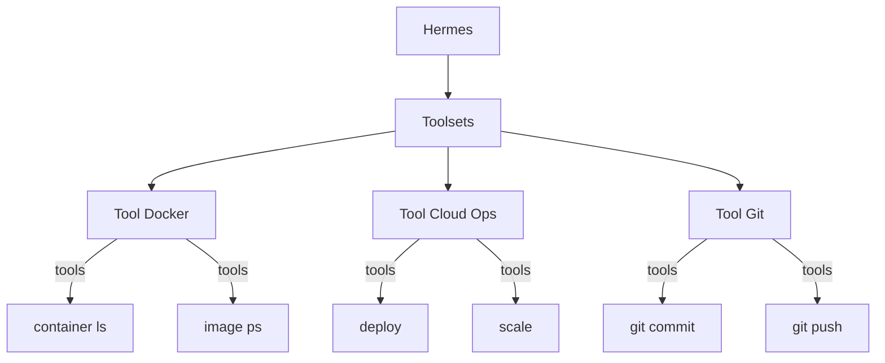

# Toolsets

## Gambaran Umum

Hermes bisa menjalankan banyak tool. Makin banyak tool yang aktif, makin banyak instruksi yang masuk ke konteks, dan makin besar ruang untuk kesalahan. Tool yang tidak pernah dipakai tetap memakan tempat di prompt.

Toolset adalah kumpulan tool yang berkerabat. Koleksi ini diaktifkan, dinonaktifkan, atau diganti sebagai satu unit. Dengan toolset, kamu mengatur akses tool berdasarkan bidang kapabilitas, bukan berdasarkan tool satu per satu.

Empat hal yang dimungkinkan oleh toolset:

- **Mengelompokkan tool yang berkerabat** ke dalam koleksi logis, misalnya "docker-tools" atau "cloud-ops".
- **Mengaktifkan atau menonaktifkan sebagai satu unit**, yaitu menghidupkan atau mematikan sekumpulan kapabilitas sekaligus.
- **Menukar penyedia tool**, yaitu berpindah dari satu implementasi tool ke implementasi lain yang setara.
- **Mengelola izin**, yaitu menerapkan kebijakan akses tool yang konsisten untuk semua tool di dalam set.



## Yang Akan Kamu Pelajari

- Membandingkan toolset dengan mengelola tool satu per satu.
- Mengenal toolset bawaan Hermes dan cara membuat bundling kustom sendiri.
- Mengatur toolset lewat `hermes tools` dan lewat baris `toolsets` di config.yaml.
- Memahami toolset bawaan seperti `web`, `browser`, `terminal`, `file`, dan `memory`.
- Memakai wildcard `all` dan menggabungkan toolset jadi satu bundling.

## Konsep Kunci

### Toolset vs Tool Individu

Keduanya melakukan hal yang sama, hanya di level yang berbeda. Toolset menang karena kamu mengelola satu file untuk banyak tool sekaligus, dan izinnya otomatis berlaku untuk seluruh isi set.

| Aspek | Tool Individu | Toolset |
|-------|----------------|---------|
| **Aktivasi** | Satu per satu | Aktivasi sekelompok |
| **Dependensi** | Dilacak manual | Diselesaikan otomatis di dalam set |
| **Konfigurasi** | Per tool | Per toolset |
| **Penggantian penyedia** | Manual | Otomatis |

### Struktur Toolset

Hermes punya toolset bawaan. Daftar lengkapnya bisa dilihat dengan:

```bash
hermes tools list
```

Beberapa yang sering muncul:

| Toolset | Keterangan |
|---------|------------|
| **web** | Pencarian dan pengambilan isi web |
| **browser** | Otomasi browser (butuh CDP aktif) |
| **terminal** | Menjalankan perintah shell |
| **file** | Baca, tulis, dan cari berkas |
| **code_execution** | Menjalankan skrip Python |
| **skills** | Memuat skill |
| **memory** | Menyimpan dan mencari fakta |
| **delegation** | Memanggil subagent |
| **cronjob** | Menjadwalkan tugas |
| **vision** | Menganalisis gambar |
| **todo** | Perencanaan tugas |

Ada juga toolset yang hanya aktif kalau prasyaratnya siap. Contohnya
`browser` butuh endpoint CDP yang bisa dijangkau, dan `kanban` sengaja
tidak ikut aktif kalau kamu memakai `all`.

### Toolset kustom

Toolset kustom dibuat dari plugin, bukan dari berkas config. Plugin mendaftarkan
tool-nya ke sebuah toolset bernama, lalu toolset itu muncul di daftar seperti
toolset bawaan.

```python
# Di ~/.hermes/plugins/calculator/__init__.py
def register(ctx):
    ctx.register_tool(
        name="calculate",
        toolset="calculator",
        schema={...},
        handler=...,
    )
```

Sesudah plugin diaktifkan, toolset `calculator` bisa diaktifkan seperti
toolset biasa:

```bash
hermes tools enable calculator
```

Yang menentukan toolset aktif untuk tiap platform ada di `config.yaml`:

```yaml
# Di ~/.hermes/config.yaml
toolsets:
  - hermes-cli        # default untuk sesi CLI interaktif
  # - hermes-telegram # override untuk gateway Telegram
```

Ada juga wildcard:

| Nilai | Arti |
|-------|------|
| `all` atau `*` | Semua toolset terdaftar, bawaan dan plugin |
| `hermes-cli` | Default untuk sesi CLI interaktif |

### Perintah Toolset

| Tugas | Perintah |
|-------|----------|
| Buka UI konfigurasi | `hermes tools` |
| Daftar toolset dan statusnya | `hermes tools list` |
| Aktifkan toolset | `hermes tools enable <name>` |
| Nonaktifkan toolset | `hermes tools disable <name>` |
| Ringkasan per platform | `hermes tools --summary` |
| Aktifkan sementara per sesi | `hermes chat --toolsets web,file` |

Toolset MCP ditulis dengan notasi `server:tool`, misalnya
`github:create_issue`.

## Perintah Praktis

Toolset bawaan sudah ada di Hermes. Yang kamu ubah cuma status aktifnya,
dan itu disimpan di `~/.hermes/config.yaml`.

```bash
# 1. Lihat toolset yang tersedia dan statusnya
hermes tools list

# 2. Buka UI interaktif (butuh terminal sungguhan, bukan pipe)
hermes tools

# 3. Aktifkan toolset lewat CLI
hermes tools enable web

# 4. Nonaktifkan lagi
hermes tools disable web

# 5. Cek tool apa saja yang aktif untuk tiap platform
hermes tools --summary

# 6. Matikan toolset MCP, atau satu tool MCP
hermes tools disable browser
hermes tools disable github:create_issue
```

## Contoh Nyata

Toolset kustom lewat plugin. Plugin mendaftarkan tool-nya ke toolset bernama
`calculator`:

```python
# ~/.hermes/plugins/calculator/__init__.py
def register(ctx):
    ctx.register_tool(
        name="calculate",
        toolset="calculator",
        schema={
            "name": "calculate",
            "description": "Hitung expression matematika.",
            "parameters": {
                "type": "object",
                "properties": {"expression": {"type": "string"}},
                "required": ["expression"],
            },
        },
        handler=lambda params, **kw: str(eval(params["expression"])),
    )
```

Manifest-nya mendaftarkan tool yang diikutsertakan:

```yaml
# ~/.hermes/plugins/calculator/plugin.yaml
name: calculator
version: "1.0"
description: Kalkulator matematika
provides_tools:
  - calculate
```

Setelah plugin aktif, toolset `calculator` bisa diaktifkan:

```bash
hermes plugins enable calculator
hermes tools enable calculator
```

Toolset khusus untuk satu platform. Ini yang bikin Telegram-mu tidak
mendapat akses browser:

```yaml
toolsets:
  - hermes-cli        # default untuk CLI interaktif
  # - hermes-telegram # override untuk gateway Telegram
```

Mengaktifkan toolset untuk satu sesi saja, tanpa mengubah config:

```bash
hermes chat --toolsets web,file,terminal
```

Mengaktifkan semua toolset yang terdaftar:

```bash
hermes chat --toolsets all
```

## Catatan Penting

- **Satu toolset, satu bidang.** Toolset yang mencampur deploy, database, dan email sulit diprediksi. Pecah per kapabilitas.
- **Pakai `hermes tools` untuk perubahan.** Perubahan lewat `config.yaml` berlaku setelah Hermes restart. Perintah CLI mengubahnya langsung.
- **Toolset bawaan punya syarat.** `browser` butuh endpoint CDP yang bisa dijangkau, dan `code_execution` butuh backend-nya aktif. Kalau syaratnya tidak terpenuhi, toolset itu diam-diam tidak muncul.
- **`kanban` tidak ikut `all`.** Toolset ini sengaja opt-in karena tool-nya mengubah status board bersama. Kalau mau, sebutkan eksplisit.
- **`hermes tools disable` bekerja per toolset, atau per tool MCP.** Untuk tool MCP, tulis notasi `server:tool`, misalnya `github:create_issue`. Tool MCP individual bisa dimatikan begini; tool bawaan Hermes tidak bisa, hanya toolset-nya.
- **Tool MCP pakai notasi `server:tool`.** Contohnya `github:create_issue`. Ini yang dipakai saat mau menonaktifkan tool MCP tertentu saja.

## Apa Selanjutnya

Toolset memberi Hermes akses ke tool. Setelah itu, kamu bisa mengemas tool, skill, dan konfigurasi agen menjadi satu paket yang bisa dibagikan, yaitu plugin di [modul 23 — Plugins](/modul/plugins).
