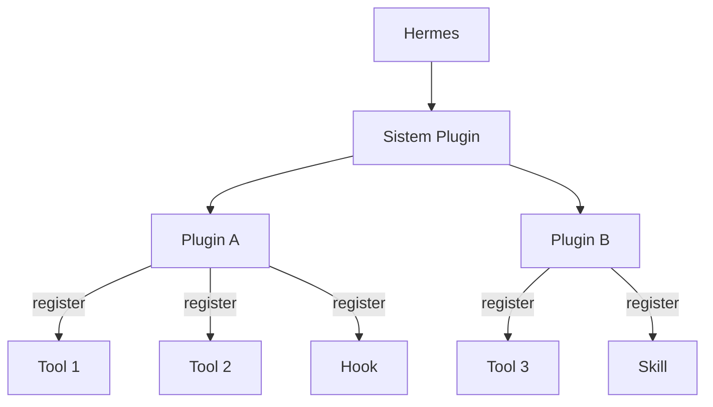

# Plugins

## Gambaran Umum

Skills memberi Hermes pengetahuan baru. Toolset memberi Hermes akses ke tool baru. Plugin menggabungkan keduanya, dan menambah konfigurasi agen, menjadi satu paket yang utuh.

Plugin adalah paket terstruktur yang memperluas Hermes dengan fungsi kustom. Paket ini bisa berisi tool, skill, dan agent sekaligus. Karena paketnya utuh, satu perintah bisa memasang seluruh kemampuan itu, dan satu perintah lain bisa melepasnya lagi tanpa menyisakan konfigurasi setengah jadi.

Empat hal yang dimungkinkan oleh plugin:

- **Mengemas kapabilitas** — menggabungkan tool, skill, dan agen dalam satu paket.
- **Berbagi fungsi** — membagikan paket plugin yang bisa dipakai ulang oleh orang lain.
- **Mengaktifkan dan menonaktifkan dengan mudah** — mengganti status plugin tanpa kehilangan konfigurasi.
- **Mengelola versi** — melacak dan memperbarui versi plugin.



## Yang Akan Kamu Pelajari

- Membedakan plugin, skill, dan toolset berdasarkan isi dan cakupannya.
- Mengenal struktur direktori plugin beserta file `plugin.yaml`-nya.
- Mengisi field manifest plugin: `provides_tools`, `provides_hooks`,
  `requires_env`, dan `capabilities`.
- Mendaftarkan tool dan hook lewat fungsi `register(ctx)`.
- Memasang, memperbarui, dan mencabut plugin lewat perintah `hermes plugins`.
- Meminta persetujuan capability sebelum memakai permukaan host sensitif.

## Konsep Kunci

### Plugin vs Skill vs Toolset

Tiga mekanisme ini sering tertukar. Bedanya ada di isi, cakupan, dan kapan masing-masing dipakai.

| Komponen | Isi | Cakupan | Kasus Pakai |
|----------|-----|---------|-------------|
| **Plugin** | Tools + Skills + Agents | Paket fitur | Kapabilitas lengkap |
| **Skill** | Instruksi + template | Keahlian | Tugas spesifik domain |
| **Toolset** | Definisi tool | Kumpulan tool | Perintah yang berkerabat |

### Struktur Plugin

```
my-plugin/
├── plugin.yaml            # Manifest plugin
├── __init__.py            # fungsi register() yang menyambungkan tool ke handler
├── schemas.py             # skema tool (yang dilihat model)
└── tools.py               # handler tool (yang jalan saat dipanggil)
```

`plugin.yaml` dan `__init__.py` yang wajib. `schemas.py` dan `tools.py`
bersifat opsional — kamu boleh menaruh semuanya di `__init__.py` kalau pluginnya
kecil.

### Manifest plugin.yaml

| Field | Tipe | Wajib | Keterangan |
|-------|------|-------|------------|
| `name` | string | Ya | Pengenal unik plugin |
| `version` | string | Ya | Versi semantik |
| `description` | string | Ya | Kegunaan plugin |
| `provides_tools` | array | Tidak | Nama tool yang didaftarkan |
| `provides_hooks` | array | Tidak | Nama hook yang didaftarkan |
| `requires_env` | array | Tidak | Env var yang wajib ada |
| `capabilities` | array | Tidak | Permukaan host sensitif yang diminta |

Manifest lengkap:

```yaml
name: calculator
version: 1.0.0
description: Kalkulator matematika dan konversi satuan
provides_tools:
  - calculate
  - unit_convert
provides_hooks:
  - post_tool_call
```

`provides_tools` dan `provides_hooks` adalah daftar dari apa yang plugin
daftarkan. Field ini tidak menentukan apakah tool-nya aktif — kalau plugin
sudah diaktifkan, semuanya yang didaftarkan `register()` tersedia. Yang
dipakai field ini:

- `hermes plugins validate` — cek "declared tools" gagal kalau tool yang
  terdaftar tidak cocok dengan daftarnya
- Daftar katalog — chip "N tools" dan pencarian nama tool
- Petunjuk izin di dashboard — hanya tool yang dideklarasikan yang cek
  ketersediaannya dipakai untuk menunjukkan "needs auth"

Field opsional lain:

```yaml
author: Nama Kamu
requires_env:            # gerbang pemuatan; ditanyakan saat install
  - SOME_API_KEY         # format sederhana — plugin nonaktif kalau hilang
  - name: OTHER_KEY      # format lengkap — tampil deskripsi dan URL
    description: "Key untuk layanan Other"
    url: "https://other.com/keys"
    secret: true
capabilities:            # permukaan host sensitif (alur persetujuan)
  - tools.override       # ganti tool bawaan (perlu persetujuan)
  - llm.model_override   # pilih model untuk panggilan LLM host
```

Kode pluginnya ada di `__init__.py`, lewat fungsi `register(ctx)`. Di
situlah kamu mendaftarkan tool, hook, provider, atau memory backend.

### Capability: Minta Izin Dulu

Kalau pluginmu butuh permukaan host yang punya hak khusus — mengganti tool
bawaan, memilih model untuk `ctx.llm` — nyatakan di `capabilities:`. Saat
install atau enable, pengguna melihat daftar itu dan menyetujuinya sekali.
Kalau versi berikutnya menambah capability baru, alur update meminta persetujuan
khusus untuk tambahan itu saja.

Capability yang tidak dideklarasikan atau belum disetujui otomatis mati
(fail closed). Jadi periksa dulu sebelum memakainya:

```python
def register(ctx):
    if ctx.has_capability("tools.override"):
        ctx.register_tool(..., override=True)
    else:
        ctx.register_tool(...)   # daftarkan dengan nama yang tidak bentrok
```

Id capability yang dikenal: `tools.override`, `llm.provider_override`,
`llm.model_override`, `llm.agent_id_override`, `llm.profile_override`,
`llm.task_override`. Id yang tidak dikenal diabaikan.

### Empat Jenis Plugin

| Tipe | Keterangan |
|------|------------|
| **Built-in** | Dikirim bersama Hermes |
| **Community** | Dibagikan lewat plugin registry |
| **Local** | Dipasang dari path lokal |
| **Remote** | Dipasang dari URL git |

### Perintah Plugin

| Tugas | Perintah |
|-------|----------|
| Daftar plugin | `hermes plugins list` |
| Pasang | `hermes plugins install <name>` |
| Cari di katalog | `hermes plugins search <kata>` |
| Lihat isi katalog | `hermes plugins browse` |
| Copot | `hermes plugins remove <name>` |
| Aktifkan | `hermes plugins enable <name>` |
| Nonaktifkan | `hermes plugins disable <name>` |
| Perbarui | `hermes plugins update <name>` |
| Cek pembaruan | `hermes plugins check-updates` |
| Validasi direktori | `hermes plugins validate <path>` |
| Periksa kesehatan | `hermes plugins doctor` |

## Perintah Praktis

Plugin diletakkan di dua tingkat. Plugin proyek hanya berlaku untuk direktori itu. Plugin pengguna berlaku untuk semua proyek.

| Tipe | Lokasi | Cakupan |
|------|--------|--------|
| **Plugin proyek** | `./.hermes/plugins/` | Proyek saat ini |
| **Plugin pengguna** | `~/.hermes/plugins/` | Semua proyek |

Plugin proyek **nonaktif secara bawaan**. Untuk mengaktifkannya, set
`HERMES_ENABLE_PROJECT_PLUGINS=true` sebelum menjalankan Hermes, dan hanya
untuk repo yang kamu percaya.

Alur kerja dari nol sampai terpasang:

```bash
# 1. Lihat plugin yang sudah terpasang
hermes plugins list

# 2. Cari plugin di katalog
hermes plugins search code-review

# 3. Pasang dari katalog, URL git, atau owner/repo
hermes plugins install code-review-plugin

# 4. Validasi struktur paket (dipakai sebagai gerbang CI)
hermes plugins validate ~/.hermes/plugins/code-review-plugin

# 5. Aktifkan plugin
hermes plugins enable code-review-plugin

# 6. Matikan plugin tanpa kehilangan konfigurasi
hermes plugins disable code-review-plugin

# 7. Perbarui ke versi terbaru
hermes plugins update code-review-plugin
```

Paket portabel (Agent Plugins v1) terpasang dalam keadaan nonaktif. Aktifkan
sendiri setelah menambahkannya.

## Contoh Nyata

Plugin Hermes adalah direktori berisi manifest YAML dan kode Python.

```
~/.hermes/plugins/my-plugin/
├── plugin.yaml      # manifest
├── __init__.py      # fungsi register() yang menyambungkan schema ke handler
├── schemas.py       # skema tool (yang dilihat model)
└── tools.py         # handler tool (yang jalan saat dipanggil)
```

Manifest paling minimal:

```yaml
# ~/.hermes/plugins/my-plugin/plugin.yaml
name: my-plugin
version: "1.0"
description: Plugin contoh
```

Isi `__init__.py` mendaftarkan tool dan hook:

```python
"""Plugin Hermes minimal."""

import json


def register(ctx):
    schema = {
        "name": "hello_world",
        "description": "Mengembalikan sapaan untuk nama yang diberikan.",
        "parameters": {
            "type": "object",
            "properties": {"name": {"type": "string"}},
            "required": ["name"],
        },
    }

    def handle_hello(params, **kwargs):
        del kwargs
        name = params.get("name", "Dunia")
        return json.dumps({"sukses": True, "sapaan": f"Halo, {name}!"})

    ctx.register_tool(
        name="hello_world",
        toolset="hello_world",
        schema=schema,
        handler=handle_hello,
    )
```

Kalau pluginmu punya skill, tool, atau agen, taruh sebagai subdirektori di
dalam plugin dan daftarkan di manifest.

Plugin bisa memeriksa sistem operasi yang sedang jalan di dalam
`register(ctx)`, lalu mendaftarkan tool yang sesuai. Jadi plugin lintas
sistem operasi tidak perlu field khusus di manifest:

```python
import platform


def register(ctx):
    if platform.system() == "Linux":
        ctx.register_tool(
            name="build_linux",
            toolset="build",
            schema={"name": "build_linux", "description": "Build khusus Linux",
                    "parameters": {"type": "object", "properties": {}}},
            handler=lambda params, **kw: "build linux selesai",
        )
```

Siklus hidup plugin mengikuti alur ini. Install membuat plugin ada di sistem. Enable mengaktifkannya. Disable menonaktifkannya tanpa menghapus apa pun. Uninstall melepasnya sepenuhnya.

```
┌──────────┐     ┌──────────┐     ┌──────────┐
│ Install  │ ──► │ Enable   │ ──► │ Active   │
└──────────┘     └──────────┘     └──────────┘
                    │                  │
                    ▼                  ▼
               ┌──────────┐     ┌──────────┐
               │ Disable  │ ──► │ Inactive │
               └──────────┘     └──────────┘
                    │
                    ▼
               ┌──────────┐
               │ Uninstall│
               └──────────┘
```

Validasi plugin dijalankan dengan perintah ini:

```
hermes plugins validate ./path/to/plugin
```

Yang diperiksa:

- Sintaks manifest dan field wajib
- Format versi valid semver
- Struktur direktori plugin
- Kode Python bisa diimpor dan fungsi `register` ada

## Catatan Penting

- **`plugin.yaml` itu wajib.** Tanpa manifest, plugin tidak dikenali. Kode Python-nya boleh kosong kalau memang pluginnya cuma metadata.
- **Pakai versi semver.** `version: "2.1.0"` membantu Hermes tahu plugin mana yang sudah usang saat `hermes plugins check-updates` dijalankan.
- **Periksa capability sebelum memakainya.** Kalau plugin butuh `tools.override` tapi pengguna belum menyetujuinya, capability-nya mati. Daftarkan tool dengan nama lain sebagai cadangan supaya plugin tetap jalan.
- **Plugin jalan di dalam proses Hermes.** Kode plugin bukan sandbox — ia jalan dengan izin pengguna saat ini dan bisa memanggil subprocess. Jangan jalankan `hermes plugins doctor` pada kode yang belum kamu percaya.
- **Capability yang gagal di-declare akan mati, bukan error.** Ini fail-closed by design: lebih aman plugin tidak jalan daripada jalan dengan akses yang tidak kamu setujui.
- **Aktifkan harus idempoten.** Menjalankan `hermes plugins enable` dua kali tidak boleh merusak state.
- **Nonaktifkan dulu, copot belakangan.** `hermes plugins disable` mempertahankan konfigurasi. `hermes plugins remove` menghapusnya.
- **Deskripsi yang jelas penting.** Registry plugin dibaca orang lain. Deskripsi satu kalimat yang jelas membuat plugin mudah ditemukan.

## Apa Selanjutnya

Plugin memberi cara mengemas kapabilitas Hermes. Untuk pekerjaan panjang, kamu perlu cara menyimpan dan melanjutkan pekerjaan itu, yaitu checkpoint di [modul 24 — Checkpoints](/modul/checkpoint).
