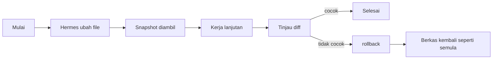

# Checkpoints

## Gambaran Umum

Pekerjaan Hermes sering berjalan panjang: refactor besar, migrasi database,
atau serangkaian iterasi yang butuh review. Di tengah jalan, satu perintah
salah bisa menghapus satu jam pekerjaan.

Checkpoint adalah **snapshot filesystem** dari project kamu. Sebelum Hermes
menjalankan tool yang bisa merusak — `write_file`, `patch`, atau perintah
terminal destruktif seperti `rm`, `mv`, `sed -i`, `git reset` — Hermes
mengambil snapshot dulu. Kalau hasilnya tidak sesuai, kamu bisa mengembalikannya
dengan satu perintah.

Checkpoint **bukan** riwayat percakapan. Yang disimpan adalah isi berkasmu
sebelum diubah, bukan pesan yang tadi.

Dua hal yang dimungkinkan:

- **Mengembalikan berkas** — kembalikan file ke kondisi sebelum perubahan.
- **Meninjau apa yang berubah** — lihat diff antara checkpoint dan kondisi
  sekarang, tanpa langsung mengembalikan.



## Yang Akan Kamu Pelajari

- Kapan Hermes mengambil checkpoint, dan apa yang memicu snapshot.
- Cara mengaktifkan checkpoint (fitur ini mati secara bawaan).
- Bedanya `/rollback`, `/rollback <N>`, dan `/rollback <N> --all`.
- Cara melihat diff sebelum memutuskan mengembalikan.
- Cara membersihkan store checkpoint supaya tidak memakan space.

## Konsep Kunci

### Checkpoint vs Memory

Keduanya menyimpan sesuatu, tapi tujuannya berbeda. Memory menjaga konteks tetap hidup. Checkpoint membekukan momen.

| Fitur | Checkpoint | Memory |
|-------|------------|--------|
| **Tujuan** | Mengembalikan berkas | Persistensi fakta |
| **Isi** | Isi filesystem | Fakta tentangmu dan proyekmu |
| **Kapan diambil** | Sebelum tool merusak | Saat agent menyimpang |
| **Dipulihkan** | Dengan `/rollback` | Otomatis di tiap percakapan |

### Isi Checkpoint

Satu checkpoint menyimpan **isi berkas** di working tree pada saat snapshot
diambil. Bukan pesan chat, bukan hasil eksekusi tool, bukan variabel agent.

Jadi kalau agent mengubah tiga berkas, checkpoint itu menyimpan versi ketiga
berkas itu sebelum diubah. Berkas lain tidak tersentuh.

### Kapan Snapshot Diambil

Hermes mengambil checkpoint otomatis sebelum:

- **Tool berkas** — `write_file` dan `patch`
- **Perintah terminal destruktif** — `rm`, `rmdir`, `cp`, `install`, `mv`,
  `sed -i`, `truncate`, `dd`, `shred`, redirect output (`>`), dan `git reset`
  / `clean` / `checkout`

Batasnya: **maksimal satu checkpoint per direktori per giliran percakapan**.
Sesi panjang tidak akan memenuhi store dengan snapshot bertubi-tubi.

### Mengaktifkan Checkpoint

Checkpoint mati secara bawaan sejak Hermes v2. Storage-nya tidak kecil, jadi
kamu yang memutuskan.

Per sesi:

```bash
hermes chat --checkpoints
```

Global, di `~/.hermes/config.yaml`:

```yaml
checkpoints:
  enabled: true
```

### Perintah Checkpoint

| Tugas | Perintah |
|-------|----------|
| Lihat semua checkpoint | `/rollback` |
| Restore ke checkpoint N | `/rollback <N>` |
| Restore penuh (timpa edit manual) | `/rollback <N> --all` |
| Lihat bedanya dulu | `/rollback diff <N>` |
| Restore satu berkas | `/rollback <N> <file>` |
| Lihat ukuran store | `hermes checkpoints status` |
| Bersihkan checkpoint yatim | `hermes checkpoints prune` |
| Hapus semua riwayat | `hermes checkpoints clear` |

## Perintah Praktis

Semua checkpoint disimpan di satu store bersama. Tidak ada tingkat proyek atau pengguna — setiap proyek yang dikerjakan Hermes berbagi store yang sama.

Semua checkpoint disimpan di satu repositori shadow git di
`~/.hermes/checkpoints/store/`. Repo git asli proyekmu tidak pernah disentuh,
dan semua proyek berbagi store yang sama, jadi database objek git yang
berbasis alamat menduplikasi isi antar proyek dan antar giliran.

Jadi checkpoint tidak punya nama yang kamu tentukan. Yang muncul di daftar
adalah nomor urut, waktu dibuat, dan berapa banyak baris yang berubah.

Cara pakainya lewat slash command di dalam sesi:

```
/rollback
/rollback 3
/rollback 3 --all
/rollback diff 3
/rollback 3 src/api.py
```

Tidak ada perintah "buat checkpoint" manual. Hermes mengambil snapshot
otomatis sebelum operasi merusak, lalu `/rollback` dipakai untuk melihat dan
mengembalikan.

## Contoh Nyata

Checkpoint otomatis diambil sebelum tool merusak. Titik-titik yang paling sering
bermasalah:

- Refactor besar atau deploy
- Migrasi database
- Experiment yang mengubah banyak berkas sekaligus

Perintah `/rollback` menampilkan daftar checkpoint beserta statistik
perubahannya:

```
#   Changes      Created
1   +12 -3       2024-01-15 10:30
2   +48 -12      2024-01-15 11:45
3   +2 -0        2024-01-15 14:20
```


Checkpoint memakai satu repositori shadow git, jadi kamu bisa melihat
perbedaannya seperti melihat diff biasa:

```
/rollback diff 1
```

Pembersihan store:

```bash
# Lihat berapa banyak space yang dipakai checkpoint
hermes checkpoints status

# Hapus checkpoint yatim dan rapikan store
hermes checkpoints prune

# Hapus semua riwayat rollback
hermes checkpoints clear
```

### Alur Kerja: Sebelum Perubahan Besar

```
# 1. Lihat kondisi sekarang
/rollback

# 2. Biarkan Hermes mengubah
[Hermes mengubah beberapa berkas]

# 3. Kalau ada yang berantakan, kembalikan
/rollback 1
```

`/rollback <N>` mengembalikan ke checkpoint N dan **mempertahankan edit manual**
kamu. Kalau kamu justru mau menimpa semuanya, pakai `--all`.

### Alur Kerja: Iterasi dengan Review

```
# 1. Kerjakan implementasi pertama
[Hermes selesai menulis fitur]

# 2. Minta review
[review feedback...]

# 3. Lihat perubahan apa saja yang terjadi sejak checkpoint terakhir
/rollback diff 2

# 4. Kembalikan kalau mau mulai dari checkpoint yang lebih awal
/rollback 2
```

### Alur Kerja: Dua Pendekatan Paralel

```
# 1. Lihat daftar checkpoint
/rollback

# 2. Bandingkan isi dua checkpoint
/rollback diff 1
/rollback diff 3

# 3. Ambil yang kamu mau
/rollback 3 --all
```

## Catatan Penting

- **Checkpoint itu filesystem, bukan chat.** Restore mengembalikan isi berkas. Efek sampingnya, giliran chat terakhir ikut dibatalkan — karena giliran itu yang memancing perubahan berkasnya.
- **Checkpoint mati secara bawaan.** Kalau `/rollback` bilang tidak ada apa-apa, cek dulu `checkpoints.enabled` di `config.yaml`.
- **Restore penuh bisa menimpa pekerjaan baru.** Kalau kamu sudah bekerja jauh setelah checkpoint diambil, `--all` akan mengembalikan ke kondisi lama. `/rollback <N>` tanpa `--all` lebih aman karena edit manualmu dipertahankan.
- **Lihat diff dulu sebelum mengembalikan.** `/rollback diff <N>` menunjukkan apa yang berubah tanpa mengubah apa pun. Lebih aman daripada langsung restore.
- **Bersihkan secara berkala.** Checkpoint menumpuk dan memakan space. `hermes checkpoints prune` membersihkan yang yatim dan menegakkan batas ukuran.
- **Pastikan working tree bersih sebelum restore.** Kalau ada perubahan yang belum masuk checkpoint, restore bisa membuat keadaan lebih rumit, bukan lebih bersih.

## Apa Selanjutnya

Sekarang kamu bisa menyimpan dan melanjutkan pekerjaan Hermes. Langkah berikutnya adalah memilih model dan penyedia yang dipakai Hermes, dibahas di [modul 25 — Provider LLM](/modul/provider).
