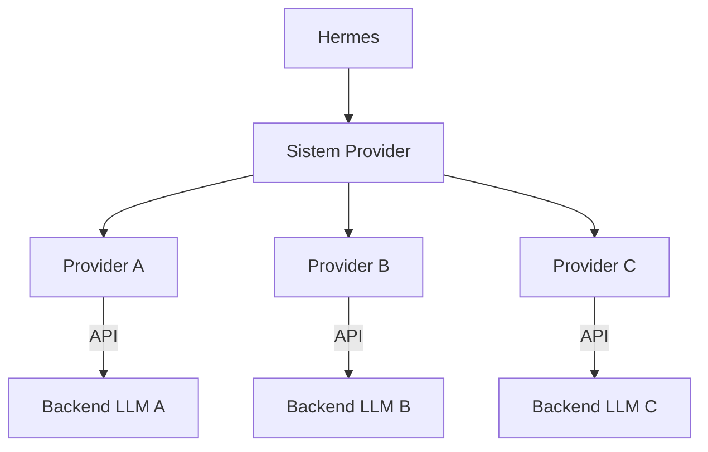

# Provider LLM

## Gambaran Umum

Hermes tidak memiliki model bahasanya sendiri. Semua kemampuan AI-nya datang dari LLM backend, dan LLM backend itu disuplai oleh **provider**: layanan yang menjual akses ke model seperti Claude, GPT, atau Gemini. Provider adalah lapisan antara Hermes dan model. Kamu menulis konfigurasi di satu tempat, lalu Hermes memakai lapisan itu untuk memanggil model yang kamu pilih.

Kenapa lapisan ini penting? Karena satu model saja jarang cukup. Model yang kuat mahal dan lambat untuk tugas sederhana. Model cepat dan murah kadang kurang teliti. Provider membuatmu bisa berpindah-pindah backend tanpa mengubah perintah atau alur kerja Hermes. Kamu juga bisa menyiapkan lebih dari satu provider, lalu memberi tahu Hermes mana yang dipakai pertama dan mana yang cadangan.

Kenyataannya, "provider" di industri sering tumpang tindih. OpenAI, OpenRouter, Nous Portal, Z.AI, Kimi, dan MiniMax semuanya punya endpoint yang kompatibel dengan gaya OpenAI. ollama adalah kasus lain: ia menjalankan model secara lokal, jadi tidak ada biaya API sama sekali, hanya biaya hardware.



## Yang Akan Kamu Pelajari

- Membedakan provider dan model, serta tahu di mana masing-masing dikonfigurasi.
- Memilih provider berdasarkan kasus pakai: kerja harian, respons cepat, hemat biaya, atau self-hosted.
- Menulis file konfigurasi provider lengkap dengan API key, endpoint, dan daftar model.
- Menyimpan API key di environment variable, bukan langsung di file.
- Menguji koneksi ke provider dan memvalidasi file konfigurasi.
- Menyiapkan fallback supaya Hermes tetap jalan saat satu provider sedang gangguan.

## Konsep Kunci

### Provider vs Model

Dua istilah ini sering tertukar. Provider adalah **layanan**. Model adalah **otak** yang dipakai layanan itu. Satu provider bisa menyediakan banyak model, dan satu model bisa tersedia di banyak provider.

| Aspek | Provider | Model |
|--------|----------|-------|
| **Cakupan** | Penyedia layanan | Instansi model tertentu |
| **Contoh** | Anthropic, OpenAI | Claude 3.5, GPT-4 |
| **Konfigurasi** | API key, endpoint | Temperature, max tokens |

Konsekuensinya jelas. API key kamu milik provider. Parameter seperti `temperature` dan `max_tokens` milik model. Kalau kamu memindahkan model ke provider lain, biasanya kamu hanya perlu menukar `api_key` dan `base_url`.

### Memilih Provider dan Model

| Kasus Pakai | Provider yang Disarankan |
|----------|---------------------|
| **Koding umum** | Anthropic (Claude) |
| **Respons cepat** | OpenAI (GPT-4o) |
| **Hemat biaya** | Google (Gemini) |
| **Self-hosted** | Ollama, LocalAI |

Cara memilih model yang praktis: lihat tiga hal. Pertama, **kemampuan** — apakah model ini cukup untuk tugasmu. Kedua, **biaya** — token lebih mahal berarti perlu `max_tokens` yang lebih kecil dan prompt yang lebih ringkas. Ketiga, **limit rate** — tiap provider punya kuota permintaan per menit; kalau kuota terlampaui, permintaan gagal dengan error 429.

| Provider | Context Window | Multimodal | Function Calling |
|----------|---------------|------------|------------------|
| Anthropic | 200K | Ya | Ya |
| OpenAI | 128K | Ya | Ya |
| Google | 32K | Ya | Ya |
| Ollama | Bervariasi | Bervariasi | Terbatas |

Kapan perlu berpindah provider? Kalau pemakaianmu naik-turun, sediakan model cepat dan murah sebagai default, lalu model kuat sebagai fallback. Kalau kerjamu butuh data privat, jalankan model lokal dengan ollama supaya tidak ada request yang keluar dari mesinmu.

### Konfigurasi Provider

Semua provider ditulis dalam satu file YAML, di bawah kunci `providers`. Setiap provider punya `name` (pengenal), `type` (jenis layanan), `api_key`, `base_url` opsional, daftar `models`, dan `settings` opsional.

```yaml
providers:
  - name: anthropic
    type: anthropic
    api_key: ${ANTHROPIC_API_KEY}
    models:
      default: claude-3-5-sonnet-latest
      Sonnet: claude-3-5-sonnet-latest
      Opus: claude-3-opus-latest
    settings:
      max_tokens: 8192
      temperature: 0.7
      top_p: 0.9

  - name: openai
    type: openai
    api_key: ${OPENAI_API_KEY}
    base_url: https://api.openai.com/v1
    models:
      default: gpt-4o
      fast: gpt-4o-mini
    settings:
      max_tokens: 4096
      temperature: 0.7

  - name: ollama
    type: ollama
    base_url: http://localhost:11434
    models:
      default: llama3.2
      coding: codellama
```

Kolom di level provider:

| Field | Tipe | Wajib | Deskripsi |
|-------|------|-------|-------------|
| `name` | string | Ya | Pengenal provider |
| `type` | string | Ya | Jenis provider (anthropic, openai, dll.) |
| `api_key` | string | Tidak | API key (atau rujukan env var) |
| `base_url` | string | Tidak | URL endpoint kustom |
| `models` | object | Ya | Pemetaan nama model |
| `settings` | object | Tidak | Setelan default model |

Kolom di level model:

| Field | Tipe | Wajib | Deskripsi |
|-------|------|-------|-------------|
| `default` | string | Ya | Pengenal model default |
| `<name>` | string | Tidak | Varian model bernama |

Kolom di level settings:

| Field | Tipe | Default | Deskripsi |
|-------|------|---------|-------------|
| `max_tokens` | number | Default provider | Panjang maksimum respons |
| `temperature` | number | 0.7 | Tingkat keacakan respons |
| `top_p` | number | 1.0 | Nucleus sampling |
| `top_k` | number | Default provider | Top-k sampling |

### Menyimpan API Key dengan Aman

Jangan pernah menulis API key langsung di file YAML. Pakai rujukan environment variable. Hermes membaca nilainya saat runtime, jadi file konfigurasi tetap aman untuk di-commit ke repo.

```yaml
api_key: ${ANTHROPIC_API_KEY}
```

Atur di shell:

```bash
export ANTHROPIC_API_KEY=sk-...
export OPENAI_API_KEY=sk-...
```

### Contoh Konfigurasi Provider

Berikut tiga contoh yang paling sering dipakai, dipilih dari berkas konfigurasi standar.

**1. Satu provider saja (Anthropic).** Konfigurasi paling sederhana. Cukup satu `api_key` dan satu model default.

```yaml
providers:
  - name: anthropic
    type: anthropic
    api_key: ${ANTHROPIC_API_KEY}
    models:
      default: claude-3-5-sonnet-latest
    settings:
      max_tokens: 8192
```

**2. Multi-provider dengan fallback.** Provider utama dicoba lebih dulu. Kalau gagal, Hermes pindah ke provider cadangan lewat `fallback_order`.

```yaml
providers:
  - name: primary
    type: anthropic
    api_key: ${ANTHROPIC_API_KEY}
    models:
      default: claude-3-5-sonnet-latest
    priority: 1

  - name: fallback
    type: openai
    api_key: ${OPENAI_API_KEY}
    models:
      default: gpt-4o
    priority: 2
    fallback_order: 1
```

**3. Provider openai-compatible dengan endpoint kustom.** OpenRouter, Nous Portal, Z.AI, Kimi, dan MiniMax bekerja lewat pola yang sama: `type: openai-compatible` plus `base_url` masing-masing. Opsi ollama untuk model lokal memakai `type: ollama` tanpa `api_key`.

```yaml
providers:
  - name: custom-llm
    type: openai-compatible
    api_key: ${CUSTOM_API_KEY}
    base_url: https://api.custom-llm.com/v1
    models:
      default: custom-model

  - name: local
    type: ollama
    base_url: http://localhost:11434
    models:
      default: llama3.2
      coding: codellama
    settings:
      max_tokens: 4096
```

## Perintah Praktis

| Tugas | Perintah |
|------|---------|
| Lihat daftar provider | `provider list` |
| Tampilkan konfigurasi | `provider show <name>` |
| Set provider default | `provider default <name>` |
| Uji koneksi | `provider test <name>` |
| Tambah provider | `provider add <name>` |

Pengujian dan validasi:

```bash
# Uji konektivitas provider
provider test anthropic

# Uji model tertentu
provider test openai --model gpt-4o

# Tampilkan konfigurasi saat ini
provider show

# Validasi file konfigurasi
hermes config get model
```

Lokasi berkas:

| Jenis | Lokasi | Cakupan |
|------|---------|-------|
Semua pengaturan provider ada di `~/.hermes/config.yaml`, di bawah blok
`provider_routing`. Tidak ada direktori provider terpisah.

## Contoh Nyata

Kebutuhan sehari-hari: mengode dengan model kuat, tapi hemat biaya saat menguji hal kecil. Solusinya, dua provider dalam satu file.

```yaml
providers:
  - name: anthropic
    type: anthropic
    api_key: ${ANTHROPIC_API_KEY}
    models:
      default: claude-3-5-haiku-latest
      sonnet: claude-3-5-sonnet-latest
    settings:
      max_tokens: 4096
      temperature: 0.5

  - name: openai
    type: openai
    api_key: ${OPENAI_API_KEY}
    models:
      default: gpt-4o-mini
      standard: gpt-4o
```

Alurnya sederhana. `claude-3-5-haiku-latest` menjadi default karena murah dan cepat untuk iterasi kecil. Begitu tugasnya berat, pilih `sonnet` secara eksplisit. Provider openai tetap ada sebagai cadangan bila kuota Anthropic habis.

## Catatan Penting

- **Jangan hardcode API key.** Pakai `${NAMA_ENV_VAR}` di file YAML dan set variabelnya di shell.
- **Tetapkan default secara eksplisit.** Tanpa `default`, Hermes tidak tahu model mana yang dipakai.
- **Siapkan fallback.** Provider bisa down atau kehabisan kuota; fallback membuat alur kerja tetap jalan.
- **Sesuaikan settings dengan model.** `temperature` dan `max_tokens` yang cocok untuk model besar bisa terlalu longgar atau terlalu pendek untuk model kecil.
- **Uji setiap kali konfigurasi berubah.** `provider test <name>` membuat masalah ketahuan sebelum menumpuk di tengah pekerjaan.
- **Waspadai limit rate.** Kalau sering kena 429, turunkan `max_tokens`, kurangi jumlah request paralel, atau tambah provider cadangan.

## Apa Selanjutnya

Lanjut ke [Modul 26](/modul/konteks-rujuk), untuk belajar merujuk file, URL, dan dokumentasi langsung di dalam prompt.
