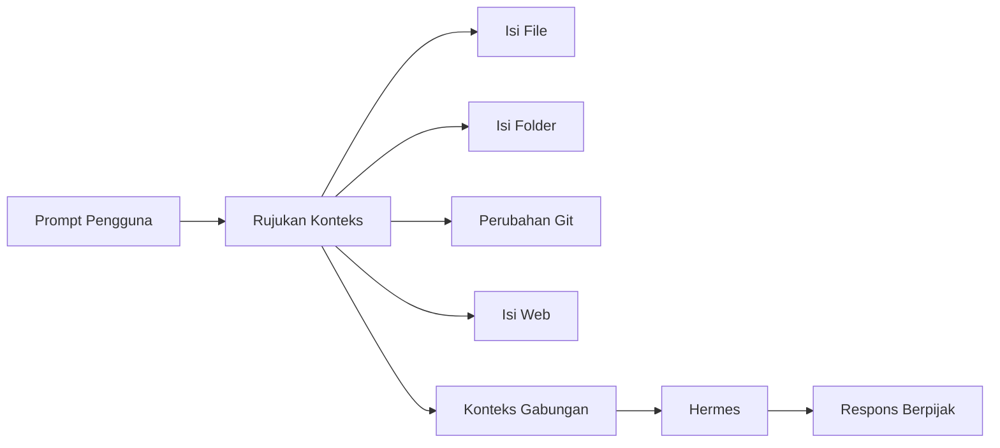

# Konteks Rujuk

## Gambaran Umum

Hermes menjawab berdasarkan isi window konteksnya. Isi itu bisa datang dari percakapan, memori, dan tool. Tapi kadang kamu butuh sesuatu yang lebih pasti: isi file tertentu, satu fungsi kode, atau satu halaman dokumentasi. Di situlah **context reference** dipakai.

Context reference adalah penanda di dalam prompt yang menunjuk ke sumber tertentu. Kamu menulis `@file:src/auth.py` di dalam prompt. Hermes membaca penanda itu, mengambil isinya, dan menempelkannya ke konteks di bawah bagian `--- Attached Context ---` sebelum menjawab.

Kenapa mekanismenya penting? Karena model yang menjawab tanpa sumber cenderung mengarang. Dengan rujukan, kamu memberi bukti. Jawabannya berpijak pada isi file yang benar, bukan pada ingatan model. Dan karena kamu yang menentukan file mana yang dirujuk, kamu juga yang mengatur topiknya: satu prompt bisa fokus ke satu bagian saja, bukan seluruh repo.



## Yang Akan Kamu Pelajari

- Bedakan context reference dengan memori, dan kapan sebaiknya memakai yang mana.
- Mengenal tujuh jenis rujukan: file, rentang baris, folder, diff, staged, commit, dan URL.
- Menunjuk baris dan rentang baris dalam satu berkas.
- Merujuk folder, perubahan git, commit terakhir, dan halaman web.
- Menggabungkan beberapa rujukan dari sumber berbeda dalam satu prompt.
- Menghormati batas ukuran supaya rujukan tidak memenuhi konteks.

## Konsep Kunci

### Context Reference vs Memori

Keduanya memasukkan informasi ke konteks. Bedanya di waktu dan sumber.

| Fitur | Context Reference | Memori |
|---------|-------------|--------|
| **Waktu** | Per-prompt | Persisten |
| **Sumber** | Rujukan eksplisit | Selalu dimuat |
| **Cakupan** | Konten spesifik | Konteks luas |
| **Pembaruan** | Diperbarui tiap dipakai | Tetap terkini |

Aturannya begini. Kalau informasinya **konteks tetap** tentangmu atau proyekmu, taruh di memori. Kalau informasinya **disebut eksplisit di prompt itu juga**, pakai context reference. Memory dimuat otomatis ke setiap percakapan, jadi isinya harus kecil dan stabil. Context reference hanya muncul kalau kamu menulisnya, jadi boleh lebih panjang dan lebih teknis.

### Jenis Rujukan

| Jenis | Sintaks | Isi yang disisipkan |
|------|--------|--------------------|
| **File** | `@file:path/to/file.py` | Isi seluruh berkas |
| **Rentang baris** | `@file:path/to/file.py:10-25` | Baris 10 sampai 25 |
| **Folder** | `@folder:path/to/dir` | Pohon folder beserta ukuran berkas |
| **Diff** | `@diff` | `git diff` (perubahan yang belum di-commit) |
| **Staged** | `@staged` | `git diff --staged` (sudah di-stage) |
| **Git** | `@git:5` | Commit terakhir beserta patch-nya (maks 10) |
| **URL** | `@url:https://example.com` | Isi halaman web |

Semua dimulai dengan tanda `@`. Dalam CLI interaktif, mengetik `@` langsung
memunculkan autocomplete: `@file:` dan `@folder:` melengkapi path di disk
dengan ukuran berkasnya.

Beberapa rujukan bisa dipakai sekaligus dalam satu pesan:

```
Tinjau @file:src/main.py dan @file:src/test.py
```

Tanda baca di akhir (`,` `.` `;` `!` `?`) otomatis dibuang dari nilainya, jadi
kamu tidak perlu berkelahi dengan parser.

### Menunjuk Bagian yang Tepat

Kalau berkasnya besar, jangan sisipkan seluruhnya. `@file:` menerima rentang
baris, dan baris dihitung mulai dari 1.

| Sintaks | Arti |
|--------|------|
| `@file:main.py:42` | Baris 42 saja |
| `@file:main.py:10-25` | Baris 10 sampai 25 (termasuk keduanya) |

Rentang yang tidak valid diabaikan diam-diam, dan Hermes mengirim isi penuh
berkas itu. Jadi ketik ulang dengan teliti kalau hasilnya terasa utuh.

Untuk menunjuk bagian kode tertentu, ambilkan dulu baris yang kamu maksud,
lalu rujuk rentangnya. Contoh:

```
Fungsi ini yang menangani autentikasi: @file:src/auth.py:50-80
```

Kalau memang butuh seluruh berkas, `@file:` saja sudah cukup.

### Menggabungkan Rujukan

Beberapa rujukan bisa hidup berdampingan dalam satu prompt. Hermes menggabungkan
isinya menjadi satu konteks sebelum menjawab, dan menandainya dengan bagian
`--- Attached Context ---`.

```
@file:src/auth.py @file:src/models.py @file:src/utils.py
```

Bisa juga mencampur sumber berbeda: berkas lokal, perubahan git, dan halaman web.

```
@file:src/api.py @diff @url:https://external-api.com/docs
```

Rujukan juga bisa ditulis di dalam kalimat, tanpa blok terpisah.

```
Berdasarkan @file:README.md:1-20, jelaskan struktur proyek ini
```

```
Tinjau @file:src/main.py untuk pola penanganan error
```

```
Bandingkan @url:https://api-v1.example.com dengan @url:https://api-v2.example.com
```

### Batas Ukuran

Hermes membatasi ukuran rujukan supaya konteks tidak meledak.

| Batas | Nilai | Yang Terjadi |
|-------|-------|---------------|
| Lunak | 25% panjang konteks | Peringatan ditambahkan, isinya tetap dikirim |
| Keras | 50% panjang konteks | Rujukan ditolak, pesan dikirim tanpa tambahan |
| Folder | 200 berkas maks | Sisanya diganti dengan `- ...` |
| Commit | 10 maks | `@git:N` dibatasi ke rentang [1, 10] |

Commit yang banyak membuat konteks penuh, jadi pakai `@git:3` alih-alih
`@git:30`.

## Perintah Praktis

Context reference bukan perintah terpisah. Kamu menulisnya langsung di dalam
pesan, dan Hermes yang-expand.

| Tugas | Cara |
|------|------|
| Lihat semua jenis rujukan | Ketik `@` di CLI, lalu lihat daftar autocomplete |
| Sisipkan berkas | `@file:src/main.py` |
| Sisipkan rentang baris | `@file:src/main.py:10-25` |
| Lihat folder | `@folder:src` |
| Lihat perubahan belum di-commit | `@diff` |
| Lihat perubahan yang di-stage | `@staged` |
| Lihat commit terakhir | `@git:5` |
| Sisipkan isi web | `@url:https://contoh.com` |

Di dalam CLI interaktif, `@file:` dan `@folder:` melengkapi path di disk
otomatis lengkap dengan ukuran berkas. Tekan Tab untuk menerima.

```bash
# Cek path yang akan dikirim
ls -la src/main.py

# Lihat perubahan yang akan di-rujuk
git diff
```

### Berkas konteks proyek

Selain rujukan per-pesan, Hermes juga memuat berkas konteks proyek secara
otomatis ke setiap percakapan. Urutan prioritasnya:

| Urutan | Berkas | Isi |
|--------|--------|-----|
| 1 | `.hermes.md` atau `HERMES.md` | Instruksi proyek (prioritas tertinggi) |
| 2 | `AGENTS.override.md` | Override pribadi per direktori |
| 3 | `AGENTS.md` | Instruksi, konvensi, arsitektur proyek |
| 4 | `CLAUDE.md` | Berkas konteks dari Claude Code (dikenali) |
| 5 | `.cursorrules` | Aturan gaya lama |

Hanya satu jenis yang dimuat per sesi, yang pertama kali cocok menang.
`SOUL.md` selalu dimuat terpisah sebagai identitas agent.

Jadi `AGENTS.md` di root repo-mu adalah tempat yang tepat menuliskan
"di repo ini, pakai pnpm dan jangan pakai npm".

## Contoh Nyata

**Tinjau kode untuk celah keamanan.** Satu rujukan fungsi, plus daftar yang harus diperiksa.

```
Tinjau @file:src/auth.py untuk:
- Celah keamanan
- Kelengkapan penanganan error
- Validasi input
```

**Dokumentasi sebagai dasar jawaban.** Rujukan menunjuk panduan, dan pertanyaannya mengikuti isi panduan itu.

```
Berdasarkan @file:docs/deployment.md, jelaskan:
1. Prasyarat
2. Setup environment
3. Langkah deployment
```

**Perubahan git sebagai bahan review.**

```
Tinjau perubahan di @diff, lalu cek apakah ada bug di @file:src/api.py
```

**Bandingkan dua versi API dan tekankan perubahan yang merusak.**

```
Bandingkan metode autentikasi berikut:
- @file:docs/api-v1/auth.md
- @file:docs/api-v2/auth.md

Tonjolkan perubahan yang merusak.
```

**Refactor bagian kode tertentu.** Rujukan membatasi cakupan, jadi Hermes tidak mengubah file lain.

```
@file:src/parser.py:50-80 menampilkan parser saat ini.
Refactor agar mendukung:
- Input XML
- Mode streaming
- Pemulihan error
```

**Analisis lintas beberapa file.**

```
Analisis dependensi pada:
- @file:src/models/user.py
- @file:src/services/auth.py
- @file:src/routes/auth.py

Buat diagram dependensi.
```

**Gabungkan web dan berkas lokal.**

```
Ringkas poin penting dari https://example.com/api-guidelines
lalu terapkan ke @file:src/api-design.md
```

## Catatan Penting

- **Spesifikkan sedetail mungkin.** Menunjuk rentang baris jauh lebih murah daripada menempelkan satu file penuh.
- **Jangan berlebihan dengan rujukan.** Terlalu banyak sumber membuat konteks penuh dan jawaban jadi dangkal.
- **Batas kerasnya 50% panjang konteks.** Kalau rujukan ditolak, Hermes mengirim pesanmu apa adanya. Kamu tahu itu karena jawabannya tidak nyambung.
- **Perhatikan path yang sensitif.** Hermes menolak `@file:` ke `~/.ssh/`, `~/.aws/`, `~/.gnupg/`, `~/.kube/`, dan `$HERMES_HOME/.env`, plus path di luar workspace.
- **Rujukan juga jalan di Telegram dan Discord.** Gateway mengekspansi sintaks `@` untuk pesan yang masuk, sama seperti di CLI. Yang berbeda hanya autocomplete-nya: di Telegram tidak ada tab-completion, jadi kamu perlu mengetik path-nya sendiri.
- **Path relatif dihitung dari direktori kerja.** Di gateway, path dihitung dari direktori kerja terminal, bukan dari folder tempat kamu mengetik.
- **Rujukan bukan pengganti memori.** Untuk aturan yang berlaku terus-menerus, memori tetap tempat yang tepat.

## Apa Selanjutnya

Lanjut ke [Modul 27](/modul/semua-sisi), supaya kamu tahu permukaan mana yang paling cocok: CLI, TUI, web, desktop, ACP, atau API.
